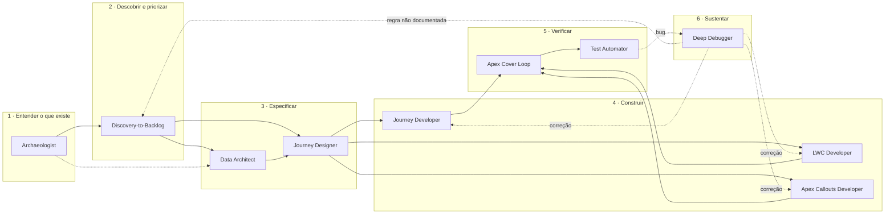

# Pipeline do ciclo de desenvolvimento

> As 10 skills do Odin organizadas pelas etapas do ciclo de desenvolvimento de software. Decisão: [ADR 0019](adr/0019-pipeline-do-ciclo-de-desenvolvimento-com-10-skills.md); decisões 49 a 52 em [DECISOES.md](DECISOES.md).
> As skills ficam **lado a lado, sem hierarquia** (decisão 50): o roteador escolhe pela intenção, e o encadeamento é só a sugestão de próximo passo (`odin_proximo_passo`), a partir dos artefatos que já existem no projeto.

## 1. Visão geral

## 2. As skills por etapa

| Etapa | Skill (repositório) | Quem usa | O que faz | Lê | Entrega | Atalho |
|---|---|---|---|---|---|---|
| **1 Entender** | Archaeologist (`Salesforce_Archaeologist`) | Arquiteto, dev | Engenharia reversa da org: inventário, regras de negócio extraídas do código e dos metadados, assessment e diagramas C4 | Metadados e código da org (somente leitura) | Documentação verificada do legado, regras extraídas, diagramas | `/odin:legado` |
| **2 Descobrir** | Discovery-to-Backlog | PO | Transforma entrevistas e material do negócio em backlog rastreável; publica no Jira | Transcrições, documentos; legado documentado (quando houver) | `backlog.json`, protótipo de discovery, documentos para o cliente | `/odin:discovery` |
| **3 Especificar** | Data Architect | Arquiteto, dev | Modelo e contrato de dados | Backlog; legado documentado | Glossário e contrato de dados | `/odin:data` |
| | Journey Designer | PO, arquiteto | Spec, plano técnico e protótipo navegável da jornada | Backlog; contrato de dados | `spec.md`, `plan.md`, `tasks.md`, protótipo | `/odin:spec` |
| **4 Construir** | Journey Developer | Dev | Constrói a capacidade ponta a ponta (metadados, Apex, Flow) e implanta na sandbox | Spec, plano, tarefas | Código em `force-app/`, `build-report.md` | `/odin:build` |
| | LWC Developer (3 skills: documentar padrões, escrever spec, gerar) | Dev front-end | Aprende o design system de LWC da org e cria, clona ou edita componentes alinhados a ele | Spec da jornada; componentes existentes | Design system documentado, spec por componente, bundle LWC com Jest | `/odin:lwc` |
| | Apex Callouts Developer | Dev de integração | Cria ou refatora callouts HTTP para a arquitetura de referência (Template Method, tabela de rotas, Named Credential, cache de token) | curl, classe legada, metadados ou descrição | Spec do callout, classes, metadados de implantação | `/odin:callout` |
| **5 Verificar** | Apex Cover Loop | Dev | Leva uma classe Apex a ≥ 99% de cobertura com todos os testes passando | Classe Apex | Classe de teste, relatório de cobertura | `/odin:cobertura` |
| | Test Automator | QA, dev | QA de tela autônomo na sandbox: separa bug, comportamento previsto e ponto a confirmar | Backlog, spec, `build-report.md` | Relatório de teste, bugs com evidência | `/odin:test` |
| **6 Sustentar** | Deep Debugger | Dev | Diagnostica um bug declarado, com causa raiz e evidência, e sugere a correção em De-Para; só corrige se pedido | Relato, log de depuração, exceção, erro de validação | Diagnóstico com causa raiz e correção sugerida | `/odin:debug` |

`/odin:status` continua mostrando onde o projeto está no pipeline e o próximo passo. Total: **11 atalhos**.

## 3. Encadeamento (`proximo` em cada `odin.yaml`)

| Skill | Próximo sugerido | Quando |
|---|---|---|
| Archaeologist | Discovery-to-Backlog; Data Architect | Legado documentado e verificado |
| Discovery-to-Backlog | Data Architect; Journey Designer | Backlog aprovado |
| Data Architect | Journey Designer | Contrato de dados pronto |
| Journey Designer | Journey Developer; LWC Developer; Apex Callouts Developer | Spec e plano prontos; a escolha depende do que as tarefas pedem (jornada completa, componente de tela, integração) |
| Journey Developer, LWC Developer, Apex Callouts Developer | Apex Cover Loop | Há classe Apex nova ou alterada sem cobertura |
| Apex Cover Loop | Test Automator | Cobertura atingida e implantado na sandbox |
| Test Automator | Deep Debugger | Há bug confirmado |
| Deep Debugger | A skill de construção do componente afetado; Discovery-to-Backlog se a causa for regra não documentada | Diagnóstico confirmado |

## 4. Dois caminhos de entrada

- **Projeto novo (greenfield):** começa na etapa 2. O Archaeologist não entra.
- **Org existente (brownfield), migração ou refatoração:** começa na etapa 1. O que o Archaeologist documenta vira insumo do Discovery (regras que já existem) e do Data Architect (modelo atual).
- **Demanda pontual:** qualquer skill pode ser chamada direto ("cubra esta classe", "investigue este erro", "refatore este callout"), sem passar pelas etapas anteriores.

## 5. Fronteiras entre skills parecidas

O roteador usa estas fronteiras como intenções negativas (o pedido parece de uma, mas é de outra).

| Pedido | Skill certa | Não é |
|---|---|---|
| "Crie a classe de teste / aumente a cobertura do `CaseRouter`" | Apex Cover Loop | Test Automator (testa tela), Journey Developer |
| "Teste a jornada de proposta na sandbox" | Test Automator | Apex Cover Loop |
| "Por que este teste/deploy/tela quebrou?" | Deep Debugger | Apex Cover Loop, Test Automator |
| "Crie/ajuste o componente de tela X" | LWC Developer | Journey Developer (jornada completa), Journey Designer (protótipo) |
| "Integre com a API Y / refatore este callout" | Apex Callouts Developer | Journey Developer |
| "Construa a capacidade Z da spec" | Journey Developer | LWC Developer e Callouts (partes isoladas) |
| "Como esta org funciona hoje? Quais regras existem?" | Archaeologist | Deep Debugger (um bug específico), Discovery (regra nova) |
| "Quais regras o negócio quer?" | Discovery-to-Backlog | Archaeologist |

## 6. Perfis e skills

| Perfil | Skills |
|---|---|
| `po` | Discovery-to-Backlog, Journey Designer |
| `dev` | Journey Developer, LWC Developer, Apex Callouts Developer, Apex Cover Loop, Deep Debugger, Test Automator, Data Architect (leitura) |
| `qa` | Test Automator, Deep Debugger |
| `arquiteto` | Archaeologist, Data Architect, Journey Designer, Journey Developer, Apex Callouts Developer, Deep Debugger |
| `mantenedor` | Todas, mais canal `beta` |

## 7. Pontos de atenção para a migração (F6)

| Ponto | Tratamento |
|---|---|
| **Callouts Developer fala em arquitetura "FSC TO BE"** | Ajustar para Service Cloud e para um nome neutro de arquitetura de referência, na migração (decisão 51) |
| **Bibliotecas de terceiros repetidas** em mais repositórios (`platform-apex-generate` no Apex Cover Loop; `experience-lwc-generate` e `design-systems-slds-apply` no LWC Developer; já estavam no Designer e no Developer) | Um pacote compartilhado único em `libs/`, com `LICENSE` e `NOTICE` (decisão 11) |
| **`karpathy-guidelines.md`** agora em 7 repositórios | Uma versão única (decisão 12) |
| **Deep Debugger faz "quick deploy sem teste"** quando pedido | Vira política do guard: só sandbox, só com pedido explícito, nunca produção (PG-05) |
| **Archaeologist lê a org inteira** | Política do guard: somente leitura; resultado pode conter regra de negócio do cliente e não vai para o conhecimento sem curadoria |
| **Sobreposição de construção** (Journey Developer × LWC Developer × Callouts) | Sem hierarquia (decisão 50); as fronteiras da seção 5 viram intenções negativas e casos de avaliação de roteamento |
| **Pastas de saída no projeto** (`.lwc-spec-writer/`, `.lwc-pattern-documenter/`, `.apex-test-loop/`) | Declaradas em `saida` de cada `odin.yaml`; quem grava é a skill, nunca o Odin |
