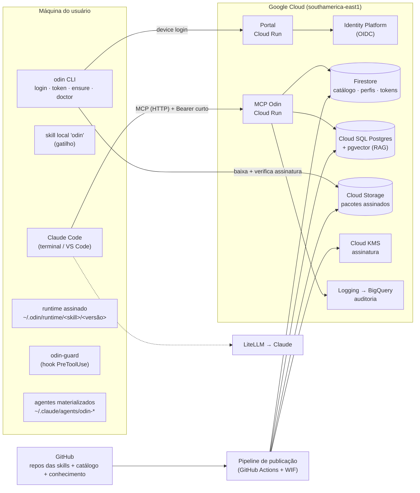
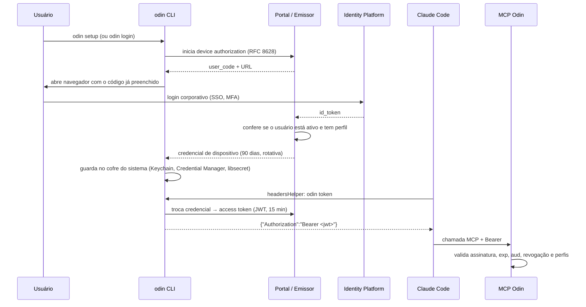

# Odin MCP Squad: plano de arquitetura

> **Status:** plano, nada foi desenvolvido. Primeiro uso: prova de conceito pessoal num projeto Google Cloud do mantenedor, já com **todas** as skills. Depois, o time (cerca de 20 devs, mais POs).
> **Convenção:** **[VERIFICAR]** marca o que depende de um comportamento do Claude Code, do Google Cloud ou do LiteLLM que não foi confirmado na documentação. Esses pontos são os primeiros testes da prova de conceito (seção 16).

## 1. Objetivo

Um único ponto de entrada, o **MCP Odin**. Qualquer pessoa autorizada (PO, dev, QA, arquiteto) conecta o Claude Code nele uma vez e pede em linguagem natural: "quero detalhar um discovery", "quero criar uma classe de teste". O Odin então:

1. **identifica** quem está pedindo e o que essa pessoa pode usar;
2. **escolhe** a skill certa entre as que ela pode usar;
3. **entrega** a skill na versão aprovada mais recente, com os agentes, as regras e os pré-requisitos dela;
4. **garante** que a máquina tem o runtime local (scripts e hooks de segurança) atualizado e assinado, e instala ou atualiza sozinho;
5. **fornece conhecimento** (base funcional, técnica e de regra de negócio) com citação da fonte;
6. **registra** tudo para auditoria e métricas.

### Restrições (decididas)

| Restrição | Consequência no desenho |
|---|---|
| Sem plano Claude Team/Enterprise | Sem console gerenciado: o Odin faz a própria governança (identidade, perfis, auditoria) |
| Modelos via token no **LiteLLM** | O Odin não chama modelo no caminho principal (roteamento determinístico + embeddings); a cobrança de modelo continua no LiteLLM |
| **Sem marketplace** de plugins | O runtime local é distribuído por um instalador próprio, com pacotes assinados |
| Skills e agentes continuam no **GitHub** | O GitHub é a fonte da verdade; o Odin publica versões fixadas por commit |
| Claude Code no terminal, no VS Code e na extensão do VS Code; acesso total ao disco | O runtime e os hooks rodam na máquina; a segurança fica em código (hooks), não na confiança no modelo |
| Todas as skills de uma vez | Fases de **construção**, não de liberação: a prova de conceito já roda as 5 skills |

### Fora do escopo desta versão
Execução das skills no servidor (o trabalho continua na máquina do usuário), interface de chat própria, marketplace de plugins, criação de modelos próprios e substituição do LiteLLM.

---

## 2. Visão geral



Três planos:
- **Plano de conteúdo (GitHub → pipeline):** as skills são versionadas e revisadas por pull request, validadas, assinadas e publicadas.
- **Plano de controle (GCP):** identidade, perfis, catálogo, roteamento, RAG e auditoria.
- **Plano de execução (máquina):** o Claude Code executa; o runtime local fornece scripts e os hooks que impõem as regras de segurança.

---

## 3. Experiência do usuário (fricção mínima)

### 3.1 Onboarding: três passos, uma vez na vida
1. Ter o Claude Code instalado e configurado no LiteLLM (já é o caso hoje).
2. Instalar o CLI: **um comando** copiado do portal.
   - macOS/Linux: `curl -fsSL https://odin.<dominio>/install.sh | sh`
   - Windows: `irm https://odin.<dominio>/install.ps1 | iex`
   - O instalador baixa o CLI da release do GitHub e confere o checksum e a atestação de origem (seção 9.3).
3. `odin setup`. Abre o navegador, a pessoa entra com a conta corporativa e o resto é automático:
   - registra o MCP Odin no Claude Code no escopo do usuário;
   - instala o `odin-guard` (hook) e a skill local `odin`;
   - instala o runtime das skills a que a pessoa tem direito e confere os pré-requisitos (Node, git, `sf` CLI, Playwright quando aplicável);
   - termina com `odin doctor` verde, ou com a correção exata do que faltou.

### 3.2 Uso diário: zero passos
A pessoa abre o Claude Code em qualquer repositório e pede o que precisa. Não existe "atualizar skill": a próxima chamada já usa a versão nova.

### 3.3 Quando algo muda
| Evento | O que o usuário vê |
|---|---|
| Skill nova liberada para o perfil dele | Passa a ser roteada; o runtime instala no primeiro uso (`odin ensure`) |
| Versão nova de uma skill | Nada: o conteúdo vem do servidor; o runtime se atualiza no primeiro uso |
| Mudança nos hooks de segurança | Uma mensagem: "atualização de segurança instalada; reinicie a sessão" (seção 7.4) |
| Acesso revogado | A próxima chamada responde "sem acesso a X; fale com o administrador" |
| Token expirado | Nada: o `headersHelper` renova sozinho; só pede login de novo se a credencial de longa duração for revogada |

### 3.4 Exemplos de ponta a ponta
- **PO:** "Quero detalhar o discovery da R02." → a skill local `odin` chama `odin_rotear` → o Odin responde "Discovery-to-Backlog, 0,91" → `odin_carregar_skill` → `odin ensure sf-discover` (runtime ok) → a skill roda, consulta a base de regras de negócio, grava `discovery/R02/` no disco e sugere o próximo passo ("Journey Designer: spec").
- **Dev:** "Cria a classe de teste do `CaseRouter`." → roteado para o Journey Developer (subskill de cobertura Apex) → busca padrões técnicos na base ("padrões de teste Apex, mocking de callout") → gera e roda os testes localmente → o hook impede deploy fora de sandbox.

---

## 4. Componentes

| # | Componente | Tecnologia | Responsabilidade |
|---|---|---|---|
| C1 | **MCP Odin** | Cloud Run, Node/TypeScript, SDK oficial de MCP, transporte Streamable HTTP | Autenticar, autorizar, rotear, entregar skills, agentes e referências, buscar conhecimento, auditar |
| C2 | **Portal** | Cloud Run, Next.js (ou similar), Identity Platform | Login, dispositivos e tokens, autoatendimento; console de administração (usuários, perfis, catálogo, conhecimento, auditoria) |
| C3 | **Serviço de identidade** | Identity Platform (OIDC: Google ou Microsoft Entra) + emissor de tokens próprio (JWT assinado no KMS) | Device login, credencial de dispositivo, tokens de acesso curtos, revogação |
| C4 | **odin CLI** | Node ≥ 20, binário único por plataforma | `setup`, `login`, `token` (headersHelper), `ensure`, `doctor`, `guard-ping`, `update`, `logout` |
| C5 | **odin-guard** | Node, um hook `PreToolUse` (e `PostToolUse` quando preciso) | Despachante das políticas de segurança de todas as skills, fail-closed |
| C6 | **Skill local `odin`** | `~/.claude/skills/odin/SKILL.md` | Gatilho: faz o Claude Code chamar o roteador sempre que o pedido for do ciclo de vida Salesforce |
| C7 | **Catálogo** | `catalog/` neste repositório (YAML) → Firestore | Quais skills existem, a versão fixada (commit SHA) de cada uma, perfis, canais |
| C8 | **Pipeline de publicação** | GitHub Actions + Workload Identity Federation (sem chave de serviço) | Validar, testar, empacotar, assinar e publicar skills e conhecimento |
| C9 | **Base de conhecimento (RAG)** | Repositório `odin-knowledge` (markdown) → Cloud SQL Postgres + pgvector, embeddings Vertex AI | Conhecimento funcional, técnico e de regra de negócio, com citação, vigência e controle de acesso |
| C10 | **Observabilidade e auditoria** | Cloud Logging → BigQuery, Cloud Monitoring, Error Reporting | Trilha de auditoria imutável, métricas de uso e de roteamento, alertas |
| C11 | **Infraestrutura como código** | Terraform (`infra/`) | Recriar o ambiente inteiro; isolar dev/poc e produção |

---

## 5. Identidade, autenticação e tokens

### 5.1 Fluxo recomendado: device login + token curto



- **Credencial de dispositivo:** uma por máquina, rotativa a cada uso e revogável no portal. Nunca aparece na tela nem em arquivo de texto: fica no cofre do sistema.
- **Token de acesso:** JWT assinado com chave do Cloud KMS, com 15 min de validade, `aud=odin-mcp` e as claims `sub`, `email`, `perfis`, `projetos`, `device_id` e `ver_politica`. O MCP valida localmente pela chave pública e consulta uma lista de revogação em cache de 30 s.
- **Renovação transparente:** o Claude Code chama `odin token` através do `headersHelper` da configuração MCP. O CLI guarda o JWT em memória/cache até faltar 2 min para expirar. **[VERIFICAR]** que o `headersHelper` é suportado na configuração de servidor MCP no escopo do usuário, no terminal e na extensão do VS Code, e com que frequência é chamado.
- **Plano B (clientes sem headersHelper):** token pessoal gerado no portal (90 dias no máximo, escopo reduzido, exibido uma vez), colocado num cabeçalho `Authorization` da configuração MCP. É o caso de exceção, auditado.
- **Plano C (futuro):** autorização OAuth 2.1 nativa da especificação MCP (o Claude Code abre o navegador sozinho). **[VERIFICAR]** o suporte do Claude Code e da extensão. Se funcionar bem, pode substituir o CLI no passo de login, mantendo o CLI para o runtime.

### 5.2 Ciclo de vida da pessoa
- **Entrada:** o administrador convida pelo e-mail no portal e atribui perfis e projetos. Opcional: domínio corporativo com autoaprovação para um perfil mínimo.
- **Saída:** desativar no portal. As credenciais de dispositivo são revogadas e os tokens deixam de valer em até 15 min (na prática, 30 s pela lista de revogação).
- **Perda de máquina:** revogar só aquele dispositivo.
- **Toda emissão e revogação é auditada.**

---

## 6. Autorização: perfis, projetos e skills

### 6.1 Modelo
**Pessoa → (perfis, projetos) → permissões em skills e coleções de conhecimento.** Tudo negado por padrão.

- **Perfil** = conjunto de skills e permissões de conhecimento.
- **Projeto (cliente)** = recorte de dados. Uma pessoa do projeto A não lê regras de negócio do projeto B. Essencial para consultoria com vários clientes.
- **Concessão individual** = exceção temporária com data de expiração, como "acesso ao Test Automator até 30/06".
- **Canal** = `stable` (padrão) ou `beta`, para testar uma versão nova com poucas pessoas antes de todas (seção 8.4).

### 6.2 Perfis iniciais (editáveis no portal)

| Perfil | Skills | Conhecimento | Administração |
|---|---|---|---|
| `po` | Discovery-to-Backlog, Journey Designer (spec e protótipo) | funcional e negócio: ler e propor | — |
| `dev` | Journey Developer, Data Architect (leitura de modelo), Test Automator | técnico: ler e propor; negócio: ler | — |
| `qa` | Test Automator | negócio e técnico: ler | — |
| `arquiteto` | Data Architect, Journey Designer, Journey Developer | técnico: curar (aprovar) | — |
| `mantenedor` | todas, mais canal `beta` | todas: curar | catálogo e perfis |
| `admin` | todas | todas | usuários, perfis, projetos, tokens, auditoria |

### 6.3 Onde a autorização é aplicada
1. **MCP:** cada ferramenta confere a permissão. O roteador nunca sugere uma skill sem permissão, e `odin_carregar_skill` recusa com uma mensagem clara.
2. **Runtime:** `odin ensure` só baixa pacotes de skills a que a pessoa tem direito (URL assinada de curta duração, emitida por pessoa).
3. **RAG:** filtro por coleção e projeto **no banco** (segurança em nível de linha), e não só na aplicação.
4. **Auditoria:** quem, o quê, quando, de qual dispositivo e com qual resultado, inclusive as recusas.

**Limite honesto:** o que já foi entregue a uma máquina (o texto de uma skill, um runtime instalado) fica lá. Revogar impede uso futuro pelo Odin, mas não apaga o que existe no disco. Com o `odin-guard`, o runtime de uma skill revogada pode ser desativado na próxima sessão (o guard confere o direito em cache), mas uma pessoa com acesso total ao disco consegue copiar arquivos. Para um conteúdo de método isso é aceitável. Segredo e dado de cliente **nunca** vão em skill (já é regra das skills hoje).

---

## 7. Execução local: runtime, guard e agentes

### 7.1 Por que existe um runtime local
O MCP entrega **instruções**. Scripts (validadores, motor Playwright, geradores de Word e PowerPoint), hooks de segurança e definições de agentes precisam estar **na máquina**. O runtime é esse pacote, assinado, por skill e por versão.

```
~/.odin/
  bin/odin                         CLI
  runtime/<skill>/<versão>/        scripts, assets, package.json (dependências instaladas)
  runtime/<skill>/current -> <versão>
  policies/<versão>/               políticas do guard (de todas as skills a que tem direito)
  cache/                           manifestos, token, direitos (cifrados)
~/.claude/skills/odin/SKILL.md     gatilho
~/.claude/agents/odin-*.md         agentes materializados (só das skills a que tem direito)
~/.claude/settings.json            1 entrada de hook → odin-guard (gerida só pelo instalador)
```

### 7.2 `odin ensure <skill>` (o "verifica, instala e usa")
É o primeiro passo obrigatório de toda skill (vem escrito no texto que o MCP entrega):
1. Lê o manifesto da skill pela **API REST do Odin** (o mesmo serviço do MCP, em `/v1/manifest/<skill>`, com o mesmo token; o CLI não é cliente MCP): versão, `runtime_sha256`, pré-requisitos, agentes, políticas.
2. Compara com o que está instalado.
3. Se faltar ou estiver desatualizado: baixa, **verifica a assinatura** contra a chave pública embutida no CLI, extrai numa pasta nova, instala dependências com `npm ci` usando o lockfile do pacote e troca `current` de forma atômica. A versão anterior fica guardada para rollback.
4. Confere os pré-requisitos (`node`, `git`, `sf`, navegadores do Playwright). Se faltar algo instalável sem privilégio, instala; senão, para com a correção exata (por exemplo, "instale o Salesforce CLI: <comando>").
5. Materializa os agentes da skill em `~/.claude/agents/`. **[VERIFICAR]** se o Claude Code passa a ver agentes novos sem reiniciar a sessão.
6. Confirma o guard ativo (7.4).
7. Responde em uma linha JSON, e a skill segue.

O modelo **nunca monta comando de instalação**. Ele só roda `odin ensure <skill>`, um comando fixo que entra na lista de permissões do usuário (sem pedido de confirmação a cada vez).

### 7.3 `odin-guard`: segurança em código
- **Um único hook** registrado no `settings.json` do usuário, que despacha as políticas de todas as skills: as de hoje (`guard-qa`, `guard-deploy`, a proteção de escrita no Jira do Discovery e as do Data Architect) viram **módulos de política** com testes.
- **Políticas globais** (sempre ativas): negar leitura de `.env*` e de chaves, negar `rm -rf` fora do projeto, negar `git push --force` e negar deploy para produção.
- **Políticas de skill:** ativas quando a skill está em uso. Ficam como gatilho por diretório de execução (por exemplo `.sf-test/`) ou pelo marcador de sessão criado por `odin ensure`.
- **Fail-closed:** se o guard falhar, a política estiver corrompida ou a assinatura não conferir, o comando é **negado**, com uma mensagem orientando `odin doctor`.
- **O agente não altera o guard:** a política global nega editar `~/.claude/settings.json`, `~/.odin/` e `~/.claude/agents/odin-*`. Só o CLI (fora da sessão do modelo, ou via `odin ensure`, que verifica assinatura) mexe neles.

### 7.4 Confirmar que o guard está ativo nesta sessão
Hooks costumam ser carregados quando a sessão começa. Um hook instalado agora pode não valer na sessão atual, e a segurança sumiria justamente no primeiro uso. Para evitar isso:
1. `odin ensure` gera um nonce e roda `odin guard-ping <nonce>`.
2. O `odin-guard`, ao interceptar esse comando, grava o nonce em `~/.odin/cache/ping`.
3. Se o nonce não aparecer, o guard **não está ativo nesta sessão**, e a skill para com "reinicie a sessão do Claude Code e repita o pedido".

É simples, verificável e não depende do modelo. **[VERIFICAR]** o comportamento de recarga de hooks no terminal e na extensão do VS Code.

### 7.5 Agentes
- **Decisão: materializar no disco** (`~/.claude/agents/odin-<skill>-<agente>.md`), a partir do pacote assinado. Motivo: agentes revisores independentes dependem das restrições de ferramenta do frontmatter (somente leitura). Isso se perderia num agente genérico criado a partir de texto vindo do MCP.
- Prefixo `odin-` para evitar colisão com agentes do projeto.
- Ao perder o direito a uma skill, o próximo `odin ensure` ou `doctor` remove os agentes dela.

### 7.6 Skill local `odin` (gatilho)
O Claude Code escolhe skills pela descrição. Ferramentas MCP sozinhas competem com tudo o mais no contexto. A skill local `odin` (curta, sem segredo) diz: "para qualquer tarefa do ciclo de desenvolvimento Salesforce (discovery, backlog, spec, protótipo, desenvolvimento, dados, testes), chame `odin_rotear` antes de começar". Assim o mecanismo nativo de descoberta de skills aciona o roteador.

---

## 8. Catálogo, versões e publicação

### 8.1 Contrato de skill: `odin.yaml` na raiz de cada repositório de skill
```yaml
id: sf-test
nome: Test Automator
descricao: QA de tela autônomo em sandbox...       # usado no roteamento
intencoes:                                        # exemplos para o roteador
  - "testar a capacidade X na sandbox"
  - "rodar o QA de tela"
perfis_sugeridos: [dev, qa]
entrada: [specs/**/spec.md, build-report.md]      # artefatos que a skill lê
saida: [.sf-test/runs/**, specs/**/test-report.md]
proximo: []                                       # encadeamento (Discovery → Designer → Developer → Test)
skills:                                           # SKILL.md expostos (principal + subskills)
  - path: .claude/skills/sf-test/SKILL.md
  - path: .claude/skills/sf-test-status/SKILL.md
agentes: [.claude/agents/sf-qa-*.md]
regras: [.claude/rules/qa-governance.md, .claude/rules/sandbox-only.md]
runtime:
  dir: .claude/skills/sf-test/scripts
  node: ">=20"
  dependencias: package-lock.json
  prerequisitos: [git, sf, playwright:chromium]
politicas: [guard-qa]
conhecimento: [tecnico, negocio, licoes]          # coleções que a skill consulta
licenca_terceiros: []                             # skills de terceiros embutidas (seção 15)
```

### 8.2 Catálogo central (`catalog/` neste repositório)
- `catalog/skills.yaml`: cada skill com `repo`, **SHA fixado**, canal e estado (`ativa`, `beta`, `aposentada`).
- `catalog/perfis.yaml`: perfis iniciais (o portal edita a cópia operacional no Firestore e o pipeline compara as duas para detectar deriva).
- Mudança no catálogo = **pull request** com revisão de um mantenedor e CI verde. Não existe "publicar direto".

### 8.3 Pipeline de publicação (a cada merge no catálogo)
1. Baixa cada repositório de skill no SHA fixado.
2. Valida: `odin.yaml`, frontmatter dos `SKILL.md` e dos agentes, e caminhos referenciados existentes. Aplica a regra "nada de alias de org, nome real ou segredo" (varredura de segredos e PII).
3. Roda os testes do repositório da skill (os que já existem, como os 71 do Test Automator).
4. **Reescreve caminhos** para o contrato Odin (8.5) e gera o **pacote de conteúdo** (servido pelo MCP) e o **pacote de runtime** (`tar.zst`).
5. Calcula o SHA-256 de cada pacote e assina o manifesto com chave assimétrica no **Cloud KMS**. O CI só tem permissão de *assinar*, nunca de exportar a chave.
6. Publica no Cloud Storage (versionado, com retenção) e atualiza o índice no Firestore, além dos embeddings de roteamento.
7. Smoke test pós-publicação: `odin_rotear` com as intenções de exemplo de cada skill tem de devolver a skill certa no topo.

### 8.4 Canais e rollback
- `beta` → mantenedores (e quem receber o canal); `stable` → todos.
- Promoção: PR que move a versão de `beta` para `stable`.
- Rollback: PR que volta o SHA. O conteúdo muda na próxima chamada e o runtime volta no próximo `ensure`.
- Nada é apagado: as versões antigas ficam no Cloud Storage para auditoria.

### 8.5 Contrato de caminhos
As skills hoje referenciam `.claude/skills/<skill>/scripts/...` relativo ao projeto. No Odin os scripts ficam em `~/.odin/runtime/<skill>/current/`. O pipeline troca esses caminhos por `{{ODIN_RUNTIME}}`, e o MCP substitui pelo caminho absoluto da máquina. O caminho chega ao servidor num cabeçalho `X-Odin-Runtime` que o próprio `odin token` devolve junto com o `Authorization` (o `headersHelper` pode retornar vários cabeçalhos). Os scripts não podem assumir que estão dentro de `.claude/` do projeto. **É a principal adaptação nas skills existentes (seção 12).**

---

## 9. Segurança da cadeia de distribuição

### 9.1 Âncoras de confiança
| O que | Confia em | Não confia em |
|---|---|---|
| CLI | Release do GitHub com **atestação de origem** (artifact attestation do GitHub Actions) + checksum | Espelhos, cópias |
| Runtime, políticas e agentes | **Assinatura do KMS**, verificada contra a chave pública embutida no CLI | O MCP (ele só aponta *qual* versão usar) |
| Conteúdo das skills | Hash no manifesto assinado (o CLI confere quando entrega referências locais) | Texto montado dinamicamente |
| Conhecimento (RAG) | Origem curada (PR aprovado) | Contribuições não revisadas |

Quem compromete o MCP consegue sugerir uma versão, mas **não consegue forjar** um pacote assinado. A rotação da chave de assinatura é feita por uma versão nova do CLI com duas chaves aceitas durante a transição.

### 9.2 Instruções vindas do servidor
O texto de uma skill é instrução para o modelo e não pode ser verificado pelo modelo. Por isso:
- O MCP só serve conteúdo do pacote publicado (sem montagem dinâmica, além da troca de `{{ODIN_RUNTIME}}`).
- **A fronteira de segurança é o `odin-guard`**, assinado e independente do texto. Mesmo uma instrução maliciosa não passa das políticas globais (produção, segredos, destruição).
- Conhecimento do RAG é **evidência, nunca instrução**: as respostas vêm marcadas e as skills mandam tratá-las como dado. A ingestão rejeita texto com instrução dirigida a agentes (como no caso de documento com "nota para o revisor de IA").

### 9.3 Governança do repositório
Proteção de branch em `main` e nas tags, revisão obrigatória de um mantenedor diferente do autor, MFA na conta do GitHub, CODEOWNERS por pasta (`catalog/`, `policies/`, `infra/`), commits assinados nos merges do catálogo e Dependabot nas dependências do runtime.

### 9.4 Modelo de ameaças (resumo)
| Ameaça | Mitigação |
|---|---|
| Roubo do token | JWT de 15 min, credencial no cofre do sistema, ligada ao dispositivo, revogável, alerta de uso a partir de IP ou país incomum |
| Conta GitHub de um mantenedor comprometida | Revisão por outra pessoa, SHA fixado no catálogo, CI obrigatório, assinatura só pelo CI |
| MCP comprometido | Não forja runtime; o guard limita o dano das instruções; alertas de mudança fora do pipeline |
| Injeção via conhecimento | Curadoria, marcação como evidência, filtro de instruções na ingestão |
| Vazamento entre clientes | Filtro de projeto em nível de linha no banco, testes de autorização no CI |
| Ex-funcionário | Desativação central, tokens curtos, auditoria |
| Exfiltração pelo próprio agente | Política global do guard (segredos, `curl` para domínios fora da lista) **[VERIFICAR]** o custo de manter essa lista |

---

## 10. Servidor MCP: superfície

Poucas ferramentas, porque cada ferramenta ocupa contexto do modelo. Todas recebem o token e auditam.

| Ferramenta | Entrada | Saída |
|---|---|---|
| `odin_rotear` | pedido, artefatos encontrados no repositório (opcional), skill atual (opcional) | até 3 skills **permitidas**, com confiança e motivo; se nenhuma passar do limiar, "não sei" e uma pergunta de esclarecimento |
| `odin_carregar_skill` | id, subskill (opcional) | `SKILL.md` com caminhos resolvidos, manifesto (versão, pré-requisitos, agentes, próximos passos) e a instrução "rode `odin ensure <id>` primeiro" |
| `odin_ler_referencia` | id, caminho | um arquivo de `references/` (revelação progressiva: não carrega tudo de uma vez) |
| `odin_conhecimento_buscar` | consulta, coleções, filtros (projeto, domínio, tipo) | trechos com **citação** (documento, seção, versão, vigência) e marcação de evidência |
| `odin_conhecimento_propor` | texto, tipo, fonte, projeto | proposta na fila de curadoria (não entra direto na base) |
| `odin_proximo_passo` | artefatos presentes | próxima skill do encadeamento (por exemplo, existe `backlog.json` e falta spec → Journey Designer) |
| `odin_feedback` | id da chamada, nota, comentário | melhora o roteamento e as métricas |

- **Prompts MCP:** um por skill principal (atalhos explícitos para quem prefere digitar o comando). **[VERIFICAR]** que o Claude Code expõe prompts MCP como comandos `/`.
- **Limite de tamanho de saída:** respostas grandes são cortadas pelo cliente. **[VERIFICAR]** o limite atual. O desenho já evita isso: `SKILL.md` curto, referências sob demanda e busca paginada.
- **Roteamento:** determinístico e barato. (1) Filtro por permissão. (2) Similaridade de embeddings entre o pedido e as `intencoes` e `descricao` da skill. (3) Regras por artefato (`odin_proximo_passo`). (4) Limiar de confiança. Opcional depois: reordenar com modelo via LiteLLM se as métricas mostrarem erro de roteamento.

---

## 11. Base de conhecimento (RAG)

### 11.1 Coleções
| Coleção | Conteúdo | Quem escreve | Escopo |
|---|---|---|---|
| `funcional` | processos, jornadas, personas, glossário funcional | PO, arquiteto | por projeto |
| `negocio` | regras de negócio, políticas, exceções, decisões do cliente | PO (com fonte do cliente) | **por projeto** (confidencial) |
| `tecnico` | padrões de arquitetura Salesforce, ADRs, anti-padrões, padrões Apex, LWC e Flow, limites de plataforma | arquiteto, dev | global ou por projeto |
| `licoes` | precedentes do Test Automator, gaps recorrentes do build-report, postmortems | gerado pelas skills → curadoria | por projeto |
| `dados` | modelo de dados, glossário de entidades (Data Architect) | arquiteto de dados | por projeto |

### 11.2 Formato da fonte (repositório `odin-knowledge`, markdown)
```yaml
---
id: TEC-APEX-012
tipo: padrao            # padrao | regra | decisao | glossario | licao
colecao: tecnico
projeto: global         # ou o id do projeto
autoridade: 2           # mesma ideia dos oráculos: 1 = norma do cliente ... 5 = prática geral
vigencia: { de: 2026-03-01, ate: null }
substitui: [TEC-APEX-007]
dono: arquitetura
sensibilidade: interna  # publica | interna | confidencial
---
```
A precedência segue o princípio que as skills já usam: maior autoridade vence; o mais novo vence o mais antigo; o substituído não é retornado (ou é marcado como histórico).

### 11.3 Pipeline de conhecimento
1. Alteração por PR em `odin-knowledge`, com revisão do dono da coleção.
2. CI valida o frontmatter, mascara PII (reaproveitando o `pii.mjs` das skills), rejeita instruções dirigidas a agentes e confere `substitui` e vigência.
3. Divide por seção (sem quebrar tabelas e blocos de código), gera embeddings (Vertex AI) e grava em Postgres com `pgvector`, mais busca textual (`tsvector`) para busca híbrida.
4. Segurança em nível de linha por `projeto` e `colecao`.
5. **Avaliação:** um conjunto de perguntas com resposta esperada por coleção roda a cada mudança; o PR falha se a precisão de recuperação cair.

### 11.4 Contribuição pelas próprias skills
`odin_conhecimento_propor` abre uma proposta (no portal, e opcionalmente como PR automático em `odin-knowledge`). Exemplos: o Test Automator propõe uma lição quando o dev decide `previsto` num caso recorrente; o Developer propõe um padrão a partir de uma decisão de arquitetura. **Nada entra sem curadoria humana.**

### 11.5 Uso nas skills
Cada skill declara em `odin.yaml` as coleções que consulta, e o texto da skill diz *quando* consultar. Por exemplo: o Discovery consulta `negocio` antes de propor regra; o Developer consulta `tecnico` antes de escolher um padrão; o Test Automator usa `licoes` para não reabrir um bug já decidido como previsto. Toda resposta usada vira **citação** no artefato, mantendo o princípio "sem fonte, sem requisito".

---

## 12. Adaptação das skills existentes (todas de uma vez)

Inventário atual (base do esforço):

| Repositório | `SKILL.md` | Agentes | Regras | Hooks | Scripts |
|---|---|---|---|---|---|
| Discovery-to-Backlog | 11 | 7 | 2 | PreToolUse | ~20 |
| Journey Designer | 11 (inclui bibliotecas de terceiros) | 7 | 3 | PostToolUse (protótipo) | ~14 |
| Journey Developer | 24 (inclui bibliotecas de terceiros) | 10 | 5 | PreToolUse (deploy) | ~27 |
| Data Architect | 1 | 4 | 1 | Pre e PostToolUse | ~19 |
| Test Automator | 2 | 4 | 2 | PreToolUse (guard-qa) | ~30 |

Mudanças, iguais para todas:
1. **`odin.yaml`** em cada repositório (8.1), com intenções de exemplo boas, que são o que mais pesa no roteamento.
2. **Caminhos:** trocar referências a `.claude/skills/<x>/scripts` por `{{ODIN_RUNTIME}}`. Os scripts passam a resolver a própria pasta (`import.meta.url`), e não o diretório do projeto.
3. **Hooks → módulos de política** do `odin-guard`, com os testes atuais migrados. O `settings.json` do projeto deixa de ser necessário.
4. **Regras (`.claude/rules`)** viram parte do conteúdo da skill entregue pelo MCP (seção "Regras" anexada ao `SKILL.md` ou como referência obrigatória), porque não há mais pasta de regras copiada no projeto.
5. **Agentes:** prefixo `odin-` na materialização. Referências entre agentes e skills atualizadas pelo pipeline.
6. **Primeiro passo** de toda skill: `odin ensure <id>`.
7. **Pontos de consulta e contribuição** ao RAG (11.5).
8. **Remover instaladores próprios** (`install.mjs`) e as cópias por repositório. O `odin doctor` detecta cópias antigas em `.claude/` do projeto e oferece remover, para evitar duas versões da mesma skill.
9. **Encadeamento:** `entrada`, `saida` e `proximo` declarados, para o `odin_proximo_passo`.
10. **Testes** de cada repositório rodando no pipeline de publicação.

---

## 13. Observabilidade, auditoria e métricas

- **Auditoria** (BigQuery, partição diária, retenção de 1 ano, somente acréscimo): emissão e revogação de tokens; cada chamada MCP (pessoa, dispositivo, ferramenta, skill, versão, resultado e latência), sem o conteúdo do pedido por padrão (LGPD) e com amostragem opcional mascarada; publicações; mudanças de perfil.
- **Painéis:** uso por skill, perfil e projeto; acerto do roteamento (feedback e trocas de skill logo após o roteamento); versões de runtime em uso (deriva); erros de `ensure`; consultas sem resultado no RAG (lacunas de conhecimento); tempo até o primeiro valor no onboarding.
- **Custo:** o custo de modelo fica no LiteLLM. Para cruzar, o CLI envia um `X-Odin-User` opcional ao LiteLLM ou se usa a mesma identidade na chave virtual do LiteLLM. **[VERIFICAR]** os recursos do LiteLLM em uso.
- **Alertas:** pico de recusas de autorização, publicação fora do pipeline, assinatura inválida reportada pelo CLI, erro acima de 2% no MCP, orçamento do projeto GCP.

---

## 14. Infraestrutura no Google Cloud

| Recurso | Uso | Observação |
|---|---|---|
| Projeto `odin-poc` (depois `odin-prod`) | Isolamento | Terraform recria tudo |
| Região `southamerica-east1` | Latência e residência de dados | Conferir disponibilidade dos serviços na região |
| Cloud Run: `odin-mcp`, `odin-portal` | Serviços | Mínimo de 0 instâncias na prova de conceito (custo perto de zero); 1 instância quente em produção para evitar partida a frio |
| Identity Platform | Login (Google, Microsoft) | Faixa gratuita ampla para poucos usuários **[VERIFICAR]** os preços |
| Firestore (nativo) | Catálogo, usuários, perfis, dispositivos, revogações | Sem servidor |
| Cloud SQL Postgres + pgvector | RAG | Menor instância na prova de conceito; AlloyDB só se o volume exigir |
| Vertex AI (embeddings) | Roteamento e RAG | Custo por chamada, baixo |
| Cloud Storage | Pacotes assinados (versionados, retenção) | URL assinada por pessoa e de curta duração |
| Cloud KMS | Chave de assinatura dos pacotes e chave dos JWT | Rotação anual |
| Secret Manager | Segredos de aplicação | Nada de segredo em variável de ambiente simples |
| Artifact Registry | Imagens dos serviços | Varredura de vulnerabilidades |
| Cloud Logging → BigQuery | Auditoria | Coletor dedicado |
| Cloud Armor (produção) | Limite de taxa e WAF na frente do MCP e do portal | Opcional na prova de conceito |
| Workload Identity Federation | CI do GitHub sem chave de serviço | Escopo mínimo por workflow |
| Domínio próprio + certificado gerenciado | `odin.<dominio>` e `mcp.odin.<dominio>` | Na prova de conceito pode ser o endereço `run.app` |
| Orçamento + alertas | Controle de gasto | Alerta em 50%, 90% e 100% |

**Custo estimado da prova de conceito:** dezenas de dólares por mês, dominado pelo Cloud SQL. O resto fica perto de zero com escala até zero e faixas gratuitas. **Estimativa**, a confirmar na calculadora de preços do GCP. Para cortar ainda mais na prova de conceito: usar a busca vetorial do Firestore no lugar do Cloud SQL e aceitar busca só vetorial (sem a híbrida).

---

## 15. Licenças e conteúdo de terceiros

O Journey Designer e o Journey Developer embutem skills de terceiros (pastas `salesforce`, `mattpocock` e `agent-skills`, com `LICENSE` e `NOTICE`). Servir esse conteúdo por um servidor para outras pessoas é **redistribuição**: conferir a licença de cada uma, manter `LICENSE` e `NOTICE` no pacote e registrar em `licenca_terceiros` no `odin.yaml`. O pipeline falha se uma skill de terceiros não tiver licença declarada.

---

## 16. Fases de construção (prova de conceito com todas as skills)

As fases são a ordem de **construção**. A prova de conceito só termina com as 5 skills funcionando ponta a ponta.

| Fase | Entrega | Critério de aceite |
|---|---|---|
| **F0 Verificações** | Testes curtos dos itens [VERIFICAR] no Claude Code (terminal e VS Code): `headersHelper` em MCP de usuário, prompts como `/`, recarga de hooks e agentes, limite de saída, OAuth do MCP | Planilha de resultado; o desenho é ajustado antes de F1 |
| **F1 Fundação** | Projeto GCP, Terraform, WIF, orçamento, Cloud Run vazio, domínio (ou `run.app`) | `terraform apply` do zero em menos de 15 min; CI publica uma imagem sem chave |
| **F2 Identidade** | Identity Platform, emissor de JWT (KMS), device flow, portal mínimo (login, dispositivos, revogar), lista de revogação | Login no navegador → credencial no cofre → `odin token` emite JWT; revogar invalida em ≤ 30 s |
| **F3 Catálogo e publicação** | `odin.yaml` (schema), `catalog/`, pipeline completo (validar, testar, reescrever caminhos, empacotar, assinar, publicar), canais | Merge no catálogo publica as 5 skills; pacote adulterado é recusado pelo CLI |
| **F4 MCP** | Ferramentas da seção 10, autorização por perfil e projeto, auditoria | PO de teste vê só Discovery e Designer; dev vê Developer, Data e Test; 100% das chamadas auditadas |
| **F5 Runtime local** | CLI completo (`setup`, `ensure`, `doctor`, `token`, `guard-ping`, `update`), `odin-guard` com as políticas migradas, skill local `odin`, materialização de agentes | Máquina limpa → 3 passos de onboarding → primeira skill roda; guard ausente bloqueia a skill; Windows, macOS e Linux |
| **F6 Adaptação das 5 skills** | Itens da seção 12 em todos os repositórios | Os testes atuais de cada skill passam rodando a partir do runtime Odin; uma tarefa real de cada skill completa ponta a ponta |
| **F7 Conhecimento** | Repositório `odin-knowledge`, pipeline, pgvector, segurança em nível de linha, avaliação, propostas e curadoria no portal | Perguntas de avaliação com recuperação ≥ meta definida; pessoa do projeto A não recupera nada do projeto B (teste automatizado) |
| **F8 Operação** | Painéis, alertas, auditoria no BigQuery, runbooks (incidente, rotação de chave, rollback, entrada e saída de pessoa) | Simulação: revogar uma pessoa, voltar uma versão e trocar a chave, cada uma em menos de 10 min |
| **F9 Validação pessoal** | Uso real pelo mantenedor por um período com as 5 skills (como PO e como dev, com dois usuários de teste) | Checklist da seção 17 todo verde |
| **F10 Preparação para o time** | Guia de onboarding de uma página, página de status, termos de uso, perfis reais, canal `beta` com 2 ou 3 pessoas | 3 pessoas fazem o onboarding sozinhas em menos de 10 min |

---

## 17. Critérios de sucesso

- **Fricção:** onboarding ≤ 3 passos e ≤ 10 min; uso diário com 0 passos de manutenção; 0 cópias de skill em repositórios de projeto.
- **Atualização:** versão nova em `stable` chega a 100% das chamadas seguintes; runtime atualizado no primeiro uso; rollback em menos de 10 min.
- **Governança:** 100% das chamadas autenticadas e auditadas; revogação efetiva em ≤ 30 s; perfil e projeto aplicados no MCP, no runtime e no banco do RAG (testes automatizados).
- **Segurança:** pacote adulterado sempre recusado; guard ausente sempre bloqueia; nenhuma skill com segredo ou dado de cliente (varredura no CI).
- **Roteamento:** ≥ 90% de acerto no conjunto de intenções de teste; "não sei" em vez de chute abaixo do limiar.
- **Conhecimento:** toda resposta com citação; meta de recuperação por coleção atingida; nenhuma injeção aceita na ingestão (casos de teste).

---

## 18. Riscos e decisões em aberto

| # | Risco ou decisão | Como tratar |
|---|---|---|
| R1 | Comportamentos do Claude Code marcados [VERIFICAR] (headersHelper, recarga de hooks e agentes, prompts, limite de saída) | F0 antes de qualquer código; alternativas já previstas (token do portal, reinício de sessão, revelação progressiva) |
| R2 | A extensão do VS Code ter comportamento diferente do terminal | Testar as duas em F0 e F5 |
| R3 | Paridade Windows (hooks, cofre de credencial, caminhos, `npm ci`) | Matriz de CI com Windows desde F5 |
| R4 | Escolha de skill pelo modelo: o Claude Code pode não chamar o roteador | Skill local `odin` (7.6) + métrica de "pedido sem roteamento" |
| R5 | Revogação não apaga o que já está no disco | Aceito para conteúdo de método; segredo e dado de cliente nunca em skill |
| R6 | Manter um instalador e um guard próprios (código com acesso total) | Testes sérios, revisão dupla, assinatura, escopo mínimo |
| R7 | Qualidade do RAG (conhecimento desatualizado erra com confiança) | Vigência, `substitui`, curadoria, avaliação automática, painel de lacunas |
| R8 | Redistribuição de skills de terceiros | Seção 15 |
| R9 | Custo do GCP crescer com o time | Orçamento e alertas; escala até zero; revisar o Cloud SQL depois da prova de conceito |
| R10 | Identidade do LiteLLM separada da do Odin | Correlacionar por cabeçalho ou unificar as chaves virtuais (13) |
| D1 | Provedor de login no time (Google ou Microsoft Entra) | O desenho aceita os dois (OIDC); decidir antes de F10 |
| D2 | Conhecimento por projeto: quem é dono em cada cliente | Definir antes de F7 |
| D3 | Um repositório por skill (como hoje) ou um monorepo de skills | Plano assume repositórios separados + catálogo; rever se a manutenção pesar |

---

## 19. Estrutura proposta deste repositório (para quando houver desenvolvimento)

```
apps/mcp-server/        servidor MCP (Cloud Run)
apps/portal/            portal e emissor de tokens
packages/cli/           odin CLI
packages/guard/         odin-guard + módulos de política (migrados das skills)
packages/manifest/      schema do odin.yaml e do manifesto assinado
packages/router/        roteamento (embeddings + regras)
catalog/                skills.yaml, perfis.yaml
pipeline/               validação, empacotamento, assinatura, publicação
infra/                  Terraform (poc e prod)
docs/                   este plano, runbooks, guia de onboarding
```
Conhecimento em repositório separado (`odin-knowledge`), com donos e ritmo próprios.

---

## 20. Revisões deste plano (laço de revisão)

O plano passou por quatro rodadas de revisão contra os objetivos (fricção, governança, segurança e escala). O que cada rodada mudou:

| Rodada | Foco | Problema encontrado | Mudança |
|---|---|---|---|
| 1 | Fricção | Copiar e colar um token do portal em cada máquina é atrito e risco | Device login + `headersHelper`; o token do portal virou plano B |
| 1 | Fricção | Ferramentas MCP podem nunca ser chamadas se o modelo não as escolher | Skill local `odin` como gatilho (7.6) |
| 1 | Fricção | "Instalar e usar" no mesmo pedido falha se o hook novo não vale na sessão | `guard-ping` com nonce + mensagem de reinício (7.4) |
| 2 | Segurança | O hash vindo do MCP não protege contra um MCP comprometido | Chave pública embutida no CLI, assinatura no KMS só pelo CI (9.1) |
| 2 | Segurança | O agente poderia editar o próprio guard | Política global negando edição de `settings.json`, `~/.odin` e agentes (7.3) |
| 2 | Segurança | Conhecimento pode carregar injeção de instrução | Filtro na ingestão + marcação de evidência (9.2, 11.3) |
| 2 | Governança | Perfil sozinho não separa clientes | Dimensão "projeto" com segurança em nível de linha (6.1, 11.3) |
| 3 | Escala | Agentes genéricos perderiam as restrições de ferramenta dos revisores | Materializar agentes assinados (7.5) |
| 3 | Escala | `SKILL.md` e referências grandes estourariam o limite de saída do MCP | Revelação progressiva (`odin_ler_referencia`), resultados paginados (10) |
| 3 | Escala | Publicar direto quebraria os 20 de uma vez | Catálogo por PR, canais `beta` e `stable`, smoke test de roteamento (8) |
| 4 | Consistência | Scripts dependem de caminhos dentro de `.claude/` do projeto | Contrato `{{ODIN_RUNTIME}}` e adaptação explícita (8.5, 12) |
| 4 | Consistência | Regras (`.claude/rules`) não teriam onde ficar | Regras entregues junto com a skill (12, item 4) |
| 4 | Conformidade | Skills de terceiros embutidas seriam redistribuídas | Seção de licenças + falha no pipeline (15) |
| 4 | Conformidade | Pedidos dos usuários na auditoria podem ter dado pessoal | Auditoria sem conteúdo por padrão, amostragem mascarada (13) |
| 5 | Consistência | O CLI não é cliente MCP, mas precisava ler manifestos | API REST `/v1/manifest` no mesmo serviço, com o mesmo token (7.2) |
| 5 | Consistência | O servidor não tinha como saber o caminho local do runtime | Cabeçalho `X-Odin-Runtime` emitido pelo `headersHelper` (8.5) |

**Rodada seguinte, recomendada:** depois de F0 (verificações), revisar o plano com os resultados reais antes de escrever código.
