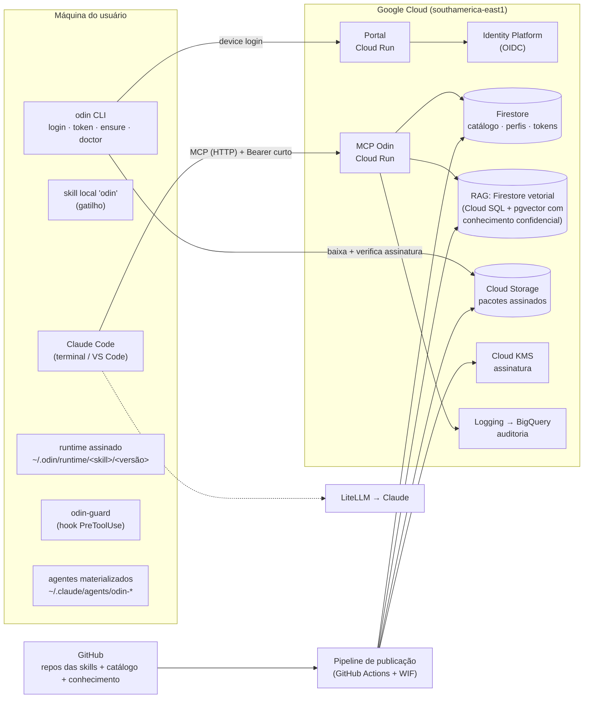
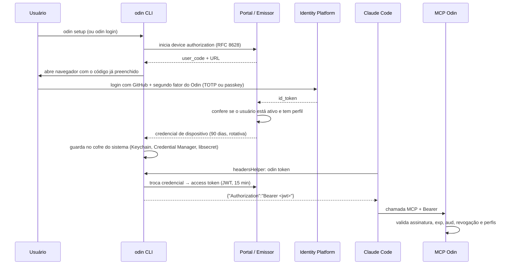

# Odin MCP Squad: plano de arquitetura

> **Status:** plano, nada foi desenvolvido. Primeiro uso: prova de conceito pessoal num projeto Google Cloud do mantenedor, já com **todas** as skills. Depois, o time (cerca de 20 devs, mais POs).
> **Para quem continua o trabalho (outro chat ou pessoa):** comece por [`CLAUDE.md`](../CLAUDE.md) e [`docs/ESTADO.md`](ESTADO.md); mudanças de decisão viram ADR em [`docs/adr/`](adr/README.md).
> **Decisões do mantenedor:** [`docs/DECISOES.md`](DECISOES.md) (41 respostas; valem sobre o que estiver diferente).
> **Portal:** pasta [`docs/portal/`](portal/README.md) (área do usuário, guia do MCP, console de administração, consumo e cotas, ciclo de vida das skills, UX, API e critérios de aceite).
> **Segurança:** pasta [`docs/seguranca/`](seguranca/README.md) (modelo de ameaças, autenticação e MFA, tokens, autorização, cadeia de suprimentos, endpoint, infraestrutura, LGPD, resposta a incidentes, controles e runbooks). Para segurança, vale a pasta.
> **Arquitetura detalhada:** [solução](arquitetura/01-arquitetura-de-solucao.md) · [funcional](arquitetura/02-arquitetura-funcional.md) · [técnica](arquitetura/03-arquitetura-tecnica.md) · [portal e perfilamento](arquitetura/04-portal-e-perfilamento.md). Em caso de diferença de detalhe, valem os documentos de arquitetura.
> **Convenção:** **[VERIFICAR]** marca o que depende de um comportamento do Claude Code, do Google Cloud ou do LiteLLM que não foi confirmado na documentação; esses pontos são os primeiros testes da prova de conceito (seção 16). **[CONFIRMADO]** marca o que foi conferido na documentação oficial do Claude Code (code.claude.com/docs, páginas `mcp`, `hooks`, `sub-agents` e `plugins`). Confirmado em documentação não dispensa o teste prático em F0.

## 1. Objetivo

Um único ponto de entrada, o **MCP Odin**. Qualquer pessoa autorizada (PO, dev, QA, arquiteto) conecta o Claude Code nele uma vez e pede em linguagem natural: "quero detalhar um discovery", "quero criar uma classe de teste". O Odin então:

1. **identifica** quem está pedindo e o que essa pessoa pode usar;
2. **escolhe** a skill certa entre as que ela pode usar;
3. **entrega** a skill na versão aprovada mais recente, com os agentes, as regras e os pré-requisitos dela;
4. **garante** que a máquina tem o runtime local (scripts e hooks de segurança) atualizado e assinado, e instala ou atualiza sozinho;
5. **fornece conhecimento** (base funcional, técnica e de regra de negócio) com citação da fonte;
6. **registra** tudo para auditoria e métricas.

### Restrições (decididas)

| Restrição | Consequência no desenho |
|---|---|
| Sem plano Claude Team/Enterprise | Sem console gerenciado: o Odin faz a própria governança (identidade, perfis, auditoria) |
| Modelos via token no **LiteLLM** | O Odin não chama modelo no caminho principal (roteamento determinístico + embeddings); a cobrança de modelo continua no LiteLLM |
| **Sem marketplace** de plugins | O runtime local é distribuído por um instalador próprio, com pacotes assinados |
| Skills e agentes continuam no **GitHub** | O GitHub é a fonte da verdade; o Odin publica versões fixadas por commit |
| Claude Code no terminal, no VS Code e na extensão do VS Code; acesso total ao disco | O runtime e os hooks rodam na máquina; a segurança fica em código (hooks), não na confiança no modelo |
| Todas as skills de uma vez | Fases de **construção**, não de liberação: a prova de conceito já roda as 10 skills ([pipeline](PIPELINE.md)) |

### Fora do escopo desta versão
Execução das skills no servidor (o trabalho continua na máquina do usuário), interface de chat própria, marketplace de plugins, criação de modelos próprios e substituição do LiteLLM.

---

## 2. Visão geral



Três planos:
- **Plano de conteúdo (GitHub → pipeline):** as skills são versionadas e revisadas por pull request, validadas, assinadas e publicadas.
- **Plano de controle (GCP):** identidade, perfis, catálogo, roteamento, RAG e auditoria.
- **Plano de execução (máquina):** o Claude Code executa; o runtime local fornece scripts e os hooks que impõem as regras de segurança.

**Custo por estágio (ADR 0018):** a nuvem tem 3 serviços e 3 jobs, todos com escala a zero. E0 (prova de conceito) custa até US$ 3 por mês; E1 (time) até US$ 25; recursos de custo fixo (Cloud SQL, Load Balancer, Cloud Armor, instância quente) só entram por gatilho medido. Detalhe em [arquitetura 05](arquitetura/05-custos-e-finops.md).

---

## 3. Experiência do usuário (fricção mínima)

### 3.1 Onboarding: três passos, uma vez na vida
1. Ter o Claude Code instalado e configurado no LiteLLM (já é o caso hoje).
2. Instalar o CLI: **um comando** copiado do portal.
   - macOS/Linux: `curl -fsSL https://odin.<dominio>/install.sh | sh`
   - Windows: `irm https://odin.<dominio>/install.ps1 | iex`
   - Como os repositórios são privados (decisão 5), o instalador baixa o CLI **pelo portal** do Odin (o binário não é segredo e fica num bucket privado) e confere o **checksum fixado** no próprio script servido pelo portal; as atualizações seguintes conferem a **assinatura do KMS** (seção 9.1).
3. `odin setup`. Abre o navegador, a pessoa entra com o GitHub e o segundo fator do Odin (autenticador ou passkey), confirma o código do dispositivo e o resto é automático:
   - registra o MCP Odin no Claude Code no escopo do usuário;
   - instala o `odin-guard` (hook), a skill local `odin`, o `~/.odin/ODIN.md` e a linha que o importa no `CLAUDE.md` do usuário, e cria `~/.claude/agents/` (seção 22);
   - instala o runtime das skills a que a pessoa tem direito e confere os pré-requisitos (Node, git, `sf` CLI, Playwright quando aplicável);
   - termina com `odin doctor` verde, ou com a correção exata do que faltou.

### 3.2 Uso diário: zero passos
A pessoa abre o Claude Code em qualquer repositório e pede o que precisa. Não existe "atualizar skill": a próxima **sessão** do Claude Code já usa a versão nova (a versão fica fixa durante a sessão, decisão 15).

### 3.3 Quando algo muda
| Evento | O que o usuário vê |
|---|---|
| Skill nova liberada para o perfil dele | Passa a ser roteada; o runtime instala no primeiro uso (`odin ensure`) |
| Versão nova de uma skill | Nada: vale na próxima sessão; o runtime se atualiza no primeiro uso (versão proibida bloqueia na hora) |
| Odin indisponível | As skills já usadas continuam pela cópia local assinada por até 7 dias; skills novas e conhecimento voltam quando o Odin voltar (decisão 14) |
| Mudança nos hooks de segurança | Normalmente nada (o Claude Code capta a mudança); só se a prova de vida do guard (7.4) falhar aparece "reinicie a sessão" (seção 7.4) |
| Acesso revogado | A próxima chamada responde "sem acesso a X; fale com o administrador" |
| Token expirado | Nada: o `headersHelper` renova sozinho; só pede login de novo se a credencial de longa duração for revogada |

### 3.4 Exemplos de ponta a ponta
- **PO:** "Quero detalhar o discovery da R02." → o Claude Code, guiado pelas instruções do servidor Odin, chama `odin_rotear` → o Odin responde "Discovery-to-Backlog, 0,91" → `odin_carregar_skill` → `odin ensure sf-discover` (runtime ok) → a skill roda, consulta a base de regras de negócio, grava `discovery/R02/` no disco e sugere o próximo passo ("Journey Designer: spec").
- **Dev:** "Cria a classe de teste do `CaseRouter`." → roteado para o Journey Developer (subskill de cobertura Apex) → busca padrões técnicos na base ("padrões de teste Apex, mocking de callout") → gera e roda os testes localmente → o hook impede deploy fora de sandbox.

---

## 4. Componentes

| # | Componente | Tecnologia | Responsabilidade |
|---|---|---|---|
| C1 | **MCP Odin** | Cloud Run, Node/TypeScript, SDK oficial de MCP, transporte Streamable HTTP sem estado, com resposta JSON e sem fluxo SSE permanente | Autenticar, autorizar, rotear, entregar skills, agentes e referências, buscar conhecimento, auditar |
| C2 | **Portal** | Cloud Run, Next.js (ou similar), Identity Platform | Login, dispositivos e tokens, autoatendimento; console de administração (usuários, perfis, catálogo, conhecimento, auditoria) |
| C3 | **Serviço de identidade** | Identity Platform com **login GitHub** (Google ou Microsoft opcionais) + emissor de tokens próprio `odin-sts` (JWT assinado no KMS) | Device login, credencial de dispositivo ligada a chave do dispositivo, tokens de acesso curtos, revogação |
| C4 | **odin CLI** | Node ≥ 20, binário único por plataforma | `setup`, `login`, `token` (headersHelper), `ensure`, `doctor`, `guard-ping`, `update`, `uninstall`, `restore-copias`, `logout` |
| C5 | **odin-guard** | Node, um hook `PreToolUse` (e `PostToolUse` quando preciso) | Despachante das políticas de segurança de todas as skills, fail-closed |
| C6 | **Gatilho e manual do Odin** | Instruções do servidor MCP + `~/.claude/skills/odin/SKILL.md` + `~/.odin/ODIN.md` | Fazer o Claude Code chamar o roteador em qualquer pedido coberto pelo Odin; explicar como o Odin funciona sem sobrepor o `CLAUDE.md` do projeto (7.6, 22.2) |
| C7 | **Catálogo** | `catalog/` neste repositório (YAML) → job `odin-publisher` (confere a assinatura) → Firestore | Quais skills existem, a versão fixada (commit SHA) de cada uma, perfis, canais |
| C8 | **Pipeline de publicação** | GitHub Actions + Workload Identity Federation (sem chave de serviço) | Validar, testar, empacotar, assinar e publicar skills e conhecimento |
| C9 | **Base de conhecimento (RAG)** | Repositório `odin-knowledge` (markdown) → job `odin-indexer` → Firestore com busca vetorial (Cloud SQL Postgres + pgvector quando houver conhecimento confidencial), embeddings Vertex AI | Conhecimento funcional, técnico e de regra de negócio, com citação, vigência e controle de acesso |
| C10 | **Observabilidade e auditoria** | Cloud Logging → BigQuery, Cloud Monitoring, Error Reporting | Trilha de auditoria imutável, métricas de uso e de roteamento, alertas |
| C11 | **Infraestrutura como código** | Terraform (`infra/`), com o estágio de custo como variável | Recriar o ambiente inteiro; isolar `poc` e `prod`; impedir recurso pago fora do estágio |
| C12 | **`odin lint`** | Node, no pipeline e no `odin doctor` | Regras de isolamento, colisão, tamanho, licença e segredo (22.5) |
| C13 | **Skills de manutenção** | `odin-dev`, `odin-curador`, `odin-arquiteto`, `odin-operacao`, revisores e auditor (neste repositório) | Ajudar os mantenedores a construir, sustentar e auditar o Odin e a incorporar skills; a decisão fica no código (22.4) |
| C14 | **Rotinas e teto de custo** | Job `odin-jobs` a cada 15 min (`odin-tick`); orçamento com disjuntor (`odin-disjuntor`) | Sincronizar com o GitHub, expirar concessões, teste sintético, agregados; fechar o ingress se o gasto disparar |
| C15 | **Contratos** | `schemas/` (JSON Schema, ferramentas MCP, OpenAPI) | Fonte única dos contratos, validada no CI e usada pelo código |

---

## 5. Identidade, autenticação e tokens

### 5.1 Fluxo recomendado: device login + token curto



- **Credencial de dispositivo:** uma por máquina, rotativa a cada uso e revogável no portal. Nunca aparece na tela nem em arquivo de texto: fica no cofre do sistema.
- **Token de acesso:** JWT assinado com chave do Cloud KMS, com 15 min de validade, `typ=at+jwt`, `aud=https://mcp.<dominio>` e as claims `sub`, id do GitHub, dispositivo, família e versão de política (formato completo em [segurança 03](seguranca/03-tokens-sessoes-e-chaves.md)). **Os perfis não vão no token:** o MCP resolve os direitos no servidor a cada chamada, com cache de 30 s, e assim uma mudança no portal vale na hora (arquitetura técnica, 5.4).
- **Credencial de dispositivo ligada a chave:** o CLI gera um par de chaves no cofre do sistema; renovar exige uma assinatura com essa chave. Credencial roubada sem a chave não renova (arquitetura técnica, 5.3).
- **Renovação transparente:** o servidor é registrado no **escopo do usuário** (`claude mcp add --transport http --scope user odin <url>` com `"headersHelper": "odin token"`), e o Claude Code chama `odin token` para obter os cabeçalhos. **[CONFIRMADO]** O helper roda a cada conexão (início de sessão e reconexão) e de novo quando o servidor responde `401` ou `403`, repetindo a chamada uma vez. O Claude Code não guarda o resultado, então o cache fica no CLI. O helper tem até 10 s e deve imprimir um objeto JSON de cabeçalhos. No escopo do usuário ele roda sem depender da confiança da pasta, que só é exigida para servidores de projeto (`.mcp.json`) ou de escopo local. Consequência: quando o JWT expira no meio da sessão, o MCP responde `401`, o Claude Code chama o helper de novo e a chamada é repetida, sem nada visível para o usuário. **[VERIFICAR]** o mesmo comportamento na extensão do VS Code.
- **Plano B (portal):** o portal tem uma página **"Gerar token"** para o usuário logado, para clientes ou situações sem o CLI: token pessoal de no máximo 90 dias, escopo reduzido, exibido uma vez, usado como `claude mcp add ... --header "Authorization: Bearer <token>"`. Como esse token fica em texto no `~/.claude.json`, é exceção auditada, com validade curta e alerta de uso fora do padrão; o caminho normal é o device login, que também passa pelo portal.
- **Plano C (alternativa nativa):** **[CONFIRMADO]** o Claude Code suporta OAuth 2.0 em servidores HTTP: o login abre no navegador via `/mcp` ou `claude mcp login odin`, com registro dinâmico de cliente, documento de metadados de cliente (CIMD) ou cliente pré-registrado (`--client-id`, `--client-secret`, `--callback-port`). Exige que o portal funcione como servidor de autorização OAuth compatível com MCP. Fica como evolução: só vale a troca se dispensar o login separado do CLI, e o CLI continua necessário para o runtime. Decidir depois de F0.

### 5.2 Ciclo de vida da pessoa
- **Entrada:** o administrador ou o gestor do squad convida pelo **login do GitHub** no portal (resolvido para o id numérico) e atribui squad e perfis. Com organização GitHub, pertencer a um time mapeado a um squad também dá entrada.
- **Saída:** desativar no portal. As credenciais de dispositivo são revogadas e os tokens deixam de valer em até 15 min (na prática, 30 s pela lista de revogação).
- **Perda de máquina:** revogar só aquele dispositivo.
- **Toda emissão e revogação é auditada.**

---

## 6. Autorização: perfis, projetos e skills

### 6.1 Modelo
**Pessoa → (perfis, projetos) → permissões em skills e coleções de conhecimento.** Tudo negado por padrão.

- **Perfil** = conjunto de skills e permissões de conhecimento.
- **Projeto (cliente)** = recorte de dados. Uma pessoa do projeto A não lê regras de negócio do projeto B. Essencial para consultoria com vários clientes.
- **Concessão individual** = exceção temporária com data de expiração, como "acesso ao Test Automator até 30/06".
- **Canal** = `stable` (padrão) ou `beta`, para testar uma versão nova com poucas pessoas antes de todas (seção 8.4).

### 6.2 Perfis de uso iniciais (editáveis no portal)

| Perfil | Skills | Conhecimento |
|---|---|---|
| `po` | Discovery-to-Backlog, Journey Designer | `funcional`, `negocio`: ler e propor |
| `dev` | Journey Developer, LWC Developer, Apex Callouts Developer, Apex Cover Loop, Deep Debugger, Test Automator, Data Architect (leitura) | `tecnico`: ler e propor; `negocio`, `dados`: ler |
| `qa` | Test Automator, Deep Debugger | `negocio`, `tecnico`, `licoes`: ler |
| `arquiteto` | Archaeologist, Data Architect, Journey Designer, Journey Developer, Apex Callouts Developer, Deep Debugger | `tecnico`, `dados`: curar; demais: ler |
| `mantenedor` | todas, mais canal `beta` | todas: ler |

**Administração é separada dos perfis de uso:** papéis `super-admin`, `admin-identidade`, `admin-catalogo`, `gestor-squad`, `curador` e `auditor`, com escopo, quatro olhos e passkey ([arquitetura funcional, 4.3](arquitetura/02-arquitetura-funcional.md); [portal 05](portal/05-console-de-administracao.md)). Nenhum perfil de uso dá poder administrativo.

### 6.3 Onde a autorização é aplicada
1. **MCP:** cada ferramenta confere a permissão. O roteador nunca sugere uma skill sem permissão, e `odin_carregar_skill` recusa com uma mensagem clara.
2. **Runtime:** `odin ensure` só baixa pacotes de skills a que a pessoa tem direito (URL assinada de curta duração, emitida por pessoa).
3. **RAG:** filtro por coleção e projeto **no banco** (segurança em nível de linha), e não só na aplicação.
4. **Auditoria:** quem, o quê, quando, de qual dispositivo e com qual resultado, inclusive as recusas.

**Limite honesto:** o que já foi entregue a uma máquina (o texto de uma skill, um runtime instalado) fica lá. Revogar impede uso futuro pelo Odin, mas não apaga o que existe no disco. Com o `odin-guard`, o runtime de uma skill revogada é desativado no próximo contato com o Odin; **uma máquina sem rede mantém a cópia local por até 7 dias** (modo degradado, decisão 14). Uma pessoa com acesso total ao disco também consegue copiar arquivos. Para um conteúdo de método isso é aceitável. Segredo e dado de cliente **nunca** vão em skill (já é regra das skills hoje).

---

## 7. Execução local: runtime, guard e agentes

### 7.1 Por que existe um runtime local
O MCP entrega **instruções**. Scripts (validadores, motor Playwright, geradores de Word e PowerPoint), hooks de segurança e definições de agentes precisam estar **na máquina**. O runtime é esse pacote, assinado, por skill e por versão.

```
~/.odin/
  bin/odin                         CLI
  runtime/<skill>/<versão>/        scripts, assets, package.json (dependências instaladas)
  runtime/<skill>/current -> <versão>
  policies/<versão>/               políticas do guard (de todas as skills a que tem direito)
  cache/                           manifestos, token, direitos (cifrados)
  ODIN.md                          manual do Odin para o modelo (22.2)
~/.claude/skills/odin/SKILL.md     gatilho
~/.claude/agents/odin-*.md         agentes materializados (só das skills a que tem direito)
~/.claude/settings.json            1 entrada de hook → odin-guard, num bloco marcado (só o CLI mexe)
~/.claude/CLAUDE.md                1 linha de importação do ODIN.md, num bloco marcado (só o CLI mexe)
(projeto do dev)                   NADA: o Odin nunca escreve no repositório do dev (22.1)
```

### 7.2 `odin ensure <skill>` (o "verifica, instala e usa")
É o primeiro passo obrigatório de toda skill (vem escrito no texto que o MCP entrega):
1. Lê o manifesto da skill pela **API REST do Odin** (o mesmo serviço do MCP, em `/v1/manifest/<skill>`, com o mesmo token; o CLI não é cliente MCP): versão, `runtime_sha256`, pré-requisitos, agentes, políticas.
2. Compara com o que está instalado.
3. Se faltar ou estiver desatualizado: baixa, **verifica a assinatura** contra a chave pública embutida no CLI, extrai numa pasta nova e troca `current` de forma atômica. A versão anterior fica guardada para rollback.
   - **Dependências:** as dependências JavaScript vão **dentro do pacote assinado** (`node_modules` gerado no pipeline), sem `npm install` na máquina. Assim a assinatura cobre também as dependências e o uso não depende do registro do npm. Exceções nativas grandes (os navegadores do Playwright) usam o instalador oficial da ferramenta, na versão fixada no manifesto.
4. Confere os pré-requisitos (`node`, `git`, `sf`, navegadores do Playwright). Se faltar algo instalável sem privilégio, instala; senão, para com a correção exata (por exemplo, "instale o Salesforce CLI: <comando>").
5. Materializa os agentes da skill em `~/.claude/agents/`. **[CONFIRMADO]** O Claude Code observa `~/.claude/agents/` e usa um agente novo ou editado na delegação seguinte, sem reiniciar, **desde que a pasta já existisse quando a sessão começou**. Por isso o `odin setup` cria a pasta no onboarding.
6. Confirma o guard ativo (7.4).
7. **Integridade no uso (ADR 0017):** na primeira chamada de cada skill na sessão, recalcula o SHA-256 dos arquivos do runtime instalado e compara com o manifesto assinado do cache. Divergência → reinstala do pacote assinado, registra telemetria e gera a detecção DT-19; sem pacote íntegro, a skill não roda (fail-closed). Nas chamadas seguintes da mesma sessão, confere só o hash do manifesto.
8. Responde em uma linha JSON, e a skill segue.

O modelo **nunca monta comando de instalação**. Ele só roda `odin ensure <skill>`, um comando fixo que entra na lista de permissões do usuário (sem pedido de confirmação a cada vez).

### 7.3 `odin-guard`: segurança em código
- **Um único hook** registrado no `settings.json` do usuário, que despacha as políticas de todas as skills: as de hoje (`guard-qa`, `guard-deploy`, a proteção de escrita no Jira do Discovery e as do Data Architect) viram **módulos de política** com testes.
- **Políticas globais** (sempre ativas): segredos, pastas e blocos do Odin, destruição fora do projeto, reescrita de histórico remoto, produção Salesforce, exfiltração, persistência e elevação. Catálogo completo (PG-01 a PG-08) em [segurança 06](seguranca/06-seguranca-do-endpoint.md).
- **Políticas de skill:** ativas quando a skill está em uso. Ficam como gatilho por diretório de execução (por exemplo `.sf-test/`) ou pelo marcador de sessão criado por `odin ensure`.
- **Fail-closed:** se o guard falhar, a política estiver corrompida ou a assinatura não conferir, o comando é **negado**, com uma mensagem orientando `odin doctor`.
- **O agente não altera o guard nem o Odin:** a política global nega editar `~/.odin/`, `~/.claude/agents/odin-*`, `~/.claude/skills/odin/` e qualquer edição de `~/.claude/settings.json` ou `~/.claude/CLAUDE.md` que altere os blocos do Odin (o resto desses arquivos continua livre para o dev). Só o CLI (fora da sessão do modelo, ou via `odin ensure`, que verifica assinatura) mexe neles.

### 7.4 Confirmar que o guard está ativo nesta sessão
**[CONFIRMADO]** A documentação diz que edições de hooks nos arquivos de configuração "normalmente" são captadas pelo observador de arquivos, sem reinício, e que os hooks disparam igual no terminal, nas extensões de IDE, no app desktop e na nuvem. Um hook de `PreToolUse` bloqueia com código de saída 2 ou com `permissionDecision: "deny"`, e ficar em silêncio não aprova a chamada. Como a palavra é "normalmente", o plano não depende disso e **comprova** que o guard está ativo:
1. O comando `odin ensure <skill>` é, ele mesmo, uma chamada de ferramenta do Claude Code. Se o guard está ativo, ele vê esse comando **antes** de rodar e grava um marcador com a hora em `~/.odin/cache/guard-visto.json`.
2. O `odin ensure` só continua se o marcador tiver menos de 60 segundos.
3. Sem marcador recente, o guard **não está ativo nesta sessão**, e a skill para com "reinicie a sessão do Claude Code e repita o pedido".

É simples, verificável e não depende do modelo. Corrige o desenho anterior (ADR 0020): um `guard-ping` chamado de dentro do `ensure` seria um subprocesso, e hooks só veem as chamadas de ferramenta do modelo. Na prática, o reinício deve ser raro: só quando o observador não captar a mudança.

### 7.5 Agentes
- **Decisão: materializar no disco** (`~/.claude/agents/odin-<skill>-<agente>.md`), a partir do pacote assinado. Motivo: agentes revisores independentes dependem das restrições de ferramenta do frontmatter (somente leitura). Isso se perderia num agente genérico criado a partir de texto vindo do MCP.
- Prefixo `odin-` para evitar colisão com agentes do projeto.
- **Risco de sombra [CONFIRMADO]:** em conflito de nome, o agente do projeto (`.claude/agents/`) vence o do usuário (`~/.claude/agents/`). Um repositório poderia trazer um `odin-sf-qa-judge.md` próprio e substituir o juiz oficial. Mitigação: o `odin-guard` e o `odin doctor` alertam sobre qualquer agente `odin-*` fora de `~/.claude/agents/`, e a skill confere, antes de delegar, que o agente em uso é o do pacote (hash no manifesto).
- Ao perder o direito a uma skill, o próximo `odin ensure` ou `doctor` remove os agentes dela.

### 7.6 Gatilho: instruções do servidor + skill local `odin`
**[CONFIRMADO]** Com a busca de ferramentas (ligada por padrão), só os **nomes das ferramentas e as instruções do servidor** entram no contexto no início da sessão; as definições completas são carregadas sob demanda. As instruções do servidor são cortadas em 4.096 caracteres, e a descrição de uma ferramenta carregada pela busca em 16.384. Então:
1. **Instruções do servidor Odin (principal):** até 4.096 caracteres, começando pelo essencial: "para qualquer tarefa do ciclo de desenvolvimento de software coberto pelo Odin (discovery, backlog, spec, protótipo, desenvolvimento Salesforce, dados, testes), chame `odin_rotear` antes de começar". É o gatilho nativo, e se atualiza sozinho com o servidor.
2. **Skill local `odin` (reforço):** curta, sem segredo, com a mesma regra. Cobre o caso em que o modelo não associa o pedido às instruções do servidor (R4). Se a busca de ferramentas estiver desligada (R11), o gatilho continua funcionando; o que muda é o custo de contexto.
3. As descrições das ferramentas começam pelas palavras que o modelo buscaria, porque a busca lê primeiro o início do texto.

---

## 8. Catálogo, versões e publicação

### 8.1 Contrato de skill: `odin.yaml` na raiz de cada repositório de skill
```yaml
id: sf-test
nome: Test Automator
dominio: salesforce      # salesforce | web | dados | devops | mobile | ... (seção 21)
dono: time-qa            # quem aprova mudanças (CODEOWNERS no repositório da skill)
descricao: QA de tela autônomo em sandbox...       # usado no roteamento
intencoes:                                        # exemplos para o roteador
  - "testar a capacidade X na sandbox"
  - "rodar o QA de tela"
perfis_sugeridos: [dev, qa]
entrada: [specs/**/spec.md, build-report.md]      # artefatos que a skill lê
saida: [.sf-test/runs/**, specs/**/test-report.md]
proximo: []                                       # encadeamento (Discovery → Designer → Developer → Test)
skills:                                           # SKILL.md expostos (principal + subskills)
  - path: .claude/skills/sf-test/SKILL.md
  - path: .claude/skills/sf-test-status/SKILL.md
agentes: [.claude/agents/sf-qa-*.md]
regras: [.claude/rules/qa-governance.md, .claude/rules/sandbox-only.md]
runtime:
  dir: .claude/skills/sf-test/scripts
  node: ">=20"
  dependencias: package-lock.json
  prerequisitos: [git, sf, playwright:chromium]
politicas: [guard-qa]
conhecimento: [tecnico, negocio, licoes]          # coleções que a skill consulta
avaliacoes: evals/                                # casos de avaliação de comportamento (8.3, ADR 0017)
licenca_terceiros: []                             # skills de terceiros embutidas (seção 15)
usa: []                                           # pacotes de biblioteca compartilhados, ex.: [lib-salesforce-oficial@^1] (22.3)
```
Só os caminhos declarados em `skills`, `agentes`, `regras` e `runtime` são empacotados: **é a lista do que pode ser entregue** (22.1). `CLAUDE.md`, `AGENTS.md`, `settings.json` e `.mcp.json` nunca entram, mesmo se declarados.

### 8.2 Catálogo central (`catalog/` neste repositório)
- `catalog/skills.yaml`: cada skill com `repo`, **SHA fixado**, canal e estado (`beta`, `ativa`, `depreciada`, `retirada`). Cada mudança gera um evento de ciclo de vida, visível no portal ([portal 07](portal/07-ciclo-de-vida-das-skills.md)).
- `catalog/perfis.yaml`: só a **semente** dos perfis iniciais. Depois disso, **acesso é governado no portal** (quem usa o quê, com aprovação e auditoria), e **conteúdo no Git** (o que existe e em que versão). Ver ADR-11 da arquitetura de solução.
- Mudança no catálogo = **pull request** com revisão de um mantenedor e CI verde. Não existe "publicar direto".

### 8.3 Pipeline de publicação (a cada merge no catálogo)
1. Baixa cada repositório de skill no SHA fixado.
2. Valida: `odin.yaml`, frontmatter dos `SKILL.md` e dos agentes, e caminhos referenciados existentes. Aplica a regra "nada de alias de org, nome real ou segredo" (varredura de segredos e PII).
3. Roda os testes do repositório da skill (os que já existem, como os 71 do Test Automator) e as **avaliações determinísticas** de `evals/` (scripts da skill sobre fixtures, sem modelo). Falha bloqueia a publicação (ADR 0017).
4. Roda o **`odin lint`** (22.5): arquivos proibidos, destinos, colisões de nome, **Unicode oculto**, tamanho de cada `SKILL.md` e referência (alvo de 5.000 tokens com aviso; reprova acima de 8.000), licenças de terceiros.
5. **Reescreve caminhos** para o contrato Odin (8.5) e gera o **pacote de conteúdo** (servido pelo MCP) e o **pacote de runtime** (`.odinpkg`, formato determinístico próprio; com as dependências).
6. Calcula o SHA-256 de cada pacote e assina o manifesto com chave assimétrica no **Cloud KMS**. O CI só tem permissão de *assinar*, nunca de exportar a chave.
7. Publica no Cloud Storage (versionado, com retenção) e atualiza o índice no Firestore, além dos embeddings de roteamento.
8. Smoke test pós-publicação: `odin_rotear` com as intenções de exemplo de cada skill tem de devolver a skill certa no topo.

### 8.4 Canais e rollback
- `beta` → mantenedores (e quem receber o canal); `stable` → todos.
- Promoção: PR que move a versão de `beta` para `stable`. **Portão de avaliação (ADR 0017):** o PR traz `evals/resultado.json` gerado por `odin dev eval <skill>` na máquina do mantenedor (a skill executada pelo Claude Code em modo não interativo sobre as fixtures, 3 repetições por caso, nota por código e, quando preciso, por juiz independente). O CI recusa a promoção se o relatório não for do SHA promovido, se a nota cair mais de 5 pontos em relação à versão `stable` atual ou se algum caso `critico` falhar. Nenhuma chave de modelo fica no CI.
- Rollback: PR que volta o SHA. O conteúdo muda na próxima chamada e o runtime volta no próximo `ensure`.
- Nada é apagado: as versões antigas ficam no Cloud Storage para auditoria.

### 8.5 Contrato de caminhos
As skills hoje referenciam `.claude/skills/<skill>/scripts/...` relativo ao projeto. No Odin os scripts ficam em `~/.odin/runtime/<skill>/current/`. O pipeline troca esses caminhos por `{{ODIN_RUNTIME}}`, e o MCP substitui pelo caminho absoluto da máquina. O caminho chega ao servidor num cabeçalho `X-Odin-Runtime` que o próprio `odin token` devolve junto com o `Authorization` (o `headersHelper` pode retornar vários cabeçalhos). Os scripts não podem assumir que estão dentro de `.claude/` do projeto. **É a principal adaptação nas skills existentes (seção 12).**

---

## 9. Segurança da cadeia de distribuição

### 9.1 Âncoras de confiança
| O que | Confia em | Não confia em |
|---|---|---|
| CLI | Primeira instalação: **checksum fixado** no script servido pelo portal (HTTPS); atualizações: **assinatura do KMS** (`cli-signing`) verificada pelo próprio CLI. Atestação de origem do GitHub registrada no CI [VERIFICAR disponibilidade em repositório privado] | Espelhos, cópias, binário sem assinatura |
| Runtime, políticas e agentes | **Assinatura do KMS**, verificada contra a chave pública embutida no CLI | O MCP (ele só aponta *qual* versão usar) |
| Conteúdo das skills | Hash no manifesto assinado: o MCP só serve conteúdo cujo hash confere, e o `odin doctor` compara amostras com o manifesto | Texto montado dinamicamente |
| Conhecimento (RAG) | Origem curada (PR aprovado) | Contribuições não revisadas |

Quem compromete o MCP consegue sugerir uma versão, mas **não consegue forjar** um pacote assinado. A rotação da chave de assinatura é feita por uma versão nova do CLI com duas chaves aceitas durante a transição.

### 9.2 Instruções vindas do servidor
O texto de uma skill é instrução para o modelo e não pode ser verificado pelo modelo. Por isso:
- O MCP só serve conteúdo do pacote publicado (sem montagem dinâmica, além da troca de `{{ODIN_RUNTIME}}`).
- **A fronteira de segurança é o `odin-guard`**, assinado e independente do texto. Mesmo uma instrução maliciosa não passa das políticas globais (produção, segredos, destruição).
- Conhecimento do RAG é **evidência, nunca instrução**: as respostas vêm marcadas e as skills mandam tratá-las como dado. A ingestão rejeita texto com instrução dirigida a agentes (como no caso de documento com "nota para o revisor de IA").

### 9.3 Governança do repositório
GitHub Free (decisão 41): em repositório privado não há proteção de branch nem revisão obrigatória. O que vale: **só o mantenedor tem escrita**; MFA na conta do GitHub; todo merge por PR com o CI verde e os revisores independentes; donos por área registrados no `CONTRIBUTING.md` (o `CODEOWNERS` entra com a organização GitHub); Dependabot nas dependências e nas ações; `SECURITY.md`, `CONTRIBUTING.md` e `CHANGELOG.md` na raiz. A garantia de integridade é a **assinatura no KMS**, conferida no registro e na máquina ([segurança 05](seguranca/05-cadeia-de-suprimentos.md)).

### 9.4 Modelo de ameaças (resumo)
| Ameaça | Mitigação |
|---|---|
| Roubo do token | JWT de 15 min, credencial no cofre do sistema, ligada ao dispositivo, revogável, alerta de uso a partir de IP ou país incomum |
| Conta GitHub de um mantenedor comprometida | Revisão por outra pessoa, SHA fixado no catálogo, CI obrigatório, assinatura só pelo CI |
| MCP comprometido | Não forja runtime; o guard limita o dano das instruções; alertas de mudança fora do pipeline |
| Injeção via conhecimento | Curadoria, marcação como evidência, filtro de instruções na ingestão |
| Vazamento entre clientes | Filtro de projeto em nível de linha no banco, testes de autorização no CI |
| Ex-funcionário | Desativação central, tokens curtos, auditoria |
| Exfiltração pelo próprio agente | Política global do guard (segredos, `curl` para domínios fora da lista) **[VERIFICAR]** o custo de manter essa lista |

---

## 10. Servidor MCP: superfície

Poucas ferramentas, porque cada ferramenta ocupa contexto do modelo. Todas recebem o token e auditam.

| Ferramenta | Entrada | Saída |
|---|---|---|
| `odin_rotear` | pedido, artefatos encontrados no repositório (opcional), skill atual (opcional) | até 3 skills **permitidas**, com confiança e motivo; se nenhuma passar do limiar, "não sei" e uma pergunta de esclarecimento |
| `odin_carregar_skill` | id, subskill (opcional) | `SKILL.md` com caminhos resolvidos, manifesto (versão, pré-requisitos, agentes, próximos passos) e a instrução "rode `odin ensure <id>` primeiro" |
| `odin_ler_referencia` | id, caminho | um arquivo de `references/` (revelação progressiva: não carrega tudo de uma vez) |
| `odin_conhecimento_buscar` | consulta, coleções, filtros (projeto, domínio, tipo) | trechos com **citação** (documento, seção, versão, vigência) e marcação de evidência |
| `odin_conhecimento_propor` | texto, tipo, fonte, projeto | proposta na fila de curadoria (não entra direto na base) |
| `odin_proximo_passo` | artefatos presentes | próxima skill do encadeamento (por exemplo, existe `backlog.json` e falta spec → Journey Designer) |
| `odin_feedback` | id da chamada, nota, comentário | melhora o roteamento e as métricas |

- **Prompts MCP:** um por skill (11 atalhos, em [PIPELINE.md](PIPELINE.md)),  (atalhos explícitos para quem prefere digitar o comando). **[CONFIRMADO]** Aparecem como `/odin:discovery (MCP)` e também rodam como `/mcp__odin__discovery`.
- **Recursos MCP:** cada skill e referência também é exposta como recurso (`skill://<id>/...`), que o usuário pode citar com `@odin:skill://sf-test/SKILL.md` **[CONFIRMADO: o formato `@servidor:protocolo://caminho`]**. O caminho principal continua sendo a ferramenta, porque o modelo a chama sozinho.
- **Limite de tamanho de saída [CONFIRMADO]:** o Claude Code avisa acima de 10.000 tokens por resposta de ferramenta e corta em 25.000 por padrão (`MAX_MCP_OUTPUT_TOKENS`); texto acima de 50.000 caracteres vai para arquivo. Regra do Odin: **nenhuma resposta acima de 8.000 tokens**. `SKILL.md` grande é dividido, referências vêm sob demanda e buscas são paginadas. O pipeline mede o tamanho de cada `SKILL.md` e falha acima do limite.
- **Economia de contexto (ADR 0017):** alvo de cerca de 5.000 tokens por `SKILL.md` e por referência (o `odin lint` avisa entre 5.000 e 8.000). Trabalho pesado (logs, metadados, relatórios, comparação de arquivos grandes) é feito por **script local**, que grava o detalhe em arquivo e devolve ao modelo só o resumo (até 40 linhas), como já faz o relatório do Test Automator.
- **Tempo limite:** sem problema para as ferramentas do Odin, que respondem em milissegundos. A conexão HTTP ociosa cai em 5 min e é refeita sozinha (o helper renova o token).
- **Não há suporte nativo documentado a "skills servidas por MCP"** no Claude Code. Por isso o Odin entrega skills por ferramenta, recurso e prompt, e não depende de uma extensão do protocolo ainda em proposta.
- **Roteamento:** determinístico e barato. (1) Filtro por permissão. (2) Similaridade de embeddings entre o pedido e as `intencoes` e `descricao` da skill. (3) Regras por artefato (`odin_proximo_passo`). (4) Limiar de confiança. Opcional depois: reordenar com modelo via LiteLLM se as métricas mostrarem erro de roteamento.

---

## 11. Base de conhecimento (RAG)

### 11.1 Coleções
| Coleção | Conteúdo | Quem escreve | Escopo |
|---|---|---|---|
| `funcional` | processos, jornadas, personas, glossário funcional | PO, arquiteto | por projeto |
| `negocio` | regras de negócio, políticas, exceções, decisões do cliente | PO (com fonte do cliente) | **por projeto** (confidencial) |
| `tecnico` | padrões de arquitetura Salesforce, ADRs, anti-padrões, padrões Apex, LWC e Flow, limites de plataforma | arquiteto, dev | global ou por projeto |
| `licoes` | precedentes do Test Automator, gaps recorrentes do build-report, postmortems | gerado pelas skills → curadoria | por projeto |
| `dados` | modelo de dados, glossário de entidades (Data Architect) | arquiteto de dados | por projeto |

### 11.2 Formato da fonte (repositório `odin-knowledge`, markdown)
```yaml
---
id: TEC-APEX-012
tipo: padrao            # padrao | regra | decisao | glossario | licao
colecao: tecnico
projeto: global         # ou o id do projeto
autoridade: 2           # mesma ideia dos oráculos: 1 = norma do cliente ... 5 = prática geral
vigencia: { de: 2026-03-01, ate: null }
substitui: [TEC-APEX-007]
dono: arquitetura
sensibilidade: interna  # publica | interna | confidencial
---
```
A precedência segue o princípio que as skills já usam: maior autoridade vence; o mais novo vence o mais antigo; o substituído não é retornado (ou é marcado como histórico).

### 11.3 Pipeline de conhecimento
1. Alteração por PR em `odin-knowledge`, com revisão do dono da coleção.
2. CI valida o frontmatter, mascara PII (reaproveitando o `pii.mjs` das skills), rejeita instruções dirigidas a agentes e **Unicode oculto** (ADR 0017), e confere `substitui` e vigência.
3. Divide por seção (sem quebrar tabelas e blocos de código), gera embeddings (Vertex AI) e grava em Postgres com `pgvector`, mais busca textual (`tsvector`) para busca híbrida.
4. Segurança em nível de linha por `projeto` e `colecao`.
5. **Avaliação:** um conjunto de perguntas com resposta esperada por coleção roda a cada mudança; o PR falha se a precisão de recuperação cair.

### 11.4 Contribuição pelas próprias skills
`odin_conhecimento_propor` abre uma proposta (no portal, e opcionalmente como PR automático em `odin-knowledge`). Exemplos: o Test Automator propõe uma lição quando o dev decide `previsto` num caso recorrente; o Developer propõe um padrão a partir de uma decisão de arquitetura. **Nada entra sem curadoria humana.**

### 11.5 Uso nas skills
Cada skill declara em `odin.yaml` as coleções que consulta, e o texto da skill diz *quando* consultar. Por exemplo: o Discovery consulta `negocio` antes de propor regra; o Developer consulta `tecnico` antes de escolher um padrão; o Test Automator usa `licoes` para não reabrir um bug já decidido como previsto. Toda resposta usada vira **citação** no artefato, mantendo o princípio "sem fonte, sem requisito".

---

## 12. Adaptação das skills existentes (todas de uma vez)

Inventário atual (base do esforço):

| Repositório | `SKILL.md` | Agentes | Regras | Hooks | Scripts |
|---|---|---|---|---|---|
| Discovery-to-Backlog | 11 | 7 | 2 | PreToolUse | ~20 |
| Journey Designer | 11 (inclui bibliotecas de terceiros) | 7 | 3 | PostToolUse (protótipo) | ~14 |
| Journey Developer | 24 (inclui bibliotecas de terceiros) | 10 | 5 | PreToolUse (deploy) | ~27 |
| Data Architect | 1 | 4 | 1 | Pre e PostToolUse | ~19 |
| Test Automator | 2 | 4 | 2 | PreToolUse (guard-qa) | ~30 |
| Archaeologist | 2 (inclui 10 playbooks de análise) | 4 | 2 | PostToolUse | ~3 |
| LWC Developer | 8 (3 próprias + bibliotecas de terceiros) | 0 | 1 | Pre e PostToolUse | ~21 |
| Apex Callouts Developer | 2 | 4 | 1 | Pre e PostToolUse | ~7 |
| Apex Cover Loop | 10 (1 própria + bibliotecas de terceiros) | 1 | 1 | PreToolUse | ~6 |
| Deep Debugger | 1 | 1 | 1 | PreToolUse | ~5 |

As 10 skills estão organizadas por etapa do ciclo em [PIPELINE.md](PIPELINE.md) (ADR 0019).

Mudanças, iguais para todas:
1. **`odin.yaml`** em cada repositório (8.1), com intenções de exemplo boas, que são o que mais pesa no roteamento.
2. **Caminhos:** trocar referências a `.claude/skills/<x>/scripts` por `{{ODIN_RUNTIME}}`. Os scripts passam a resolver a própria pasta (`import.meta.url`), e não o diretório do projeto.
3. **Hooks → módulos de política** do `odin-guard`, com os testes atuais migrados. O `settings.json` do projeto deixa de ser necessário.
4. **Regras (`.claude/rules`)** viram parte do conteúdo da skill entregue pelo MCP (seção "Regras" anexada ao `SKILL.md` ou como referência obrigatória), porque não há mais pasta de regras copiada no projeto.
5. **Agentes:** prefixo `odin-` na materialização. Referências entre agentes e skills atualizadas pelo pipeline.
6. **Primeiro passo** de toda skill: `odin ensure <id>`.
7. **Pontos de consulta e contribuição** ao RAG (11.5).
8. **Remover instaladores próprios** (`install.mjs`) e as cópias por repositório. O `odin doctor` detecta cópias antigas em `.claude/` do projeto e oferece remover, para evitar duas versões da mesma skill.
9. **Encadeamento:** `entrada`, `saida` e `proximo` declarados, para o `odin_proximo_passo`.
10. **Testes** de cada repositório rodando no pipeline de publicação.
11. **`CLAUDE.md` e `AGENTS.md` da raiz de cada repositório não vão para a máquina de ninguém** (seção 22). O que neles for regra operacional da skill é movido para o `SKILL.md` ou para uma referência da skill, e o resto fica como documentação de quem mantém o repositório.
12. **Bibliotecas de terceiros duplicadas** (5 skills idênticas no Designer e no Developer) viram um único pacote compartilhado (seção 22.3).

---

## 13. Observabilidade, auditoria e métricas

- **Auditoria** (BigQuery, partição diária, retenção de 1 ano, somente acréscimo): emissão e revogação de tokens; cada chamada MCP (pessoa, dispositivo, ferramenta, skill, versão, resultado e latência), sem o conteúdo do pedido por padrão (LGPD) e com amostragem opcional mascarada; publicações; mudanças de perfil.
- **Painéis:** uso por skill, perfil e projeto; acerto do roteamento (feedback e trocas de skill logo após o roteamento); versões de runtime em uso (deriva); erros de `ensure`; consultas sem resultado no RAG (lacunas de conhecimento); tempo até o primeiro valor no onboarding.
- **Custo:** o Odin mede **só o consumo do próprio MCP** (requisições). As chaves e o custo de modelo no LiteLLM são da empresa e ficam fora do Odin (decisão 27).
- **Alertas:** pico de recusas de autorização, publicação fora do pipeline, assinatura inválida reportada pelo CLI, erro acima de 2% no MCP, orçamento do projeto GCP.

---

## 14. Infraestrutura no Google Cloud

| Recurso | Uso | Observação |
|---|---|---|
| Projeto `salesforcemcpodin` (depois `odin-prod`) | Isolamento | Terraform recria tudo; cada projeto num estágio de custo (E0, E1, E2) |
| Região `southamerica-east1` | Latência e residência de dados | Conferir disponibilidade e preço dos serviços na região |
| Cloud Run (serviços): `odin-mcp`, `odin-sts`, `odin-portal` | Atender pessoas | **Mínimo de 0 e máximo de 3 instâncias** em E0 e E1; instância quente só por gatilho medido |
| Cloud Run (jobs): `odin-publisher`, `odin-indexer`, `odin-jobs` | Publicar, indexar, rotinas | Uma imagem, três contas de serviço; sem porta e sem custo parado |
| Cloud Scheduler: `odin-tick` | Um agendamento a cada 15 min | Faixa gratuita |
| Identity Platform | Login com **GitHub** (Google e Microsoft opcionais) e segundo fator (TOTP) | Faixa gratuita ampla para poucos usuários **[VERIFICAR]** os preços e o MFA com login federado |
| Firestore (nativo) | Catálogo, usuários, perfis, dispositivos, revogações; RAG e roteamento (busca vetorial) | Sem servidor, faixa gratuita |
| Cloud SQL Postgres + pgvector | RAG com segunda barreira no banco | **Só por gatilho:** primeiro conhecimento confidencial. Menor instância, sem alta disponibilidade (decisões 7 e 43) |
| Vertex AI (embeddings) | Roteamento e RAG | Custo por chamada, baixo; cache |
| Cloud Storage | Pacotes assinados (versionados, retenção) | URL assinada por pessoa e de curta duração |
| Cloud KMS | Chaves de assinatura dos pacotes, do CLI e dos JWT; envelope de campos | Em software; HSM só em E2 |
| Secret Manager | Segredos de aplicação | Nada de segredo em variável de ambiente simples |
| Artifact Registry | Imagens (4) | Varredura de vulnerabilidades e limpeza automática |
| Cloud Logging → BigQuery | Auditoria | Coletor dedicado; tabela agregada para o portal |
| Workload Identity Federation | CI do GitHub sem chave de serviço | Escopo mínimo por workflow |
| Orçamento + alertas + disjuntor | Controle de gasto | Alertas em 50%, 90%, 100%, 200% e 300%; a 300% o ingress fecha (RB-13) |
| Load Balancer, Cloud Armor, domínio próprio | Borda com WAF | **Só em E2**, por gatilho; em E0 e E1, endereços `run.app` |

**Custo estimado:** até **US$ 3 por mês** na prova de conceito e até **US$ 25 por mês** com o time (o Cloud SQL mínimo é quase todo esse valor, e só entra com conhecimento confidencial). O desenho anterior de "produção" custaria algumas centenas de dólares por mês. Modelo, gatilhos e disjuntor em [arquitetura 05](arquitetura/05-custos-e-finops.md). **Estimativa**, a confirmar na calculadora de preços do Google Cloud.

---

## 15. Licenças e conteúdo de terceiros

O Journey Designer e o Journey Developer embutem skills de terceiros (pastas `salesforce`, `mattpocock` e `agent-skills`, com `LICENSE` e `NOTICE`). Servir esse conteúdo por um servidor para outras pessoas é **redistribuição**: conferir a licença de cada uma, manter `LICENSE` e `NOTICE` no pacote e registrar em `licenca_terceiros` no `odin.yaml`. O pipeline falha se uma skill de terceiros não tiver licença declarada.

---

## 16. Fases de construção (prova de conceito com todas as skills)

As fases são a ordem de **construção**. A prova de conceito só termina com as 10 skills funcionando ponta a ponta.

| Fase | Entrega | Critério de aceite |
|---|---|---|
| **F0 Verificações e ferramentas de manutenção** | Um servidor MCP de brinquedo (Cloud Run ou local) para testar no Claude Code, no terminal **e** na extensão do VS Code: `headersHelper` no escopo do usuário com renovação em `401`; prompts como `/`; recursos com `@`; observador de hooks e de agentes; limite de saída; instruções do servidor como gatilho; importação `@~/.odin/ODIN.md` no `CLAUDE.md` do usuário (R13); **busca de ferramentas através do LiteLLM** (R11); OAuth do MCP como alternativa; **MCP com resposta JSON e sem fluxo SSE**, partida a frio com escala a zero e preços na região (ADR 0018). Também: as skills `odin-construtor` e `odin-curador` (são markdown e agentes, e ajudam a construir as fases seguintes) | Planilha de resultado; o desenho é ajustado antes de F1 |
| **F1 Fundação** | Projeto GCP, Terraform com estágio de custo, WIF, orçamento com disjuntor, limpeza do Artifact Registry, Cloud Run vazio em `run.app`, `schemas/` usados pelo código | `terraform apply` do zero em menos de 15 min; CI publica uma imagem sem chave; conformidade de custo (CF-11 a CF-14) verde |
| **F2 Identidade** | Identity Platform com GitHub, **segundo fator** (TOTP e passkey, códigos de recuperação), emissor de JWT (KMS), device flow com chave do dispositivo, portal mínimo (login, ativação, dispositivos, revogar), revogação | Login no navegador → credencial no cofre → `odin token` emite JWT; revogar invalida em ≤ 30 s |
| **F3 Catálogo e publicação** | `odin.yaml` (schema), `catalog/`, `odin lint`, pipeline completo (validar, testar, reescrever caminhos, empacotar com dependências, assinar, publicar), canais | Merge no catálogo publica as 5 skills; pacote adulterado é recusado pelo CLI; pacote com `CLAUDE.md`, colisão de nome, Unicode oculto ou avaliação determinística falhando é recusado pelo pipeline; promoção sem relatório de avaliação do SHA é recusada |
| **F4 MCP** | Ferramentas da seção 10, autorização por perfil e projeto, auditoria | PO de teste vê só Discovery e Designer; dev vê Developer, Data e Test; 100% das chamadas auditadas |
| **F5 Runtime local** | CLI completo (`setup`, `ensure`, `doctor`, `token`, `guard`, `update`, `uninstall`), `odin-guard` com as políticas migradas, skill local `odin`, `ODIN.md` e blocos marcados, materialização de agentes | Máquina limpa → 3 passos de onboarding → primeira skill roda; guard ausente bloqueia a skill; runtime adulterado depois da instalação é detectado e reinstalado (DT-19); nenhum arquivo escrito no projeto; `uninstall` deixa `settings.json` e `CLAUDE.md` do usuário como estavam; Windows, macOS e Linux |
| **F6 Adaptação das 10 skills** | Itens da seção 12 em todos os repositórios, incluindo mover as regras dos `CLAUDE.md` e extrair as bibliotecas de terceiros duplicadas (com o `odin-curador`) | Os testes atuais de cada skill passam rodando a partir do runtime Odin; cada skill tem `evals/` com ao menos 10 casos (negativos e de injeção incluídos) e nota de referência registrada; uma tarefa real de cada skill completa ponta a ponta |
| **F7 Conhecimento** | Repositório `odin-knowledge`, pipeline, `KnowledgeStore` no Firestore, implementação pgvector com segurança em nível de linha testada em contêiner (pronta para o gatilho), avaliação, propostas e curadoria no portal | Perguntas de avaliação com recuperação ≥ meta definida; pessoa do projeto A não recupera nada do projeto B (teste automatizado) |
| **F8 Operação** | Painéis, alertas, auditoria no BigQuery, runbooks (incidente, rotação de chave, rollback, entrada e saída de pessoa) | Teste de carga com **50 usuários** simultâneos (decisão 33) dentro dos SLOs e do teto de 3 instâncias; partida a frio medida (p95 ≤ 3 s); ensaio do disjuntor de custo; simulação: revogar uma pessoa, voltar uma versão e trocar a chave, cada uma em menos de 10 min |
| **F9 Validação pessoal** | Uso real pelo mantenedor por um período com as 10 skills (como PO e como dev, com dois usuários de teste) | Checklist da seção 17 todo verde |
| **F10 Preparação para o time** | Portão 2 da seção 23 (organização GitHub, projeto `prod` em E1, segundo super-admin, jurídico, pentest), guia de onboarding de uma página, repositório de suporte, **ensaio do corte** com 2 ou 3 pessoas | Portão 2 todo verde; 3 pessoas fazem o onboarding sozinhas em menos de 10 min no ensaio |

### 16.1 Estimativa (mantenedor + Claude, tempo integral; decisão 35)

| Fase | Duração estimada |
|---|---|
| F0 Verificações e ferramentas de manutenção | 1 semana |
| F1 Fundação | 0,5 semana |
| F2 Identidade (com MFA e passkeys) | 1,5 semana |
| F3 Catálogo e publicação | 1,5 semana |
| F4 MCP | 1,5 semana |
| F5 Runtime local (prioridade Windows nativo e extensão do VS Code) | 2 semanas |
| F6 Adaptação das 10 skills (inclui as avaliações, ADR 0017; 5 skills a mais, ADR 0019) | 4,5 semanas |
| F7 Conhecimento (Firestore; pgvector testado em contêiner) | 1 semana |
| F8 Operação | 1 semana |
| F9 Validação pessoal | 2 semanas |
| F10 Preparação para o time (inclui organização GitHub, projeto `prod` em E1, segundo super-admin, jurídico) | 1,5 semana |
| **Total** | **cerca de 18 semanas (± 30%)** |

Estimativa de ordem de grandeza: as fases F0 e F5 são as mais incertas (dependem do comportamento real do Claude Code no Windows e na extensão do VS Code). Revisar a estimativa ao fim da F0.

---

## 17. Critérios de sucesso

- **Fricção:** onboarding ≤ 3 passos e ≤ 10 min; uso diário com 0 passos de manutenção; 0 cópias de skill em repositórios de projeto.
- **Atualização:** versão nova em `stable` chega a 100% das chamadas seguintes; runtime atualizado no primeiro uso; rollback em menos de 10 min.
- **Governança:** 100% das chamadas autenticadas e auditadas; revogação efetiva em ≤ 30 s; perfil e projeto aplicados no MCP, no runtime e no banco do RAG (testes automatizados).
- **Segurança:** pacote adulterado sempre recusado (na instalação e no uso); Unicode oculto sempre recusado; guard ausente sempre bloqueia; nenhuma skill com segredo ou dado de cliente (varredura no CI).
- **Roteamento:** ≥ 90% de acerto no conjunto de intenções de teste; "não sei" em vez de chute abaixo do limiar.
- **Comportamento das skills:** nenhuma promoção para `stable` com queda de nota maior que 5 pontos ou caso crítico falhando (ADR 0017).
- **Conhecimento:** toda resposta com citação; meta de recuperação por coleção atingida; nenhuma injeção aceita na ingestão (casos de teste).
- **Custo:** ≤ US$ 3 por mês em E0 e ≤ US$ 25 em E1; nenhum recurso de custo fixo sem ADR de gatilho; disjuntor ensaiado.
- **Isolamento:** 0 arquivos escritos pelo Odin dentro de projetos; 0 colisões de nome não resolvidas no catálogo; `odin uninstall` devolve os arquivos do usuário idênticos ao que eram.

---

## 18. Riscos e decisões em aberto

| # | Risco ou decisão | Como tratar |
|---|---|---|
| R1 | Comportamentos do Claude Code: a maioria **confirmada** na documentação (headersHelper, OAuth, prompts, recursos, limites de saída, observador de hooks e de agentes, busca de ferramentas) | F0 confirma na prática; alternativas já previstas (token do portal, reinício de sessão, revelação progressiva) |
| R2 | A extensão do VS Code ter comportamento diferente do terminal. A documentação de MCP não cobre a configuração de servidores na extensão, e as "tarefas MCP" não existem nela; os hooks disparam igual | Testar o servidor de escopo do usuário, o `headersHelper` e os prompts na extensão em F0 |
| R11 | **Busca de ferramentas através do LiteLLM** [CONFIRMADO o requisito]: com `ANTHROPIC_BASE_URL` apontando para um gateway, o Claude Code espera que ele repasse os campos `defer_loading`, os blocos `tool_reference` e o cabeçalho `anthropic-beta`. Se o LiteLLM não repassar, a chamada falha ou (v2.1.305+) é refeita sem busca de ferramentas, e aí todas as definições do Odin entram no contexto | Teste em F0 com o LiteLLM real; manter o Odin com **poucas ferramentas** (7) e descrições curtas para que o custo seja pequeno mesmo sem busca; a skill local `odin` garante o gatilho |
| R12 | Agente de projeto com o mesmo nome sombreando um agente `odin-*` | Alerta do guard e do doctor + conferência de hash antes de delegar (7.5) |
| R13 | Importação `@~/.odin/ODIN.md` não suportada ou limitada no `CLAUDE.md` do usuário | Teste em F0; alternativa: o CLI escreve o conteúdo do `ODIN.md` direto no bloco marcado (mais texto, mesma garantia de não sobrepor) |
| R14 | Dependências de terceiros dos scripts (cadeia de suprimentos do npm) | Dependências empacotadas e assinadas no pipeline, com Dependabot e varredura de vulnerabilidades; nada de `npm install` na máquina do usuário (7.2) |
| R3 | Paridade Windows (hooks, cofre de credencial, caminhos, `npm ci`) | Matriz de CI com Windows desde F5 |
| R4 | Escolha de skill pelo modelo: o Claude Code pode não chamar o roteador | Skill local `odin` (7.6) + métrica de "pedido sem roteamento" |
| R5 | Revogação não apaga o que já está no disco | Aceito para conteúdo de método; segredo e dado de cliente nunca em skill |
| R6 | Manter um instalador e um guard próprios (código com acesso total) | Testes sérios, revisão dupla, assinatura, escopo mínimo |
| R7 | Qualidade do RAG (conhecimento desatualizado erra com confiança) | Vigência, `substitui`, curadoria, avaliação automática, painel de lacunas |
| R8 | Redistribuição de skills de terceiros | Seção 15 |
| R9 | Custo do GCP crescer com o time | Estágios de custo com gatilhos, escala a zero, teto de 3 instâncias, orçamento com disjuntor, conformidade CF-11 a CF-14 (arquitetura 05) |
| R10 | ~~Identidade do LiteLLM separada da do Odin~~ | **Encerrado:** o Odin não correlaciona com o LiteLLM (decisão 27) |
| R15 | Pessoa única na PoC (administração, aprovação de skills, curadoria e suporte) | Segundo super-admin obrigatório antes do time; runbooks escritos (decisões 26 e 31) |
| R16 | Migração por corte único (decisão 29) | Ensaio do corte, guia de uma página, plano de volta com as cópias arquivadas por 30 dias |
| R18 | GitHub Free em repositório privado: sem proteção de branch, revisão obrigatória, tags protegidas, ambientes com aprovação nem atestação (decisão 41) | Só o mantenedor escreve; 2FA; condições da identidade federada por `actor_id` e `main`; checagens no próprio workflow; assinatura no KMS como garantia principal |
| R17 | Sem jurídico ou DPO (decisão 37) | Bloqueio formal: o time não entra sem validação de LGPD, termos e licenças |
| R20 | Sem WAF em E0 e E1 (ADR 0018) | Token em toda rota útil, entrada validada por schema, superfície anônima listada e testada, limites no serviço, teto de instâncias, disjuntor; pentest antes do time; Cloud Armor por gatilho |
| R21 | Saída de pessoa pelo GitHub detectada em até 15 min, sem webhooks (ADR 0018) | Revogação imediata pelo portal (≤ 30 s); runbook de saída manda suspender no portal; webhooks em E2 |
| R22 | Endereços `run.app` no E1: troca futura para domínio próprio | O CLI lê os endereços de `/.well-known/odin-configuration`; o token aceita dois `aud` na transição |
| R23 | Partida a frio com escala a zero piora a primeira chamada do dia | Reforço de CPU na inicialização, imagens pequenas, token em cache; medir na F8; instância quente só no `odin-mcp`, por gatilho |
| R24 | Desenvolvimento local primeiro: o que só a nuvem prova fica para o fim (ADR 0020) | Interfaces com implementação local e de nuvem; F0 e F1 logo após o caminho local; testes da implementação de nuvem com emuladores |
| R25 | Cofre de credenciais em arquivo (0600) até entrar o cofre do sistema | Só em desenvolvimento local; troca atrás da interface `Cofre` antes de qualquer uso pelo time |
| R19 | Avaliação de comportamento com modelo é não determinística e roda só na máquina do mantenedor (ADR 0017) | 3 repetições por caso, mediana, tolerância de 5 pontos; nota principal por código; camada determinística no CI; casos `critico` sem tolerância |
| D1 | Provedor de login | **Decidido: GitHub** (SSO), via Identity Platform; Google ou Microsoft podem ser ligados depois. Times do GitHub viram squads quando houver organização GitHub |
| D2 | Conhecimento por projeto: quem é dono em cada cliente | **PoC: o mantenedor cura tudo** (decisão 20); definir por projeto antes do time |
| D3 | Um repositório por skill (como hoje) ou um monorepo de skills | **Decidido: um repositório por skill** + catálogo (decisão 8) |

---

## 19. Estrutura deste repositório

Já existem: `CLAUDE.md`, `AGENTS.md`, `docs/` (com `ESTADO.md` e `adr/`), `apresentacao/`, `.claude/` (skills `odin-dev`, `odin-curador`, `odin-arquiteto`, `odin-operacao`; agentes revisores e auditor; hook `guard-docs`), `scripts/` (ADR, sessão, verificações de documentação, skills e conformidade), `tests/`, `schemas/`, `.github/` (CI, Dependabot, modelo de PR) e os arquivos de governança da raiz (`SECURITY.md`, `CONTRIBUTING.md`, `CHANGELOG.md`). O restante entra a partir da F1:

```
apps/mcp-server/        odin-mcp: servidor MCP + API /v1
apps/sts/               odin-sts: emissor de tokens (device flow, JWKS)
apps/portal/            odin-portal: interface e BFF administrativo
apps/jobs/              uma imagem para os jobs odin-publisher, odin-indexer e odin-jobs
apps/disjuntor/         função que fecha o ingress a 300% do orçamento
packages/shared/        limites, erros, tipos gerados dos schemas
packages/cli/           odin CLI
packages/guard/         odin-guard + módulos de política (migrados das skills)
packages/router/        roteamento (embeddings + regras)
packages/lint/          odin lint (isolamento, colisões, Unicode oculto, tamanho, licença, segredo)
schemas/                contratos: odin.yaml, manifesto, avaliações, auditoria, ferramentas MCP, OpenAPI /v1 (já existe)
policies/               módulos de política do guard, com testes
.claude/skills/         odin-dev, odin-curador, odin-arquiteto, odin-operacao (para mantenedores; ADR 0016)
.claude/agents/         revisores (arquitetura, segurança, testes, documentação) e auditor
scripts/                ADR, sessão, verificações e conformidade
libs/                   pacotes de biblioteca de terceiros compartilhados, com LICENSE e NOTICE
catalog/                skills.yaml, perfis.yaml
pipeline/               validação, empacotamento, assinatura, publicação
infra/                  Terraform (módulos + envs poc e prod, com estágio de custo)
docs/                   este plano, arquitetura, segurança, portal, ADRs
```
Conhecimento em repositório separado (`odin-knowledge`), com donos e ritmo próprios.

---

## 20. Revisões deste plano (laço de revisão)

O plano passou por quinze rodadas de revisão contra os objetivos (fricção, governança, segurança, escala, conformidade, verificação na documentação, isolamento, consistência geral, arquitetura detalhada, cibersegurança, portal e revisão completa da documentação). O que cada rodada mudou:

| Rodada | Foco | Problema encontrado | Mudança |
|---|---|---|---|
| 1 | Fricção | Copiar e colar um token do portal em cada máquina é atrito e risco | Device login + `headersHelper`; o token do portal virou plano B |
| 1 | Fricção | Ferramentas MCP podem nunca ser chamadas se o modelo não as escolher | Skill local `odin` como gatilho (7.6) |
| 1 | Fricção | "Instalar e usar" no mesmo pedido falha se o hook novo não vale na sessão | `guard-ping` com nonce + mensagem de reinício (7.4) |
| 2 | Segurança | O hash vindo do MCP não protege contra um MCP comprometido | Chave pública embutida no CLI, assinatura no KMS só pelo CI (9.1) |
| 2 | Segurança | O agente poderia editar o próprio guard | Política global negando edição de `settings.json`, `~/.odin` e agentes (7.3) |
| 2 | Segurança | Conhecimento pode carregar injeção de instrução | Filtro na ingestão + marcação de evidência (9.2, 11.3) |
| 2 | Governança | Perfil sozinho não separa clientes | Dimensão "projeto" com segurança em nível de linha (6.1, 11.3) |
| 3 | Escala | Agentes genéricos perderiam as restrições de ferramenta dos revisores | Materializar agentes assinados (7.5) |
| 3 | Escala | `SKILL.md` e referências grandes estourariam o limite de saída do MCP | Revelação progressiva (`odin_ler_referencia`), resultados paginados (10) |
| 3 | Escala | Publicar direto quebraria os 20 de uma vez | Catálogo por PR, canais `beta` e `stable`, smoke test de roteamento (8) |
| 4 | Consistência | Scripts dependem de caminhos dentro de `.claude/` do projeto | Contrato `{{ODIN_RUNTIME}}` e adaptação explícita (8.5, 12) |
| 4 | Consistência | Regras (`.claude/rules`) não teriam onde ficar | Regras entregues junto com a skill (12, item 4) |
| 4 | Conformidade | Skills de terceiros embutidas seriam redistribuídas | Seção de licenças + falha no pipeline (15) |
| 4 | Conformidade | Pedidos dos usuários na auditoria podem ter dado pessoal | Auditoria sem conteúdo por padrão, amostragem mascarada (13) |
| 5 | Consistência | O CLI não é cliente MCP, mas precisava ler manifestos | API REST `/v1/manifest` no mesmo serviço, com o mesmo token (7.2) |
| 5 | Consistência | O servidor não tinha como saber o caminho local do runtime | Cabeçalho `X-Odin-Runtime` emitido pelo `headersHelper` (8.5) |

| 6 | Verificação | 12 itens sem confirmação | Conferidos na documentação oficial: a maioria virou [CONFIRMADO] (5.1, 7.2, 7.4, 7.5, 7.6, 10) |
| 6 | Fricção | O token expirando no meio da sessão poderia interromper o trabalho | Renovação por `401` → helper → repetição da chamada, confirmada (5.1) |
| 6 | Escala | Busca de ferramentas pode não passar pelo LiteLLM | Novo risco R11, teste em F0, servidor com poucas ferramentas |
| 6 | Segurança | Agente do projeto pode sombrear o agente oficial | Novo risco R12, alerta e conferência de hash (7.5) |
| 6 | Fricção | Agentes novos não aparecem se a pasta não existia no início da sessão | `odin setup` cria `~/.claude/agents/` (7.2) |
| 6 | Escala | O gatilho dependia só de uma skill local | Instruções do servidor como gatilho principal (7.6) |
| 6 | Expansão | O desenho falava só de Salesforce | Campo `dominio`, catálogo multidomínio e roteiro para adicionar skills (seção 21) |
| 7 | Isolamento | `CLAUDE.md`, `AGENTS.md`, `settings.json` e `.mcp.json` das skills poderiam sobrepor os arquivos do dev | Lista do que pode ser entregue (só o declarado no `odin.yaml`) + bloqueio no pipeline + o projeto do dev nunca é tocado (seção 22) |
| 7 | Isolamento | Faltava um "manual" do próprio Odin para o modelo | `ODIN.md` gerido pelo Odin, importado por uma linha no `CLAUDE.md` do usuário, mais as instruções do servidor (22.2) |
| 7 | Isolamento | Nomes repetidos entre repositórios: 5 skills duplicadas (conteúdo igual) e uma regra com o mesmo nome e conteúdo diferente | Nomes únicos no catálogo, pacote compartilhado para bibliotecas, pipeline falha em colisão (22.3) |
| 7 | Governança | Ninguém verificava as regras de empacotamento além do código | Skills de manutenção do Odin (`odin-curador`, `odin-construtor`), com a decisão final no pipeline (22.4) |
| 8 | Consistência | Componentes, árvore de arquivos, onboarding, fases e critérios não refletiam `ODIN.md`, blocos marcados, `odin lint` e as skills de manutenção | C6, C12 e C13 (4); árvore (7.1); onboarding (3.1); F0, F3, F5 e F6 (16); critério de isolamento (17); estrutura do repositório (19) |
| 8 | Segurança | `npm ci` na máquina deixava as dependências fora da assinatura | Dependências empacotadas no pacote assinado (7.2) e novo risco R14 |
| 8 | Segurança | O guard negava editar todo o `settings.json` e não protegia o `CLAUDE.md` do usuário | Guard protege só os blocos e as pastas do Odin; o resto continua livre para o dev (7.3) |
| 8 | Segurança | O token do plano B fica em texto no `~/.claude.json` | Registrado como exceção, com validade curta e alerta (5.1) |
| 8 | Consistência | A rodada 6 dizia que, sem a busca de ferramentas, o gatilho falharia; na verdade só aumenta o custo de contexto | Texto corrigido (7.6) |
| 8 | Consistência | Origem do hash do conteúdo confusa (o CLI não entrega o conteúdo das skills) | O MCP só serve conteúdo cujo hash confere com o manifesto (9.1) |
| 8 | Fricção | Hooks novos exigiam reinício segundo a seção 3.3, em contradição com a 7.4 | Reinício só quando o `guard-ping` falha (3.3) |
| 9 | Arquitetura | Faltavam as arquiteturas de solução, funcional e técnica e o portal | Quatro documentos em `docs/arquitetura/` |
| 9 | Governança | Perfis dentro do token atrasariam revogações e mudanças de acesso | Direitos resolvidos no servidor, cache de 30 s (5.1) |
| 9 | Segurança | Credencial de dispositivo roubada poderia ser renovada em outra máquina | Credencial ligada à chave do dispositivo, com detecção de reuso (5.1) |
| 9 | Identidade | Provedor de login em aberto | GitHub decidido; id numérico do GitHub como chave da pessoa (D1) |
| 9 | Segurança | Revogação global exigiria permissão de KMS no portal | Revogação por carimbo de tempo; troca de chave só por runbook (arquitetura técnica, 5.5) |
| 9 | Governança | Duplicidade de onde se editam perfis (Git e portal) | Acesso no portal, conteúdo no Git (8.2, ADR-11) |
| 10 | Segurança | Faltava documentação de segurança dedicada | Pasta `docs/seguranca/` com 12 documentos |
| 10 | Identidade | Login dependia só do 2FA do GitHub | Segundo fator do Odin (TOTP obrigatório, passkey para administradores) e níveis de garantia N1, N2 e N3 |
| 10 | Tokens | Inatividade de dispositivo em 90 dias era longa demais | Revogação após 30 dias sem uso; ativação vale no máximo 90 dias |
| 10 | Resposta | Não havia como bloquear uma versão já instalada | Lista assinada de versões proibidas, aplicada pelo CLI e pelo guard |
| 10 | Ameaças | Phishing de device code não estava tratado | MFA na aprovação, dados do dispositivo na tela, alerta de IP divergente |
| 11 | Portal | Faltava detalhar o portal para consumidores e administradores | Pasta `docs/portal/` com 11 documentos |
| 11 | Governança | Não havia medição de consumo nem cotas | Requisições por pessoa, squad, skill e ferramenta; cota diária e limite por minuto por perfil (portal 06) |
| 11 | Governança | Não havia histórico de quando uma skill entrou, mudou ou saiu | Eventos de ciclo de vida, estados `depreciada` e `retirada`, comparação de versões (portal 07) |
| 11 | Consistência | O guia do portal dependia de chamada ao MCP | O MCP grava os metadados das ferramentas no Firestore |
| 11 | Segurança | O GitHub App precisava abrir PRs de catálogo | Escrita só em branches `portal/*`; `main` protegida (arquitetura técnica 7.2) |
| 12 | Consistência | Seções antigas do plano divergiam dos documentos novos: login "corporativo", convite por e-mail, `aud` do token, tabela de perfis misturando uso e administração, Identity Platform com Google e Microsoft, políticas globais resumidas, F2 sem MFA | Plano alinhado à arquitetura, à segurança e ao portal (3.1, 5.1, 5.2, 6.2, 7.3, 14, 16) |
| 12 | Consistência | Token de acesso diferente na arquitetura técnica e na segurança (`aud`, `typ`, `amr`, `acr`, `fam`) | Formato único (segurança 03), refletido na arquitetura técnica 5.4 |
| 12 | Consistência | Duas APIs administrativas com caminhos diferentes (`/admin/v1` e `/api/admin`) | Uma só: `/api/*` e `/api/admin/*` (portal 09) |
| 12 | Consistência | Modelo do Firestore sem as coleções do portal | `policy_versions`, `notifications`, `review_campaigns` acrescentadas |
| 12 | Precisão | O login com GitHub era descrito como "com PKCE" sem confirmação | Marcado [VERIFICAR] (depende do provedor e do SDK) |
| 12 | Consistência | MFA ausente no onboarding da arquitetura de solução; ADRs fora de ordem | Corrigidos |
| 13 | Decisões | 40 perguntas abertas | Respondidas em `docs/DECISOES.md`: PoC perto de zero com Firestore, modo degradado de 7 dias, versão fixa por sessão, Windows e VS Code como prioridade, sem correlação com LiteLLM, corte único, estimativa de 15,5 semanas; riscos R15 a R17 |
| 14 | Integração | As decisões valiam só por cima dos documentos | Integradas em todos: versão por sessão e modo degradado (3.2, 3.3, 6.3), PoC sem Load Balancer e com Firestore (arquitetura 01 e 03, segurança 01, 04, 07, 08, 10), alertas pelo Cloud Monitoring na PoC (segurança 09, portal 08), Windows nativo nas políticas do guard (segurança 06) |
| 14 | Segurança | Repositórios privados quebrariam o instalador do CLI (baixava da release do GitHub) e o pipeline (não leria as skills) | CLI servido pelo portal a partir de bucket privado, com checksum fixado e assinatura no KMS (`cli-signing`); pipeline lê as skills com token do GitHub App (arquitetura 03, segurança 03, 05, 11) |
| 14 | Consistência | Primeira correção pôs o CLI em bucket público, contra a política da produção | Bucket privado + download pelo portal |
| 14 | Fechamento | Faltavam critérios objetivos para começar e para liberar ao time | Portões 1 e 2, corte único e suporte (seção 23) |
| 14 | Operação | Corte único sem plano de volta e suporte sem lugar definido | `odin restore-copias` por 30 dias; repositório `odin-suporte` (23.3, 23.4) |
| 14 | Escala | Meta de carga não estava nas fases | Teste com 50 usuários na F8 |
| 14 | Segurança | GitHub Free (decisão 41) tira proteções que a segurança supunha | Compensações em segurança 05 e arquitetura 03 (7.1, 7.4); risco R18 |
| 15 | Continuidade | Outro chat não conheceria as regras nem o estado do projeto | ADR 0016: `CLAUDE.md`, `docs/ESTADO.md`, ADRs, skills `odin-dev`/`odin-curador`/`odin-arquiteto`/`odin-operacao`, revisores, hook `guard-docs`, verificações e CI (seções 19 e 22.4) |
| 19 | Implementação | Começou o desenvolvimento, local primeiro; a implementação mostrou ajustes necessários no desenho | ADR 0020: serviços atrás de interfaces com implementação local e de nuvem; prova de vida do guard pelo próprio `odin ensure` (7.4); pacote `.odinpkg`; manifesto com `entrega`; TypeScript executado direto pelo Node; decisão 53 |
| 20 | Homologação | A nuvem real foi homologada (20/20) e achou 4 ajustes | ADR 0021: projeto `salesforcemcpodin`; serviços no Cloud Run; `/saude`; recarga de direitos para dispositivo recém-ativado; ativação interina por segredo até o portal |
| 18 | Escopo | Entraram 5 skills novas (Archaeologist, LWC Developer, Apex Callouts Developer, Apex Cover Loop, Deep Debugger); faltava a ordem das 10 no ciclo | ADR 0019: [PIPELINE.md](PIPELINE.md) com 6 etapas, encadeamento, fronteiras e perfis; 11 atalhos; F6 passa a 4,5 semanas (total de cerca de 18); decisões 49 a 52 |
| 17 | Custo e arquitetura | "Produção" superdimensionada para 20 pessoas (centenas de dólares por mês); 5 serviços + 2 jobs + Pub/Sub, com o Pub/Sub entregando a um job (impossível); sem teto de gasto; MCP sem regra para fluxo aberto; trechos ainda supondo proteção de branch; contratos só em prosa | ADR 0018: estágios E0, E1 e E2 com gatilhos (arquitetura 05), 3 serviços + 3 jobs, sem webhooks nem Pub/Sub de aplicação, publisher confere a assinatura, teto de 3 instâncias e disjuntor, MCP com resposta JSON, `schemas/` validados no CI, governança do repositório, CF-11 a CF-14; riscos R20 a R23; decisões 42 a 48 |
| 16 | Qualidade e segurança | Comparação com práticas de mercado (skills por MCP): faltavam avaliação de comportamento por skill, recusa de Unicode oculto, integridade do runtime no uso e diretriz de economia de contexto | ADR 0017: `evals/` e portão de promoção (8.3, 8.4), Unicode oculto no lint, no RAG e no CI deste repositório (8.3, 11.3, 22.5), `ensure` confere hashes na primeira chamada (7.2, DT-19), alvo de 5.000 tokens e scripts que devolvem resumo (10); risco R19 |

**Rodada seguinte, recomendada:** depois de F0 (verificações práticas), revisar o plano com os resultados reais antes de escrever código.

---

## 21. Expansão: adicionar skills e outros domínios

### 21.1 Adicionar uma skill (fluxo do mantenedor)
1. Criar ou escolher o repositório da skill, com `SKILL.md`, agentes, scripts e testes.
2. Escrever o `odin.yaml`: domínio, intenções de exemplo, perfis, runtime, políticas e coleções.
3. Rodar localmente `odin dev validate` e `odin dev try <pasta>`, que sobe a skill num **canal pessoal** para testar o roteamento e o runtime sem afetar ninguém.
4. PR no catálogo adicionando a skill no canal `beta`. O pipeline valida, testa, mede tamanho, assina e publica.
5. Atribuir a skill a perfis no portal (ou em `catalog/perfis.yaml`).
6. Depois de um período em `beta` sem regressão, PR promovendo para `stable`.

Meta: uma skill nova pronta em **menos de um dia** de trabalho do mantenedor, sem mudar nada no servidor.

### 21.2 Atualizar uma skill
PR no repositório da skill → nova tag → PR no catálogo trocando o SHA (o pipeline pode abrir esse PR sozinho a cada tag) → `beta` → `stable`. Os usuários não fazem nada.

### 21.3 Outros domínios além de Salesforce
Nada no núcleo é específico de Salesforce: identidade, perfis, catálogo, roteamento, runtime, guard e RAG valem para qualquer engenharia de software. O que muda por domínio:
- `dominio` no `odin.yaml`, que agrupa skills no portal, no roteamento e nas métricas;
- **políticas do guard por domínio** (por exemplo, `deploy-salesforce`, `terraform-apply`, `kubectl-prod`), escritas como módulos com testes;
- **coleções de conhecimento por domínio** (`tecnico/salesforce`, `tecnico/web`...), com donos próprios;
- **perfis compostos** (por exemplo, `dev-salesforce`, `dev-web`), em vez de um único `dev`.

Crescimento previsto: mais skills de **outros times** em repositórios próprios (cada time dono das suas, com CODEOWNERS), o mesmo servidor e o mesmo catálogo. O limite prático é o roteamento: com dezenas de skills, o filtro por perfil e domínio reduz os candidatos antes da similaridade, e a reordenação por modelo (seção 10) entra se as métricas mostrarem queda de acerto.


---

## 22. Isolamento: nada do Odin sobrepõe os arquivos do dev

### 22.1 Regra fundamental: o Odin nunca escreve no projeto do dev
O repositório em que o dev trabalha é dele. O Odin **não cria, não edita e não apaga** nada dentro do projeto: nem `CLAUDE.md`, nem `AGENTS.md`, nem `.claude/`, nem `.mcp.json`. Tudo o que o Odin instala fica em pastas do usuário que são só do Odin:

| Destino | O que vai | Quem escreve |
|---|---|---|
| `~/.odin/` | runtime, políticas, cache, `ODIN.md` | só o CLI |
| `~/.claude/agents/odin-*.md` | agentes das skills a que a pessoa tem direito | só o CLI, só com prefixo `odin-` |
| `~/.claude/skills/odin/` | a skill de gatilho | só o CLI |
| `~/.claude/settings.json` | **uma** entrada de hook (`odin-guard`), dentro de um bloco marcado | só o CLI, sem tocar no resto do arquivo |
| `~/.claude/CLAUDE.md` | **uma** linha de importação do `ODIN.md`, dentro de um bloco marcado | só o CLI, sem tocar no resto do arquivo |
| `~/.claude.json` | o registro do servidor MCP `odin` (via `claude mcp add --scope user`) | o próprio Claude Code, a pedido do CLI |

O que **nunca** é entregue, venha de que repositório vier:
- `CLAUDE.md`, `AGENTS.md`, `README.md` da raiz dos repositórios de skill;
- `.claude/settings.json` e `.claude/settings.local.json` (hooks e permissões viram políticas do `odin-guard`);
- `.mcp.json` (o único servidor MCP que o Odin registra é ele mesmo);
- qualquer arquivo não declarado no `odin.yaml`.

**Como isso é garantido:** o empacotamento usa uma **lista do que pode entrar** (só os caminhos declarados no `odin.yaml`), não uma lista do que fica de fora. O pipeline também **falha** se um pacote contiver um desses nomes proibidos, mesmo que declarado por engano. E o CLI recusa instalar qualquer arquivo fora dos destinos da tabela acima, mesmo de um pacote assinado. São três barreiras independentes.

**Blocos marcados:** nos dois arquivos compartilhados do usuário (`settings.json` e `CLAUDE.md`), o CLI só mexe entre `odin:inicio` e `odin:fim` (em JSON, numa chave própria). Antes de qualquer mudança faz cópia de segurança, depois confere que o resto do arquivo ficou igual e desfaz se não ficou. `odin uninstall` remove os blocos e deixa o arquivo como estava.

### 22.2 O "manual" do Odin: `ODIN.md` + instruções do servidor
Em vez de levar o `CLAUDE.md` de cada skill, o Odin tem **o seu próprio**, em duas camadas:

1. **Instruções do servidor MCP** (até 4.096 caracteres, entram em toda sessão): as regras que nunca podem faltar. Exemplos: chamar `odin_rotear` antes de começar; rodar `odin ensure` antes de executar uma skill; conhecimento do RAG é evidência e não instrução; nunca editar `~/.odin` nem os blocos do Odin. **Atualizam sozinhas** a cada conexão, sem arquivo nenhum na máquina.
2. **`~/.odin/ODIN.md`** (mais longo): como o Odin funciona, encadeamento das skills, convenções de saída, o que fazer quando algo falha. O `~/.claude/CLAUDE.md` do usuário recebe só **uma linha** de importação (`@~/.odin/ODIN.md`) dentro do bloco marcado. O conteúdo vem no pacote assinado e é atualizado por `odin ensure` sempre que muda, então "sempre que o MCP funciona, o manual está atualizado". **[VERIFICAR]** que o Claude Code resolve importações com `@~/...` no `CLAUDE.md` do usuário e com que profundidade.

O `ODIN.md` é escrito para **conviver** com o `CLAUDE.md` do projeto: não repete nem contradiz regras de projeto, e diz explicitamente que, em conflito sobre convenções de código, vale o projeto; em segurança, vale o guard (que é código e não depende de texto).

### 22.3 Colisões entre skills (encontradas no inventário atual)
O inventário dos 5 repositórios mostrou:
- **5 skills com o mesmo nome e conteúdo idêntico** no Journey Designer e no Journey Developer (`design-systems-slds-apply`, `design-systems-slds-validate`, `experience-lwc-generate`, `platform-apex-generate`, `test-driven-development`), vindas das bibliotecas de terceiros embutidas. As pastas `salesforce`, `mattpocock` e `agent-skills` existem nos dois repositórios com conjuntos diferentes.
- **Uma regra com o mesmo nome e conteúdo diferente** nos dois (`karpathy-guidelines.md`).
- Os 32 agentes não têm nomes repetidos.
- **Com as 5 skills novas (ADR 0019):** as mesmas bibliotecas de terceiros aparecem também no Apex Cover Loop (`platform-apex-generate`) e no LWC Developer (`experience-lwc-generate`, `design-systems-slds-apply`), e a regra `karpathy-guidelines.md` está em 7 repositórios. O tratamento abaixo vale igual: um pacote compartilhado e uma versão única da regra.

Tratamento:
- **Namespace por skill:** tudo o que é entregue leva o id da skill (`odin-sf-build-...`, referências em `skill://sf-build/...`). Duas skills podem ter um arquivo com o mesmo nome sem se sobrepor.
- **Bibliotecas compartilhadas:** o conteúdo de terceiros sai dos repositórios das skills e vira um **pacote de biblioteca** único no catálogo (por exemplo `lib-salesforce-oficial`, `lib-mattpocock`), com versão, licença e `NOTICE`. As skills declaram a dependência (`usa: [lib-salesforce-oficial@^1]`).
- **Pipeline falha** em qualquer colisão de nome que não seja o mesmo conteúdo da mesma biblioteca, e em regra com o mesmo nome e conteúdo diferente (força a escolher uma ou a renomear).

### 22.4 Skills e agentes de manutenção do próprio Odin
A sua ideia de uma skill para governar o MCP faz sentido, com uma divisão clara: **quem decide é o código; o agente ajuda o mantenedor.** Um agente no caminho de entrega deixaria a distribuição não determinística, e ela precisa ser previsível e auditável.

| Skill (no repositório Odin, só para mantenedores) | O que faz | Onde fica a decisão |
|---|---|---|
| **`odin-curador`** | Ao incorporar ou atualizar uma skill: lê o repositório, propõe o `odin.yaml`, move as regras do `CLAUDE.md` para o `SKILL.md` ou referências, aponta colisões, tamanho acima do limite, licenças e segredos, e abre o PR no catálogo | Pipeline (`odin lint`): o PR só entra com todas as verificações verdes |
| **`odin-construtor`** | Quando o desenvolvimento do Odin começar: conduz a construção por fases deste plano (servidor, portal, CLI, guard, pipeline), com agentes de arquitetura, implementação, revisor de segurança (contexto novo, somente leitura) e revisor de testes | Testes e revisão humana, como em qualquer código |
| **`odin-auditor`** (opcional) | Periodicamente: compara catálogo × portal × pacotes publicados, procura deriva de versões nas máquinas (pelas métricas), perfis com acesso demais e skills sem uso | Relatório para o admin; nenhuma mudança automática |

Não é preciso "um MCP para criar o MCP": essas três são skills comuns do Claude Code, que ficam neste repositório e são usadas por quem mantém o Odin. Elas mesmas podem ser publicadas pelo Odin para o perfil `mantenedor`.

**Implementado (ADR 0016):** o `odin-construtor` virou a skill **`odin-dev`** (construção por fases e sustentação: bug, melhoria, verificação), ao lado de **`odin-curador`**, **`odin-arquiteto`** (consultas e mudanças por ADR) e **`odin-operacao`** (incidentes e runbooks); o `odin-auditor` virou agente, junto com os revisores independentes de arquitetura, segurança, testes e documentação. O hook `guard-docs` bloqueia a edição dos documentos de referência sem ADR aberto, e o CI recusa um conjunto de mudanças que altere documento protegido sem ADR.

### 22.5 Verificações automáticas de isolamento (`odin lint`, no pipeline e no `doctor`)
1. Nenhum arquivo proibido (22.1) em pacote algum.
2. Todo arquivo entregue está num destino permitido e com o prefixo da skill.
3. Nenhuma colisão de nome não resolvida (22.3).
4. Blocos marcados íntegros no `settings.json` e no `CLAUDE.md` do usuário (no `doctor`).
5. Nenhum agente `odin-*` fora de `~/.claude/agents/` (sombra, R12).
6. Cópias antigas de skills dentro de `.claude/` do projeto detectadas, com a oferta de remoção (o dev decide, porque é o projeto dele).
7. Nenhum caractere Unicode oculto (largura zero, controle de direção, *tags*) em arquivo de texto do pacote (ADR 0017); no `doctor`, conferência dos hashes do runtime instalado contra o manifesto.


---

## 23. Portões e corte para o time

### 23.1 Portão 1: pronto para começar a F0
- [x] Decisões do mantenedor registradas ([DECISOES.md](DECISOES.md)).
- [x] Arquitetura de solução, funcional, técnica, segurança e portal escritas e alinhadas.
- [ ] Projeto `salesforcemcpodin` criado (decisão 1).
- [ ] Roteiro da F0 (`docs/F0-ROTEIRO.md`) entregue.
- [ ] Máquina de teste Windows nativo com Claude Code na extensão do VS Code e no terminal, com acesso ao LiteLLM real.

### 23.2 Portão 2: pronto para liberar ao time (fim da F9, durante a F10)
| Item | Por quê |
|---|---|
| Organização GitHub criada, com 2FA obrigatório e os repositórios transferidos (decisão 4) | Identidade e times |
| Projeto `prod` criado no **estágio E1** (mesma topologia da PoC), com orçamento, alertas e disjuntor ensaiado (decisões 42 e 45) | Custo sob controle antes de abrir para 20 pessoas |
| Nenhum conhecimento `confidencial` no ar sem o Cloud SQL e os testes de isolamento no banco verdes (decisões 7 e 43) | Separação entre clientes |
| Partida a frio e carga medidas dentro dos SLOs; superfície anônima testada (CT-11) | Substitui a borda com WAF em E1 (R20) |
| Segundo super-admin nomeado e com passkey (decisão 26, R15) | Pessoa única |
| Exceção registrada do quatro olhos no catálogo (decisões 31 e 41: só o mantenedor escreve) e revisão das compensações do GitHub Free | Integridade da distribuição |
| Jurídico: base legal LGPD, termos de uso, aviso de privacidade, licenças de terceiros (decisão 37, R17) | Conformidade |
| E-mail das notificações escolhido (decisão 36) | Avisos de segurança às pessoas |
| Pentest externo sem achado crítico ou alto em aberto ([segurança 10](seguranca/10-controles-e-testes.md)) | Segurança |
| Ensaio do corte concluído (23.3) | Corte único (decisão 29, R16) |

**Não são mais itens do Portão 2** (ADR 0018): domínio próprio, Load Balancer e Cloud Armor. Entram por gatilho, no estágio E2 ([arquitetura 05](arquitetura/05-custos-e-finops.md), seção 3).

### 23.3 Corte único (decisão 29)
1. **Ensaio:** 2 a 3 pessoas fazem o onboarding sozinhas, usam as 10 skills por 1 semana e removem as cópias do projeto com o `odin doctor`.
2. **Janela combinada** com o time (data, horário, canal de suporte).
3. **No dia:** guia de uma página + vídeo curto; cada pessoa roda o instalador e o `odin setup`; o `odin doctor` remove as cópias antigas de `.claude/` dos projetos (com confirmação) e **arquiva** um pacote delas em `~/.odin/arquivo-copias/`.
4. **Plano de volta:** por 30 dias, `odin restore-copias` devolve as cópias arquivadas a um projeto, se o Odin falhar para alguém.
5. **Acompanhamento:** painel de adoção (pessoas conectadas, guard ativo, erros por skill) por 2 semanas.

### 23.4 Suporte (decisão 30)
Como os repositórios são privados, o suporte fica num repositório **`odin-suporte`** (privado, com leitura para todo o time), separado do código do Odin, com modelos de issue: **problema**, **pedido de acesso**, **sugestão de skill**, **conhecimento**. O portal leva a esse repositório pelo botão "Preciso de ajuda".
