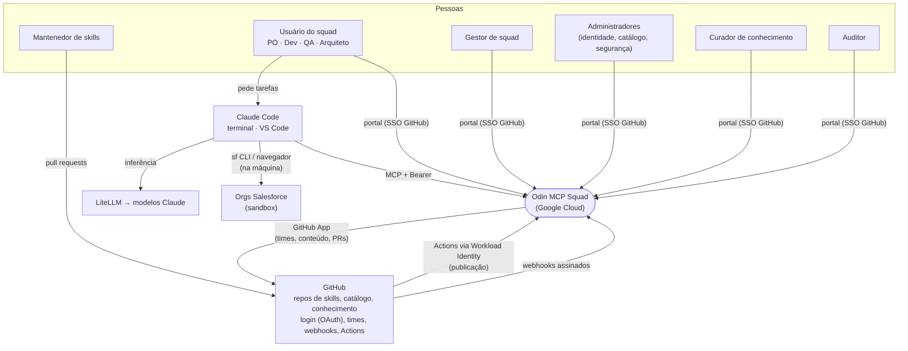
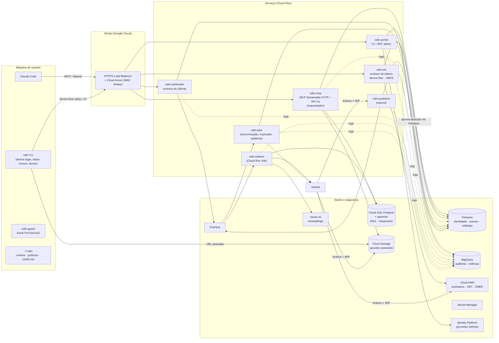

# 01. Arquitetura de solução

> Parte da série de arquitetura do Odin MCP Squad: **01 Solução** · [02 Funcional](02-arquitetura-funcional.md) · [03 Técnica](03-arquitetura-tecnica.md) · [04 Portal e perfilamento](04-portal-e-perfilamento.md). Base: [plano](../PLANO.md).
> **Status:** desenho, nada foi desenvolvido. [VERIFICAR] = ponto a confirmar na prova de conceito (fase F0 do plano).

## 1. Propósito

O Odin entrega, a qualquer pessoa autorizada do time (PO, dev, QA, arquiteto), as skills e os agentes de engenharia de software hospedados no GitHub. O ponto de acesso é um único servidor MCP. O Odin cuida de:
- **identidade:** quem é a pessoa, via login com GitHub;
- **autorização:** o que ela pode usar, por perfil, squad e projeto;
- **orquestração:** qual skill atende ao pedido e qual vem depois;
- **distribuição:** versão aprovada, assinada e atualizada sozinha;
- **conhecimento:** RAG funcional, técnico e de regra de negócio, com citação;
- **governança:** auditoria, revogação e administração centralizada no Google Cloud.

O trabalho em si (ler e escrever arquivos, rodar scripts, Playwright, `sf` CLI) continua **na máquina do usuário**, dentro do Claude Code.

## 2. Princípios de arquitetura

| # | Princípio | Consequência |
|---|---|---|
| P1 | **GitHub é a fonte da verdade do conteúdo; o Google Cloud é a fonte da verdade do acesso** | Skills, agentes, regras e conhecimento mudam por pull request. Quem acessa o quê muda no portal, com auditoria |
| P2 | **Negado por padrão** | Sem perfil ou concessão explícita, não há skill, coleção nem pacote |
| P3 | **Segurança em código, não em instrução** | O `odin-guard` (hook assinado) é a fronteira na máquina; o texto entregue ao modelo nunca é a única proteção |
| P4 | **Confiança verificável** | Pacotes assinados (Cloud KMS) e conferidos pelo CLI com a chave pública embutida; quem compromete o servidor não forja pacote |
| P5 | **Credenciais curtas e ligadas ao dispositivo** | Token de acesso de 15 min; renovação exige a chave privada do dispositivo |
| P6 | **Serviços sem estado, dados gerenciados** | Cloud Run escala horizontalmente; Firestore, Cloud SQL e Cloud Storage guardam o estado |
| P7 | **Nada sobrepõe o projeto do dev** | O Odin só escreve em pastas e blocos próprios do usuário (plano, seção 22) |
| P8 | **Fricção mínima** | 3 passos de onboarding, 0 passos de manutenção |
| P9 | **Tudo como código** | Terraform para a infraestrutura, GitOps para o catálogo e o conhecimento, políticas com testes |
| P10 | **Mínimo privilégio e separação de funções** | Uma conta de serviço por componente; quem implanta não assina; quem administra não aprova o próprio acesso |

## 3. Contexto (visão C4, nível 1)

**Fora do Odin, de propósito:** a inferência dos modelos (continua no LiteLLM), o acesso às orgs Salesforce (continua na máquina, com as credenciais do dev) e o código dos projetos (nunca sai da máquina para o Odin).

## 4. Contêineres (visão C4, nível 2)

| Contêiner | Papel | Exposição |
|---|---|---|
| `odin-mcp` | **Orquestrador.** Valida o token, resolve os direitos, roteia o pedido para a skill, entrega skill, referências e agentes, busca conhecimento e audita. Também serve a API REST `/v1` usada pelo CLI | Pública, pela borda |
| `odin-sts` | Emissor de tokens: device flow (RFC 8628), credencial de dispositivo, token de acesso (JWT), revogação, chaves públicas (JWKS) | Pública, pela borda |
| `odin-portal` | Interface para usuários e administradores, com backend (BFF) para a API administrativa | Pública, pela borda |
| `odin-webhooks` | Recebe eventos do GitHub (membros e times, tags, pushes), confere a assinatura e publica no Pub/Sub | Pública, pela borda (só GitHub) |
| `odin-publisher` | Registra versões publicadas pelo pipeline no catálogo | **Interna**: só a conta de serviço do CI pode chamar |
| `odin-indexer` | Ingestão do conhecimento (divisão, máscara de PII, embeddings) e índice de roteamento | Job interno |
| `odin-jobs` | Tarefas agendadas: sincronizar times do GitHub, expirar concessões, exportações, relatório do auditor | Job interno |

## 5. Decisões de arquitetura (ADRs resumidos)

| ADR | Decisão | Alternativas consideradas | Motivo |
|---|---|---|---|
| ADR-01 | **Login com GitHub** (SSO), via Identity Platform | Google ou Microsoft como provedor principal; contas próprias | O time já tem GitHub; dá para ligar acesso a times do GitHub; o Identity Platform permite acrescentar Google ou Microsoft sem mudar o resto |
| ADR-02 | Identidade pelo **id numérico do GitHub**, não pelo login | Login (`@usuario`) ou e-mail | O login pode ser renomeado e o e-mail pode ser privado; o id numérico é estável |
| ADR-03 | **Device flow próprio** (RFC 8628) com página de ativação no portal, e credencial de dispositivo **ligada a uma chave do dispositivo** | Device flow do próprio GitHub; token copiado do portal | Um só fluxo, independente do provedor; a credencial roubada não serve sem a chave privada que fica no cofre do sistema |
| ADR-04 | Token de acesso **Bearer JWT de 15 min** entregue ao Claude Code pelo `headersHelper` | Token de longa duração; OAuth nativo do MCP | O `headersHelper` é renovado sozinho (confirmado na documentação); OAuth do MCP fica como evolução (ADR-12) |
| ADR-05 | **Direitos resolvidos no servidor** a cada chamada (cache de 30 s), não gravados no token | Perfis dentro do JWT | Mudança de acesso no portal vale em até 30 s, sem esperar o token expirar |
| ADR-06 | **MCP sem estado** (Streamable HTTP) no Cloud Run | Sessões com afinidade | Escala horizontal sem afinidade; reinício de instância não derruba ninguém |
| ADR-07 | **Firestore** para identidade, acesso e catálogo; **Cloud SQL Postgres + pgvector** para RAG e roteamento | Tudo no Firestore; AlloyDB; banco vetorial dedicado | Firestore é sem servidor e barato para documentos de controle; Postgres dá busca híbrida (vetor + texto) e segurança em nível de linha para separar clientes |
| ADR-08 | **GitHub Actions + Workload Identity Federation** para publicar | Cloud Build com conexão GitHub; chave de conta de serviço | Sem chave guardada; condições por repositório e branch; o pipeline fica junto do código |
| ADR-09 | **GitHub App** para o Google Cloud ler o GitHub (times, conteúdo, PRs, webhooks) | Token pessoal de alguém | Permissões mínimas por recurso, token de instalação de 1 h, não depende de uma pessoa |
| ADR-10 | Pacotes **assinados no Cloud KMS** (ECDSA P-256), chave pública **embutida no CLI** | Só checksum; assinatura com chave em arquivo | A chave nunca sai do KMS; o CI só tem permissão de assinar |
| ADR-11 | **Catálogo por GitOps** (o que existe e em que versão) e **acesso pelo portal** (quem usa) | Tudo no portal; tudo no Git | Conteúdo exige revisão de código; acesso exige agilidade e trilha de aprovação |
| ADR-12 | **OAuth 2.1 do MCP como evolução**: o `odin-sts` já nasce com metadados OAuth (RFC 8414) e JWKS | Implementar desde o início | O Claude Code suporta OAuth em servidores HTTP (confirmado); fica para depois da F0, porque o CLI continua necessário para o runtime |
| ADR-13 | **Borda única** (Load Balancer + Cloud Armor) na frente de todos os serviços públicos | Endereços `run.app` diretos | WAF, limite de taxa, certificado e domínio próprio num lugar só; `run.app` só na prova de conceito |
| ADR-15 | **Segundo fator próprio do Odin** (TOTP obrigatório; passkey para administradores), além do GitHub | Confiar só no 2FA do GitHub | Conta do GitHub tomada não basta; a conta pessoal da prova de conceito não permite exigir 2FA |
| ADR-14 | **Região `southamerica-east1`** para dados e serviços | `us-central1` | Residência de dados no Brasil (LGPD) e latência; [VERIFICAR] disponibilidade de cada serviço na região |

## 6. Fluxos de ponta a ponta

### 6.1 Onboarding (uma vez)
1. A pessoa é convidada no portal (pelo login do GitHub) ou entra automaticamente por pertencer a um time do GitHub mapeado para um squad.
2. Instala o CLI com um comando copiado do portal.
3. `odin setup` → abre `https://odin.<dominio>/ativar` com o código preenchido → login com GitHub → aprova o dispositivo → o CLI recebe a credencial ligada à chave do dispositivo, registra o MCP no Claude Code e instala o guard, o `ODIN.md` e o runtime das skills a que ela tem direito.

### 6.2 Pedido de trabalho (todo dia)
1. "Quero criar a classe de teste do `CaseRouter`" → o Claude Code (guiado pelas instruções do servidor Odin) chama `odin_rotear`.
2. `odin-mcp` valida o token, carrega os direitos da pessoa e devolve a skill certa entre as permitidas.
3. `odin_carregar_skill` entrega o texto da versão aprovada; a skill roda `odin ensure`, que confere o runtime e o guard.
4. A skill consulta o conhecimento (`odin_conhecimento_buscar`) com o filtro do projeto da pessoa.
5. O trabalho acontece na máquina; cada chamada ao Odin é auditada.

### 6.3 Publicação de uma skill
1. Mantenedor abre um PR no repositório da skill → merge → tag.
2. PR no catálogo (`catalog/skills.yaml`) trocando o SHA → merge.
3. GitHub Actions (identidade federada) valida, testa, roda o `odin lint`, empacota, **assina no KMS**, envia ao Cloud Storage e chama o `odin-publisher`.
4. O publisher registra a versão no canal `beta`; o `odin-indexer` atualiza o índice de roteamento.
5. Promoção a `stable` por um novo PR. Usuários não fazem nada.

### 6.4 Mudança de acesso
- **Pelo portal:** o gestor do squad adiciona uma pessoa → aprovação (quando a regra exigir) → vale em até 30 s.
- **Pelo GitHub:** a pessoa sai do time do GitHub → webhook → o Odin remove a pertença ao squad, revoga os dispositivos se ela não tiver outro vínculo, e audita.

## 7. Visões transversais

### 7.1 Segurança (resumo; detalhe na arquitetura técnica, seção 8)
- **Identidade:** login com GitHub (2FA exigido pela organização do GitHub) **mais o segundo fator do Odin** (TOTP ou passkey; passkey para administradores), sessão no portal com cookie seguro e reautenticação para ações administrativas. Detalhe na pasta [`docs/seguranca/`](../seguranca/README.md).
- **Acesso:** perfis de uso × papéis administrativos separados; squads e projetos como recorte; concessões com validade; aprovação a quatro olhos para papéis administrativos.
- **Credenciais:** token de 15 min; credencial de dispositivo rotativa e ligada a chave; revogação em até 30 s; token pessoal só como exceção.
- **Cadeia de suprimentos:** pacotes e dependências assinados; imagens com varredura e (em produção) Binary Authorization; Dependabot.
- **Dados:** criptografia com chave própria (CMEK) nos dados sensíveis; RAG separado por projeto no banco; auditoria sem conteúdo dos pedidos por padrão.
- **Borda:** Cloud Armor (regras OWASP, limite de taxa), TLS gerenciado, cabeçalhos de segurança no portal.

### 7.2 Escalabilidade
| Dimensão | Como escala | Primeiro limite esperado |
|---|---|---|
| Usuários (20 → centenas) | Cloud Run sem estado, de 0 a N instâncias; Firestore sem servidor | Nenhum relevante até milhares |
| Skills (5 → dezenas) | Catálogo e roteamento com filtro por perfil e domínio antes da similaridade | Precisão do roteamento: entra a reordenação por modelo se as métricas caírem |
| Conhecimento (centenas → milhões de trechos) | pgvector com índice HNSW; Cloud SQL maior ou réplicas de leitura; AlloyDB se preciso | Memória do índice vetorial |
| Times e domínios | Multidomínio (`dominio` no `odin.yaml`), squads e projetos | Governança: delegar curadoria por coleção |
| Ambientes | Um projeto GCP por ambiente (poc → dev, stage, prod), mesmo Terraform | Organização GCP necessária para políticas centrais (seção 8) |

### 7.3 Disponibilidade e continuidade
- Meta inicial: 99,5% (prova de conceito); 99,9% em produção, com uma instância quente por serviço público.
- Se o Odin estiver fora, o runtime já instalado continua funcionando para skills em uso (o guard usa o cache de direitos por até 24 h). Novas skills e conhecimento ficam indisponíveis.
- Backups: Firestore com recuperação a um ponto no tempo e exportação diária; Cloud SQL com backup automático e PITR; Cloud Storage versionado. Metas: RPO de 1 h e RTO de 4 h.

## 8. Ambientes e evolução

| Ambiente | Projeto GCP | Quem usa | Diferenças |
|---|---|---|---|
| `poc` | Projeto pessoal do mantenedor | Mantenedor + 2 usuários de teste | Escala até zero, endereços `run.app` permitidos, menor instância de Cloud SQL, Cloud Armor opcional |
| `prod` | Projeto da empresa (idealmente numa organização GCP) | Time | Domínio próprio, Cloud Armor, instância quente, Binary Authorization, VPC Service Controls, políticas da organização |

**Limite do projeto pessoal:** sem uma organização GCP não há políticas de organização nem VPC Service Controls. O desenho funciona sem eles, mas a produção deve ficar numa organização.

**Limite da conta GitHub pessoal:** times do GitHub só existem em organizações. Na prova de conceito o acesso é dado por convite no portal (pelo login do GitHub). A sincronização por times entra quando houver uma organização GitHub.

## 9. Rastreabilidade com o plano

| Tema do plano | Onde está detalhado |
|---|---|
| Identidade e tokens (plano, seção 5) | Técnica, seção 5; Portal, seções 3 e 4 |
| Perfis, projetos e skills (plano, seção 6) | Funcional, seções 4 e 5; Portal, seção 5 |
| Runtime, guard, agentes (plano, seção 7) | Técnica, seção 9 |
| Catálogo e publicação (plano, seção 8) | Técnica, seção 7 |
| Cadeia de distribuição (plano, seção 9) | Técnica, seção 8 |
| Superfície MCP (plano, seção 10) | Técnica, seção 6 |
| RAG (plano, seção 11) | Técnica, seção 4.3; Funcional, seção 6 |
| Isolamento (plano, seção 22) | Técnica, seção 9.3 |
