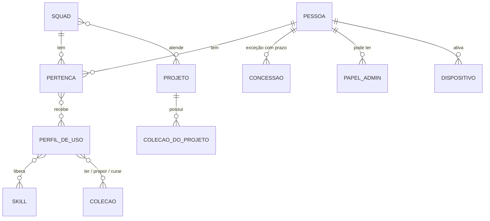

# 02. Arquitetura funcional

> Série: [01 Solução](01-arquitetura-de-solucao.md) · **02 Funcional** · [03 Técnica](03-arquitetura-tecnica.md) · [04 Portal e perfilamento](04-portal-e-perfilamento.md). Base: [plano](../PLANO.md).

## 1. Atores

| Ator | Quem é | O que quer |
|---|---|---|
| **Usuário do squad** | PO, dev, QA, arquiteto | Pedir em linguagem natural e receber a skill certa, atualizada, sem configurar nada |
| **Gestor de squad** | Líder técnico ou de entrega | Colocar e tirar pessoas do squad, dentro dos perfis permitidos ao squad |
| **Administrador de identidade** | Responsável por acessos | Convidar, suspender, revogar dispositivos e tokens, tratar incidentes |
| **Administrador de catálogo** | Responsável pelas skills | Ver versões, canais e uso; ligar perfis a skills |
| **Curador de conhecimento** | Dono de uma coleção (por projeto ou global) | Aprovar ou recusar propostas, manter a vigência |
| **Mantenedor de skills** | Quem escreve as skills | Publicar e atualizar skills por PR, testar no canal `beta` |
| **Auditor** | Segurança ou conformidade | Consultar a trilha de auditoria, sem poder mudar nada |
| **Superadministrador** | Duas pessoas, acesso de emergência | Recuperar o controle (por exemplo, se todos os administradores perderem acesso) |
| **Sistemas** | GitHub, Claude Code, LiteLLM | Integrar sem credenciais pessoais |

## 2. Mapa de capacidades

```mermaid
flowchart TB
  subgraph C1["1. Identidade e acesso"]
    a1[Login com GitHub] --> a2[Ativação de dispositivo] --> a3[Tokens e revogação]
    a4[Perfis, squads e projetos] --> a5[Solicitação e aprovação de acesso]
  end
  subgraph C2["2. Orquestração"]
    b1[Roteamento por intenção] --> b2[Entrega de skill e referências] --> b3[Encadeamento da jornada]
  end
  subgraph C3["3. Distribuição"]
    c1[Catálogo e versões] --> c2[Publicação assinada] --> c3[Canais e rollback]
    c4[Runtime local e guard]
  end
  subgraph C4["4. Conhecimento"]
    d1[Busca com citação] --> d2[Proposta pelas skills] --> d3[Curadoria e vigência]
  end
  subgraph C5["5. Governança"]
    e1[Auditoria] --> e2[Métricas e painéis] --> e3[Alertas e incidentes]
  end
  subgraph C6["6. Administração"]
    f1[Portal do usuário] --- f2[Console de administração]
  end
```

| Capacidade | Subcapacidades | Componente principal |
|---|---|---|
| 1. Identidade e acesso | Login, ativação de dispositivo, tokens, revogação, perfis, squads, projetos, concessões, solicitações | `odin-sts`, `odin-portal`, Firestore |
| 2. Orquestração | Roteamento, entrega de skill, revelação progressiva, próximo passo, feedback | `odin-mcp` |
| 3. Distribuição | Catálogo, publicação, assinatura, canais, rollback, runtime local, guard, `ODIN.md` | Pipeline, `odin-publisher`, CLI |
| 4. Conhecimento | Busca híbrida, citação, propostas, curadoria, vigência, avaliação | `odin-mcp`, `odin-indexer`, Firestore ou Cloud SQL |
| 5. Governança | Auditoria, painéis, alertas, revogação em massa, relatórios | BigQuery, Monitoring, `odin-jobs` |
| 6. Administração | Portal do usuário e console de administração | `odin-portal` |

## 3. Casos de uso

| UC | Caso de uso | Ator | Resultado |
|---|---|---|---|
| UC-01 | Primeiro acesso e ativação do dispositivo | Usuário | CLI ativado, MCP registrado, runtime instalado |
| UC-02 | Pedir uma tarefa em linguagem natural | Usuário | Skill permitida escolhida e entregue na versão aprovada |
| UC-03 | Seguir a jornada (Discovery → Designer → Developer → Test) | Usuário | Próxima skill sugerida a partir dos artefatos existentes |
| UC-04 | Consultar conhecimento | Usuário (via skill) | Trechos com citação, só das coleções e projetos permitidos |
| UC-05 | Propor conhecimento | Usuário (via skill) | Proposta na fila do curador |
| UC-06 | Solicitar acesso a uma skill ou coleção | Usuário | Solicitação com justificativa e prazo |
| UC-07 | Aprovar ou recusar solicitação | Gestor de squad ou administrador | Concessão com validade, ou recusa com motivo |
| UC-08 | Incluir ou remover pessoa do squad | Gestor de squad | Pertença atualizada, vale em até 30 s |
| UC-09 | Gerir dispositivos e tokens próprios | Usuário | Dispositivo revogado ou token pessoal gerado (exceção) |
| UC-10 | Suspender pessoa ou revogar em massa | Administrador de identidade | Acesso cortado em até 30 s |
| UC-11 | Publicar ou atualizar uma skill | Mantenedor | Versão nova no canal `beta` |
| UC-12 | Promover ou voltar uma versão | Mantenedor + administrador de catálogo | Versão em `stable`, ou rollback |
| UC-13 | Ligar perfis a skills e coleções | Administrador de catálogo | Matriz perfil × skill × coleção atualizada |
| UC-14 | Curar conhecimento | Curador | Proposta aprovada (vira PR no repositório de conhecimento) ou recusada |
| UC-15 | Consultar auditoria | Auditor | Trilha filtrada, exportável |
| UC-16 | Atribuir papel administrativo | Superadministrador ou admin de identidade | Papel concedido após **segunda aprovação** |
| UC-17 | Sair da empresa ou do time | Sistema (varredura do GitHub a cada 15 min) ou admin (imediato) | Pertenças removidas, dispositivos revogados |
| UC-18 | Acesso de emergência | Superadministrador | Conta de emergência usada, com alerta imediato |

### 3.1 UC-02 em detalhe (o fluxo principal)
1. O usuário pede a tarefa no Claude Code.
2. O Claude Code chama `odin_rotear` com o pedido e os artefatos que encontrou no repositório.
3. O Odin filtra as skills pelos direitos da pessoa, compara o pedido com as intenções de cada skill e devolve até 3 candidatas com confiança.
4. Se a confiança for baixa, devolve "não sei" e uma pergunta de esclarecimento, sem chutar.
5. O Claude Code chama `odin_carregar_skill`; a skill pede `odin ensure`, que confere runtime, pré-requisitos e guard.
6. A skill executa e consulta conhecimento quando o texto dela manda.
7. Ao fim, o Odin sugere o próximo passo da jornada (`odin_proximo_passo`).

**Exceções:** sem direito → mensagem "sem acesso a X; peça em `odin.<dominio>/solicitar`". Runtime desatualizado → atualiza sozinho. Guard inativo → para e pede para reiniciar a sessão. Odin indisponível → skills já instaladas continuam, a mensagem informa.

## 4. Modelo de acesso

### 4.1 Conceitos

- **Pessoa:** identificada pelo id numérico do GitHub.
- **Squad:** grupo de pessoas que atende a um ou mais **projetos** (clientes). Tem gestores e uma lista de perfis de uso permitidos.
- **Pertença:** pessoa × squad, com os perfis de uso que a pessoa exerce nele (por exemplo, `dev` no squad Atendimento).
- **Perfil de uso:** o que se pode **usar** (skills e coleções). Exemplos: `po`, `dev`, `qa`, `arquiteto`, `mantenedor`.
- **Papel administrativo:** o que se pode **administrar**. Separado dos perfis de uso (seção 4.3).
- **Concessão:** exceção individual com prazo e aprovador.
- **Direitos efetivos** = união dos perfis das pertenças + concessões válidas, **recortada pelos projetos** dos squads da pessoa.

### 4.2 Perfis de uso iniciais
| Perfil | Skills | Coleções de conhecimento |
|---|---|---|
| `po` | Discovery-to-Backlog, Journey Designer | `funcional`, `negocio`: ler e propor |
| `dev` | Journey Developer, Data Architect (leitura), Test Automator | `tecnico`: ler e propor; `negocio`, `dados`: ler |
| `qa` | Test Automator | `negocio`, `tecnico`, `licoes`: ler |
| `arquiteto` | Journey Designer, Journey Developer, Data Architect | `tecnico`, `dados`: curar; demais: ler |
| `mantenedor` | todas, mais canal `beta` | todas: ler |

### 4.3 Papéis administrativos
| Papel | Pode | Não pode |
|---|---|---|
| `super-admin` (2 pessoas) | Tudo, inclusive atribuir papéis administrativos (com segunda aprovação) | Aprovar o próprio pedido |
| `admin-identidade` | Convidar, suspender, revogar dispositivos e tokens, gerir squads e projetos | Mudar o catálogo; ver conteúdo de conhecimento confidencial |
| `admin-catalogo` | Matriz perfil × skill × coleção, canais, ver versões e uso | Gerir pessoas |
| `gestor-squad` (por squad) | Incluir e remover pessoas **do seu squad**, só com perfis permitidos ao squad; aprovar solicitações do squad | Criar perfis; dar papel administrativo; mexer em outro squad |
| `curador` (por coleção e projeto) | Aprovar ou recusar propostas, marcar vigência | Mudar acessos |
| `auditor` | Ler auditoria, métricas e configurações | Mudar qualquer coisa |

**Separação de funções:** ninguém aprova o próprio acesso; papéis administrativos precisam de duas pessoas (quem pede e quem aprova); ações administrativas exigem reautenticação recente; toda ação administrativa é auditada com antes e depois.

## 5. Regras de negócio

| RN | Regra |
|---|---|
| RN-01 | Todo acesso é negado por padrão; direito só existe por perfil de uma pertença ou por concessão válida |
| RN-02 | Conhecimento de projeto só é visível a quem pertence a um squad que atende ao projeto |
| RN-03 | Concessão individual tem prazo máximo de 90 dias e motivo obrigatório |
| RN-04 | Gestor de squad só atribui perfis da lista permitida ao squad |
| RN-05 | Papel administrativo exige aprovação de uma segunda pessoa com papel suficiente |
| RN-06 | Mudança de direitos vale em até 30 s em todas as chamadas seguintes |
| RN-07 | Sair do último squad (ou do time do GitHub mapeado) revoga todos os dispositivos da pessoa |
| RN-08 | Token pessoal (plano B) dura no máximo 90 dias, é exibido uma vez e tem uso auditado |
| RN-09 | Nenhuma skill nova ou versão nova chega a `stable` sem passar por `beta` |
| RN-10 | Conhecimento só entra na base depois de aprovado pelo curador da coleção |
| RN-11 | Conhecimento substituído (`substitui`) ou fora da vigência não é retornado como atual |
| RN-12 | Resposta de conhecimento sempre traz citação (documento, seção, versão) |
| RN-13 | Auditoria guarda quem, o quê, quando e resultado, mas não o texto do pedido (salvo amostragem mascarada habilitada) |
| RN-14 | Dispositivo sem uso por 30 dias é revogado automaticamente; toda ativação vale no máximo 90 dias |
| RN-16 | Todo login no portal exige o segundo fator do Odin (TOTP ou passkey); papéis administrativos exigem passkey |
| RN-15 | Conta de emergência só é usada com alerta imediato a todos os administradores |

## 6. Conhecimento: visão funcional

| Coleção | Exemplos | Dono | Visibilidade |
|---|---|---|---|
| `funcional` | Jornadas, processos, personas, glossário funcional | PO do projeto | Projeto |
| `negocio` | Regras de negócio, políticas, exceções, decisões do cliente | PO do projeto (com fonte do cliente) | Projeto (confidencial) |
| `tecnico` | Padrões de arquitetura Salesforce, ADRs, anti-padrões, limites de plataforma | Arquitetura | Global ou projeto |
| `licoes` | Precedentes de teste, gaps recorrentes, postmortems | Arquitetura + QA | Projeto |
| `dados` | Modelo de dados, glossário de entidades | Arquiteto de dados | Projeto |

**Ciclo de vida de um item:** proposta (skill ou pessoa) → curadoria → PR no repositório de conhecimento → ingestão → vigente → substituído ou expirado (histórico).

## 7. Requisitos funcionais

| RF | Requisito | Capacidade |
|---|---|---|
| RF-01 | Login no portal com GitHub (opcionalmente Google ou Microsoft) **+ segundo fator do Odin** (TOTP ou passkey), com códigos de recuperação | 1 |
| RF-02 | Ativar o CLI por device flow, com o código mostrado no terminal e confirmado no portal | 1 |
| RF-03 | Listar e revogar os próprios dispositivos; ver o último uso | 1 |
| RF-04 | Gerar token pessoal (exceção), com escopo, prazo e exibição única | 1 |
| RF-05 | Solicitar acesso a skill ou coleção, com justificativa e prazo | 1 |
| RF-06 | Aprovar ou recusar solicitações (gestor de squad ou admin) | 1 |
| RF-07 | Criar squads, projetos e perfis; editar a matriz perfil × skill × coleção | 1, 6 |
| RF-08 | Sincronizar pessoas a partir de times do GitHub mapeados para squads | 1 |
| RF-09 | Rotear o pedido para até 3 skills permitidas, com confiança e motivo | 2 |
| RF-10 | Entregar a skill na versão aprovada, com referências sob demanda | 2 |
| RF-11 | Sugerir o próximo passo da jornada pelos artefatos presentes | 2 |
| RF-12 | Publicar versões assinadas, em canais `beta` e `stable`, com rollback | 3 |
| RF-13 | Instalar e atualizar o runtime local sozinho, com verificação de assinatura | 3 |
| RF-14 | Buscar conhecimento com filtros (coleção, projeto, domínio, tipo) e citação | 4 |
| RF-15 | Propor conhecimento a partir das skills; fila de curadoria no portal | 4 |
| RF-16 | Registrar auditoria de todas as chamadas e ações administrativas | 5 |
| RF-17 | Painéis de uso, roteamento, versões, lacunas de conhecimento | 5 |
| RF-18 | Revogação em massa (por pessoa, squad, dispositivo ou geral) | 5 |
| RF-19 | Consulta e exportação da auditoria pelo auditor | 5 |
| RF-20 | Conta de emergência com alerta | 5 |
| RF-21 | Medir consumo de requisições (por pessoa, squad, projeto, skill, ferramenta, resultado) e aplicar cotas por perfil, squad ou pessoa | 5, 6 |
| RF-22 | Registrar e mostrar o ciclo de vida das skills (incorporação, versões, promoções, rollbacks, mudanças de acesso, depreciação, retirada, proibição) | 3, 6 |
| RF-23 | Guia do MCP no portal (ferramentas, skills permitidas, conexão, autenticação, consumo, problemas comuns) | 6 |

## 8. Requisitos não funcionais

| RNF | Requisito | Meta |
|---|---|---|
| RNF-01 | Latência do MCP (roteamento, entrega de skill) | p95 < 300 ms com a instância ativa; primeira chamada após ociosidade ≤ 3 s |
| RNF-02 | Latência da busca de conhecimento | p95 < 800 ms |
| RNF-03 | Disponibilidade | 99,5% em horário comercial (decisão 32); 99,9% só no estágio E2 |
| RNF-04 | Efetividade da revogação | ≤ 30 s |
| RNF-05 | Validade do token de acesso | 15 min |
| RNF-06 | Onboarding | ≤ 3 passos, ≤ 10 min |
| RNF-07 | Atualização de skill | 0 passos do usuário |
| RNF-08 | Escala | 500 usuários e 100 skills sem mudança de arquitetura |
| RNF-09 | Residência de dados | `southamerica-east1` |
| RNF-10 | Retenção de auditoria | 1 ano (configurável) |
| RNF-11 | Backup | RTO 4 h; RPO 24 h em E0 e 1 h a partir do E1 (catálogo e conhecimento: fonte no Git) |
| RNF-12 | Acessibilidade do portal | WCAG 2.1 AA |
| RNF-13 | Sistemas operacionais do CLI | Windows, macOS e Linux |
| RNF-14 | Superfícies do Claude Code | Terminal e extensão do VS Code |
| RNF-15 | Custo de nuvem | ≤ US$ 3/mês em E0 e ≤ US$ 25/mês em E1; teto de instâncias e disjuntor ([05 Custos](05-custos-e-finops.md)) |
