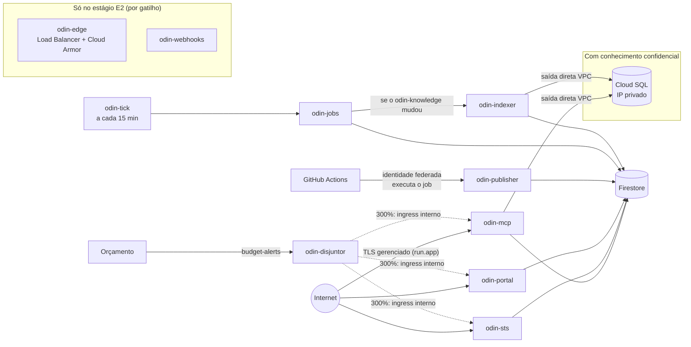
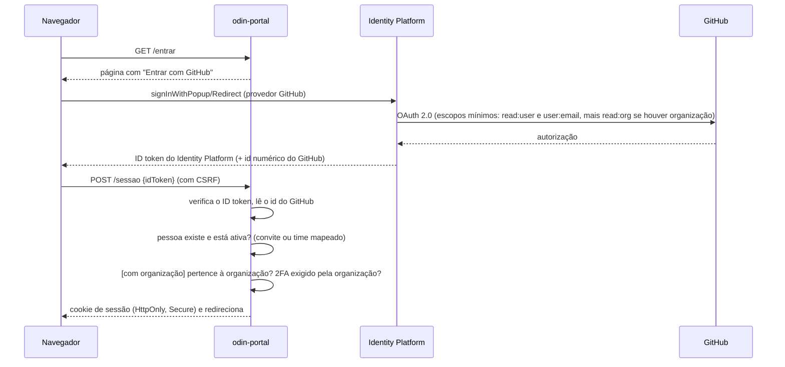
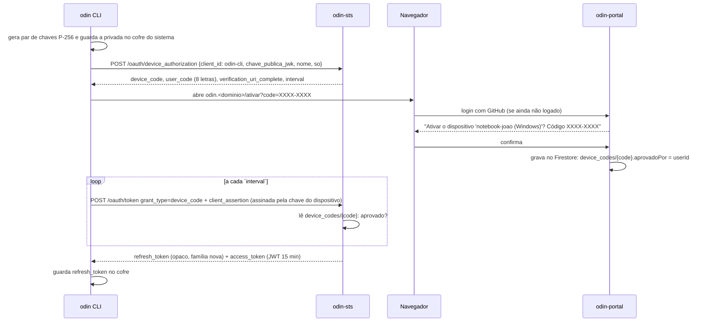
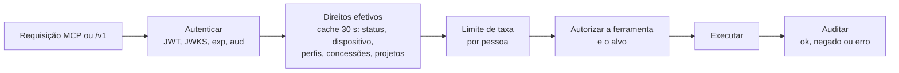

# 03. Arquitetura técnica

> Série: [01 Solução](01-arquitetura-de-solucao.md) · [02 Funcional](02-arquitetura-funcional.md) · **03 Técnica** · [04 Portal e perfilamento](04-portal-e-perfilamento.md) · [05 Custos](05-custos-e-finops.md). Base: [plano](../PLANO.md).
> [VERIFICAR] = confirmar na prova de conceito. Nomes de recursos usam `<amb>` = `poc` ou `prod`. **Estágios de custo** E0 (prova de conceito), E1 (time) e E2 (corporativo) em [05 Custos](05-custos-e-finops.md): um recurso pago só entra por gatilho (ADR 0018).

## 1. Inventário de recursos do Google Cloud

| Recurso | Nome | Configuração | Para quê |
|---|---|---|---|
| Projeto | `odin-<amb>` | Um por ambiente; APIs habilitadas pelo Terraform | Isolamento |
| Região | `southamerica-east1` | Todos os recursos regionais | Residência de dados, latência |
| **Cloud Run (serviço)** | `odin-mcp` | Node 22, 1 vCPU, 512 MiB, concorrência 80, **min 0, max 3** (E0 e E1), reforço de CPU na inicialização, cobrança por requisição | Orquestrador MCP + API `/v1` |
| Cloud Run (serviço) | `odin-sts` | Node 22, 1 vCPU, 512 MiB, min 0, max 3 | Device flow, tokens, JWKS |
| Cloud Run (serviço) | `odin-portal` | Next.js, 1 vCPU, 1 GiB, min 0, max 3 | UI + BFF administrativo + download do CLI |
| **Cloud Run (job)** | `odin-publisher` | 1 vCPU, 512 MiB; executado pelo CI depois de assinar | **Confere a assinatura do manifesto** e registra a versão no catálogo; calcula os embeddings das intenções |
| Cloud Run (job) | `odin-indexer` | 2 vCPU, 2 GiB, tempo máximo 60 min | Ingestão do RAG |
| Cloud Run (job) | `odin-jobs` | 1 vCPU, 512 MiB; executado pelo `odin-tick` | Rotinas: sincronizar times, expirar concessões, verificar mudança no `odin-knowledge`, teste sintético, agregados de consumo, exportações, relatório do auditor |
| Imagens | 4 (`mcp`, `sts`, `portal`, `jobs`) | Os três jobs usam a **mesma imagem** com tarefas diferentes e **contas de serviço diferentes** | Menos para construir e manter |
| Cloud Scheduler | `odin-tick` | Um agendamento, a cada 15 min | Executa o `odin-jobs`, que decide o que está vencido |
| Pub/Sub | `budget-alerts` | Único tópico do desenho | Avisos do orçamento para o disjuntor |
| Cloud Run (função) | `odin-disjuntor` | Acionada por `budget-alerts`; min 0 | Fecha o ingress dos serviços públicos a 300% do orçamento ([05 Custos](05-custos-e-finops.md), seção 5) |
| Verificações de disponibilidade | Cloud Monitoring | `/healthz` de cada serviço, a cada 5 min | Disponibilidade vista de fora (faixa gratuita) |
| **Load Balancer** — só E2 | `odin-edge` | HTTPS externo global, backends serverless (NEG), certificado gerenciado | Borda única, por gatilho |
| **Cloud Armor** — só E2 | `odin-edge-policy` | Regras OWASP pré-configuradas, limite de taxa por IP | WAF, por gatilho |
| Cloud DNS — só com domínio próprio | `odin-<dominio>` | `odin.`, `mcp.`, `auth.` | Domínios |
| `odin-webhooks` — só E2 | Cloud Run (serviço) | 0,5 vCPU, 256 MiB, min 0 | Eventos do GitHub em segundos (em E1, varredura de 15 min) |
| **Identity Platform** | — | Provedor **GitHub** (OAuth App do GitHub), opcional Google e Microsoft; domínios autorizados | Login das pessoas |
| **Firestore** (nativo) | `(default)` | Modo nativo, `southamerica-east1`; E0: exportação diária para bucket (30 dias); E1: PITR de 7 dias + exportação; CMEK só em E2 (precisa ser definido na criação do banco) [VERIFICAR na região] | Identidade, acesso, catálogo, revogações |
| **Firestore (busca vetorial)** — E0 e E1 sem conhecimento confidencial | coleções `kb_chunks_<projeto>`, `routing_intents` | Índice vetorial, filtros por coleção e projeto; isolamento na aplicação (coleção por projeto); **sem conhecimento confidencial** | RAG e roteamento (decisões 7 e 43) |
| **Cloud SQL** — por gatilho (primeiro conhecimento `confidencial`) | `odin-kb-<amb>` | PostgreSQL 16, **IP privado apenas**, extensão `vector`, autenticação IAM, backup diário de 7 dias. E1: menor instância de núcleo compartilhado, disco de 10 GB, **sem alta disponibilidade e sem réplica** (o RAG se refaz do Git); E2: dimensionado pela carga | RAG e roteamento com segunda barreira no banco |
| VPC — só com Cloud SQL | `odin-vpc` | Sub-rede regional; Cloud Run com **saída direta para VPC** (sem conector e sem Cloud NAT) | Acesso privado ao Cloud SQL |
| **Cloud Storage** | `odin-bundles-<amb>` | Versionamento, retenção de 365 dias, acesso uniforme, prevenção de acesso público; objetos por hash (runtime igual não é enviado nem baixado de novo); CMEK só em E2 | Pacotes assinados |
| Cloud Storage | `odin-kb-snapshots-<amb>` | Versionamento, ciclo de vida de 180 dias | Cópia do que foi ingerido |
| Cloud Storage | `odin-tfstate-<amb>` | Versionamento, acesso só do CI de infraestrutura | Estado do Terraform |
| Cloud Storage | `odin-cli-<amb>` | **Privado** (prevenção de acesso público mantida), escrita só pelo CI, versionamento | Binários do CLI. O download é servido pelo **portal** (`/download/cli/<versao>/<plataforma>`), sem login, porque o binário não é segredo e os repositórios são privados (decisão 5) |
| Cloud KMS | chave `cli-signing` | Assimétrica P-256 | Assinatura dos binários do CLI (autoatualização) |
| **Cloud KMS** | chaveiro `odin` | `bundle-signing` e `jwt-signing` (assimétricas, `EC_SIGN_P256_SHA256`, em software em E0 e E1, HSM em E2); `campos` (simétrica, envelope do segredo TOTP); `cmek` só em E2 | Assinatura de pacotes, JWT e criptografia de campos |
| **Secret Manager** | `github-app-key`, `github-oauth-client-secret`, `session-secret` (e `github-webhook-secret` só em E2) | Replicação na região, versões com rotação | Segredos |
| Artifact Registry | `odin-images` | Docker, varredura de vulnerabilidades, **política de limpeza** (3 últimas versões; sem tag após 7 dias) | Imagens dos serviços |
| Vertex AI | — | Modelo de embeddings de texto multilíngue [VERIFICAR o nome atual do modelo e a disponibilidade na região] | Vetores do RAG e do roteamento |
| **BigQuery** | `odin_audit`, `odin_metrics` | Partição por dia, expiração de partição em 365 dias, acesso por papel; tabela agregada diária para o portal, consultas com limite de bytes | Auditoria e métricas |
| Cloud Logging | coletor `odin-audit-sink` | Filtro por `jsonPayload.tipo="auditoria"` → BigQuery; exclusão dos logs de verificação de saúde | Trilha de auditoria |
| Cloud Monitoring | painéis e alertas | SLOs por serviço | Operação |
| **Workload Identity Federation** | pool `github`, provedor `github-oidc` | Emissor `https://token.actions.githubusercontent.com`, com condição por dono, repositório e ref | CI sem chave |
| Binary Authorization (E2) | política `odin` | Só imagens atestadas pelo CI | Cadeia de suprimentos |
| Security Command Center | nível padrão | Achados de configuração | Postura |
| Orçamento | `odin-<amb>-budget` | Alertas em 50%, 90%, 100%, 200% e 300% (e-mail + `budget-alerts`) | Custo, com disjuntor |

## 2. Rede e borda



- **Endereços:** em E0 e E1, os endereços `run.app` de cada serviço (TLS gerenciado pelo Google). O CLI não fixa endereços: lê `/.well-known/odin-configuration` do portal (emissor, MCP, STS, versão mínima do CLI), e o token aceita dois valores de `aud` durante uma troca de domínio. Domínio próprio em E1, se desejado, sem Load Balancer ([05 Custos](05-custos-e-finops.md), seção 6).
- **Ingress:** em E0 e E1 os três serviços têm ingress público; a proteção fica na autenticação de toda rota útil, na validação de entrada por schema, nos limites por pessoa e por IP no próprio serviço, no **teto de 3 instâncias** e no **disjuntor**. Os jobs não têm porta: são executados pelo CI ou pelo `odin-tick`, por IAM. Em E2, os serviços aceitam tráfego **só do Load Balancer**, para que o Cloud Armor não possa ser contornado.
- **Rotas públicas sem token de pessoa** (toda a superfície anônima): `/entrar`, `/ativar` e `/download/cli/*` no portal; `/oauth/device_authorization`, `/oauth/token` e `/.well-known/*` no STS; `/healthz`. Cada uma com limite por IP (30/min nos fluxos de login e ativação).
- **Sem webhooks em E0 e E1:** nenhuma porta recebe eventos do GitHub. Mudanças de time e de organização são lidas pela varredura do `odin-jobs` (GitHub App), a cada 15 min.
- **TLS:** 1.2+; HSTS no portal.

## 3. Serviços e contas de serviço (mínimo privilégio)

| Serviço | Conta de serviço | Papéis (escopo mínimo) |
|---|---|---|
| `odin-mcp` | `sa-mcp` | `datastore.user`; `cloudsql.client` + usuário IAM no banco (somente leitura no RAG); `storage.objectViewer` no bucket de pacotes; `iam.serviceAccountTokenCreator` **em si mesma** (para gerar URLs assinadas); `kms` **verificador** na chave `jwt-signing` (ou JWKS em cache); `aiplatform.user` (embedding da consulta) |
| `odin-sts` | `sa-sts` | `datastore.user`; `cloudkms.signerVerifier` **só** na chave `jwt-signing`; `cloudkms.cryptoKeyEncrypterDecrypter` **só** na chave `campos` |
| `odin-portal` | `sa-portal` | `datastore.user`; `firebaseauth.admin` (verificar ID tokens e cookies de sessão); `bigquery.dataViewer` + `jobUser` nos conjuntos de auditoria e de métricas (auditor e consumo); `secretmanager.secretAccessor` em `session-secret` e `github-app-key`; `storage.objectViewer` no bucket `odin-cli-<amb>` (download do CLI) |
| `odin-publisher` (job) | `sa-publisher` | `datastore.user` (só coleções do catálogo, imposto pela aplicação); `storage.objectViewer` no bucket de pacotes (lê o manifesto); `cloudkms.publicKeyViewer` em `bundle-signing` (confere a assinatura); `aiplatform.user` (embeddings das intenções) |
| `odin-indexer` (job) | `sa-indexer` | `datastore.user` nas coleções do RAG (ou `cloudsql.client` + usuário IAM com escrita, quando houver Cloud SQL); `aiplatform.user`; `storage.objectAdmin` no bucket de snapshots; `secretmanager.secretAccessor` em `github-app-key` |
| `odin-jobs` (job) | `sa-jobs` | `datastore.user`; `secretmanager.secretAccessor` em `github-app-key`; `run.invoker` no job `odin-indexer`; `bigquery.dataEditor` na tabela agregada |
| `odin-tick` (Scheduler) | `sa-tick` | `run.invoker` **só** no job `odin-jobs` |
| `odin-disjuntor` (função) | `sa-disjuntor` | `run.services.update` (papel próprio) **só** em `odin-mcp`, `odin-sts` e `odin-portal` |
| CI: deploy de serviços | `sa-ci-deploy` | `run.developer` nos serviços do Odin; `artifactregistry.writer`; `iam.serviceAccountUser` nas contas de execução |
| CI: assinatura de pacotes | `sa-ci-signer` | `cloudkms.signerVerifier` **só** em `bundle-signing`; `storage.objectCreator` no bucket de pacotes; executar o job `odin-publisher` com argumentos (`run.jobs.runWithOverrides`) |
| CI: infraestrutura | `sa-ci-infra` | Papéis administrativos para Terraform, **só** a partir de `main` do repositório Odin e **só** quando o disparo é do mantenedor (condição no `actor_id`; no GitHub Free não há ambiente com aprovação) |

Nenhuma conta de serviço tem chave exportada. Os papéis amplos (`owner`, `editor`) não são usados em nenhum lugar, nem por pessoas no dia a dia: administradores usam papéis específicos e elevação temporária quando necessário.

## 4. Dados: onde fica cada coisa

### 4.1 Mapa de armazenamento

| Dado | Onde | Retenção | Proteção |
|---|---|---|---|
| Código do Odin, catálogo (`catalog/`), políticas do guard | GitHub (repositório Odin) | Histórico Git | Só o mantenedor escreve (GitHub Free, decisão 41); PR com CI verde; publicação só com assinatura no KMS |
| Fonte das skills e agentes | GitHub (repositório de cada skill) | Histórico Git | Idem |
| Fonte do conhecimento | GitHub (`odin-knowledge`) | Histórico Git | Idem; conteúdo `confidencial` em repositório **privado** |
| Pacotes assinados (conteúdo, runtime, políticas, agentes, `ODIN.md`) | Cloud Storage `odin-bundles-<amb>` | 365 dias por versão | URL assinada por pessoa (5 min), versionamento (CMEK em E2) |
| Índice do catálogo (versões, canais, hashes, manifestos) | Firestore `catalog_*` | Enquanto existir a versão | Escrita só pelo job `odin-publisher`, depois de conferir a assinatura |
| Pessoas, squads, projetos, perfis, concessões, solicitações | Firestore | Enquanto ativos; pseudonimização na exclusão | Regras de acesso, só pelos serviços |
| Dispositivos (chave pública, hash da credencial) | Firestore `devices` | Até revogar + 90 dias | Nunca guarda a credencial em claro |
| Revogações | Firestore `revocations` (com TTL) | Até o fim da validade do que foi revogado | — |
| Trechos do conhecimento e vetores | Firestore `kb_chunks_<projeto>`; Cloud SQL `kb_*` quando houver conhecimento confidencial | Enquanto vigentes; histórico marcado | Firestore: isolamento na aplicação. Cloud SQL: IP privado e segurança em nível de linha |
| Índice de roteamento (intenções das skills) | Firestore `routing_intents` (ou Cloud SQL `routing_*`) | Por versão do catálogo | Idem |
| Cópia do que foi ingerido | Cloud Storage `odin-kb-snapshots-<amb>` | 180 dias | Acesso só do indexer |
| Auditoria | Cloud Logging → BigQuery `odin_audit` | 365 dias | Acesso só do papel auditor e super-admin |
| Métricas | BigQuery `odin_metrics` + Cloud Monitoring | 13 meses | — |
| Segredos | Secret Manager | Versões com rotação | IAM por segredo, logs de acesso |
| Chaves | Cloud KMS | Rotação (seção 8.2) | Não exportáveis; HSM em E2 |
| Na máquina do usuário | `~/.odin/` (runtime, políticas, cache cifrado, `ODIN.md`), cofre do sistema (credencial e chave do dispositivo) | Até `odin uninstall` | Assinatura conferida; guard protege as pastas |

### 4.2 Firestore: modelo
```
users/{userId}                 githubId (número), githubLogin, nome, email?, status (ativo|suspenso|saiu),
                               policyVersion, adminRoles[], criadoEm, ultimoAcesso
squads/{squadId}               nome, projetos[], perfisPermitidos[], gestores[], githubTeam? (org/slug)
memberships/{userId_squadId}   perfis[], origem (portal|github), desde, expiraEm?
projects/{projectId}           nome, cliente, classificacao (interna|confidencial)
profiles/{profileId}           skills[], colecoes {nome: ler|propor|curar}, canais[]
grants/{grantId}               userId, alvo (skill|colecao), nivel, projeto?, motivo, aprovadoPor, expiraEm
access_requests/{id}           userId, alvo, motivo, prazo, status, decididoPor, decididoEm
admin_changes/{id}             tipo, alvo, antes, depois, pedidoPor, aprovadoPor?, status   (quatro olhos)
devices/{deviceId}             userId, nome, so, chavePublicaJwk, refreshHash, familia, criadoEm, ultimoUso, ip, status
device_codes/{code}            userCodeHash, deviceId, expiraEm (TTL 10 min), aprovadoPor?
pats/{id}                      userId, hash, escopos[], expiraEm, ultimoUso
revocations/{id}               tipo (usuario|dispositivo|familia|jti|global), alvo, ate (TTL)
catalog_skills/{skillId}       nome, dominio, estado, canais {beta: versao, stable: versao}
catalog_versions/{skillId@ver} sha, manifestoUri, manifestoHash, assinatura, publicadoEm, publicadoPor (run do CI)
catalog_events/{id}            ciclo de vida das skills (portal 07): incorporada, versão, promoção, rollback, perfil, depreciação, retirada, proibição
mcp_tools/{versaoServidor}     metadados das ferramentas MCP (gravado pelo odin-mcp; lido pelo guia do portal)
quotas/{userId}/{dia}          contador diário de requisições (incremento atômico)
quota_rules/{id}               cotas por perfil, squad ou pessoa (portal 06)
proposals/{id}                 colecao, projeto, texto, fonte, origem (skill|pessoa), status, curador, prUrl?
settings/global                ttls, limites, provedores habilitados, mensagem de manutenção
policy_versions/{n}            versões da matriz perfil × skill × coleção (portal 09)
notifications/{userId}/{id}    avisos do portal (portal 08)
review_campaigns/{id}          revisão trimestral de acessos (segurança RB-12)
```
- **Acesso:** os clientes nunca leem o Firestore direto. As regras de segurança negam tudo para clientes, e só as contas de serviço acessam.
- **Cache de direitos:** o `odin-mcp` monta os "direitos efetivos" de cada pessoa a partir de `users`, `memberships`, `profiles`, `grants` e `projects`, e os guarda em memória por 30 s, chaveados por `userId` + `policyVersion`. Qualquer mudança administrativa incrementa o `policyVersion` da pessoa (ou de todos os membros de um squad).

### 4.3 Cloud SQL: RAG e roteamento
```sql
CREATE EXTENSION IF NOT EXISTS vector;

CREATE TABLE kb_documents (
  id text PRIMARY KEY,               -- ex.: TEC-APEX-012
  colecao text NOT NULL,             -- funcional | negocio | tecnico | licoes | dados
  projeto text NOT NULL,             -- 'global' ou id do projeto
  tipo text NOT NULL, autoridade int NOT NULL,
  vigencia_de date, vigencia_ate date, substituido_por text,
  sensibilidade text NOT NULL, fonte_repo text, fonte_sha text, fonte_caminho text,
  atualizado_em timestamptz NOT NULL DEFAULT now()
);

CREATE TABLE kb_chunks (
  id bigserial PRIMARY KEY,
  documento_id text REFERENCES kb_documents(id) ON DELETE CASCADE,
  colecao text NOT NULL, projeto text NOT NULL,          -- repetidos para a política de linha
  secao text, ordem int, texto text NOT NULL,
  tsv tsvector GENERATED ALWAYS AS (to_tsvector('portuguese', texto)) STORED,
  embedding vector(768) NOT NULL                          -- dimensão conforme o modelo escolhido [VERIFICAR]
);
CREATE INDEX ON kb_chunks USING hnsw (embedding vector_cosine_ops);
CREATE INDEX ON kb_chunks USING gin (tsv);

-- Segurança em nível de linha: o odin-mcp define, por transação, os projetos e coleções permitidos
ALTER TABLE kb_chunks ENABLE ROW LEVEL SECURITY;
CREATE POLICY leitura_por_direito ON kb_chunks FOR SELECT USING (
  projeto = ANY (string_to_array(current_setting('odin.projetos', true), ','))
  AND colecao = ANY (string_to_array(current_setting('odin.colecoes', true), ','))
);

CREATE TABLE routing_intents (
  skill_id text, versao text, canal text, dominio text,
  texto text NOT NULL, embedding vector(768) NOT NULL
);
```
- **Busca híbrida:** combinação da similaridade vetorial com a busca textual (`ts_rank`) por fusão de ranking (RRF), depois o filtro de vigência e precedência (autoridade, `substituido_por`).
- **Usuários do banco:** `odin_mcp` (só `SELECT`, sujeito à política de linha, **sem** `BYPASSRLS`) e `odin_indexer` (escrita). Os dois por autenticação IAM, sem senha.
- **Teste obrigatório:** no CI, uma consulta com os projetos de A não pode retornar nenhuma linha de B. O teste roda num **contêiner Postgres + pgvector** do próprio CI, com o mesmo esquema e as mesmas políticas: não exige banco pago ligado.

### 4.3.1 RAG no Firestore e troca para o Cloud SQL
- O `odin-mcp` e o `odin-indexer` falam com o RAG por uma interface única (`KnowledgeStore`: `upsert`, `search`, `purgeProject`). Em E0, e em E1 enquanto não houver conhecimento confidencial, a implementação é o **Firestore com busca vetorial**; o **Cloud SQL** do esquema acima entra pelo gatilho de [05 Custos](05-custos-e-finops.md), seção 3.
- No Firestore: uma coleção por projeto (`kb_chunks_<projeto>`), filtro obrigatório de coleção e projeto na aplicação, só busca vetorial (sem a textual), e **nenhum conhecimento confidencial**.
- Troca: configuração (`ODIN_KB_BACKEND=cloudsql`) + cópia dos trechos e vetores pelo `odin-indexer` + reexecução da avaliação de recuperação e dos testes de isolamento. Sem mudança no código das ferramentas MCP.

### 4.3.2 Cópia local para o modo degradado (decisão 14)
- O pacote assinado do runtime passa a incluir também o **conteúdo** da skill (`SKILL.md`, referências, regras).
- Se o Odin estiver indisponível, o CLI entrega o conteúdo local à skill **por até 7 dias** desde o último contato bem-sucedido, só para skills que a pessoa tinha direito de usar nesse contato.
- Ao reconectar, o direito é conferido de novo e as cópias de skills revogadas são apagadas.

### 4.3.3 Versão fixa por sessão (decisão 15)
- A primeira chamada de uma skill numa sessão do Claude Code fixa a versão (conteúdo e runtime) para aquela sessão (`session_id` do Claude Code repassado pelo CLI quando disponível [VERIFICAR]; senão, por processo).
- Versões antigas do runtime ficam em disco enquanto houver sessão usando; o `odin ensure` limpa as sem uso há 24 h.
- Versão proibida bloqueia **imediatamente**, mesmo no meio da sessão.

### 4.4 BigQuery: auditoria
Tabela `odin_audit.eventos` (a partir do coletor): `ts`, `servico`, `ator` (userId ou conta de serviço), `dispositivo`, `acao` (por exemplo `mcp.rotear`, `mcp.carregar_skill`, `sts.token`, `admin.grant.create`), `alvo`, `resultado` (`ok`|`negado`|`erro`), `motivo`, `ip`, `ua`, `latencia_ms`, `skill`, `versao`, `request_id`, `antes`/`depois` (ações administrativas). **Sem** o texto do pedido (RN-13).

## 5. Identidade e autenticação

### 5.1 Matriz de métodos

| Quem → onde | Método | Credencial | Validade |
|---|---|---|---|
| Pessoa → portal | **OIDC/OAuth 2.0 com GitHub** via Identity Platform **+ segundo fator do Odin** (TOTP obrigatório; passkey obrigatória para administradores); depois cookie de sessão | Cookie de sessão `HttpOnly`, `Secure`, `SameSite=Lax`, com proteção CSRF | 8 h; ações administrativas exigem login com menos de 15 min (reautenticação) |
| CLI → STS (ativação) | **Device Authorization Grant (RFC 8628)**, aprovado no portal | Credencial de dispositivo opaca + par de chaves do dispositivo (P-256) no cofre do sistema | Família de até 90 dias, rotativa a cada uso, revogada sem uso por 30 dias |
| CLI → STS (renovação) | `refresh_token` + **prova de posse** (JWT assinado pela chave do dispositivo, no estilo `private_key_jwt`, RFC 7523) | — | — |
| Claude Code → MCP | **Bearer JWT** (ES256) via `headersHelper` (`odin token`) | Token de acesso | 15 min |
| CLI → `/v1` | Mesmo Bearer JWT | — | 15 min |
| CLI → Cloud Storage | **URL assinada** emitida pelo `/v1` por pessoa e por pacote | — | 5 min |
| Exceção sem CLI | **Token pessoal** gerado no portal, enviado como `Authorization: Bearer odin_pat_...` | Token opaco (só o hash fica guardado) | ≤ 90 dias |
| Evolução | **OAuth 2.1 do MCP** (STS como servidor de autorização: RFC 8414, RFC 9728, PKCE, registro de cliente) | — | — |
| GitHub Actions → Google Cloud | **Workload Identity Federation** (OIDC do GitHub) | Token federado de curta duração | ~1 h |
| Google Cloud → GitHub | **GitHub App**: JWT assinado com a chave do app → token de instalação | Token de instalação | 1 h |
| GitHub → webhooks (só E2) | **HMAC SHA-256** (`X-Hub-Signature-256`) + faixa de IP | Segredo compartilhado | Rotação semestral |
| CI ou agendador → job | **IAM do Cloud Run** (`run.invoker` no job) | Token da conta de serviço | ~1 h |
| Serviço → serviço | **IAM do Cloud Run** (ID token da conta de serviço) | ID token | ~1 h |
| Serviço → Cloud SQL | **Autenticação IAM do banco** | Token IAM | ~1 h |

### 5.2 Login no portal com GitHub


- **Segundo fator:** depois do GitHub, o portal exige o fator do Odin (TOTP ou passkey) antes de criar a sessão. Detalhes em [segurança 02](../seguranca/02-autenticacao-e-mfa.md).
- **Chave da pessoa:** o id numérico do GitHub (`providerData[github.com].uid`), nunca o login.
- **Primeiro acesso:** só entra quem foi **convidado** (pelo login do GitHub, resolvido para o id no aceite) ou quem pertence a um **time do GitHub mapeado** a um squad. Os demais veem "sem acesso; peça a um administrador".
- **2FA:** a organização do GitHub deve exigir 2FA (configuração da organização). Na conta pessoal da prova de conceito, o portal mostra o aviso e o administrador decide. [VERIFICAR] como confirmar o 2FA de um membro pela API (depende de permissões de dono da organização).
- **Token do GitHub:** o portal não guarda o token OAuth do GitHub. Pertença a times e à organização é consultada pelo **GitHub App** (seção 7.2), não com o token da pessoa.

### 5.3 Ativação do CLI (device flow com chave do dispositivo)


- **Proteções:** `user_code` expira em 10 min e só vale uma vez; a tela mostra nome, sistema, IP e localização aproximada do dispositivo; limite de tentativas no `/ativar`.
- **Renovação:** `POST /oauth/token grant_type=refresh_token` + `client_assertion` assinada pela chave do dispositivo. O STS confere a assinatura com a chave pública registrada. Uma credencial roubada sem a chave privada não renova.
- **Rotação com detecção de reuso:** cada renovação emite um `refresh_token` novo e invalida o anterior. Se um anterior for reapresentado, **toda a família** (o dispositivo) é revogada e um alerta é gerado.

### 5.4 Token de acesso (JWT)
```json
{
  "iss": "https://auth.<dominio>",
  "aud": "https://mcp.<dominio>",
  "sub": "usr_8f2c...",          // id interno da pessoa
  "client_id": "odin-cli",
  "gh": 1234567,                 // id numérico do GitHub
  "dev": "dev_41a9...",          // dispositivo
  "fam": "fam_77b0...",          // família do refresh token
  "pv": 17,                      // policyVersion no momento da emissão
  "amr": ["github", "otp"], "acr": "N1",
  "iat": 1760000000, "nbf": 1760000000, "exp": 1760000900, "jti": "…"
}
```
- Cabeçalho `{"alg":"ES256","typ":"at+jwt","kid":"…"}`. Lista completa de validações em [segurança 03, seção 2.2](../seguranca/03-tokens-sessoes-e-chaves.md).
- **Sem perfis dentro do token** (ADR-05). O MCP resolve os direitos no servidor, com cache de 30 s. Se o `pv` do token for menor que o atual da pessoa, os direitos usados são **os atuais** (nunca os antigos).
- Assinado com `jwt-signing` (KMS, ES256). As chaves públicas ficam em `https://auth.<dominio>/.well-known/jwks.json`, com cache de 10 min no MCP. A rotação mantém duas chaves publicadas durante a troca.
- O `odin token` imprime `{"Authorization":"Bearer <jwt>","X-Odin-Runtime":"<caminho>","X-Odin-Cli":"<versão>"}` e guarda o JWT em cache até faltar 2 min para expirar.

### 5.5 Revogação (≤ 30 s)
- **Tipos:** pessoa, dispositivo, família, `jti` e global (incidente).
- **Mecanismo:** o MCP e o `/v1` consultam o status da pessoa e do dispositivo junto com os direitos (o mesmo cache de 30 s). Revogar = mudar o status no Firestore + incrementar o `policyVersion`. O STS deixa de renovar na hora.
- **Revogação global:** o super-admin grava no portal `revocations/global` com um **carimbo de tempo**. O MCP recusa todo token com `iat` anterior ao carimbo, e o STS recusa toda credencial de dispositivo emitida antes dele. Todos os CLIs pedem login de novo. O portal **não** precisa de permissão no KMS. A troca da chave de JWT, se o incidente envolver a chave, é feita à parte por runbook, com papel de KMS concedido temporariamente.

### 5.6 Evolução: OAuth 2.1 do MCP
O `odin-sts` já publica `/.well-known/oauth-authorization-server` (RFC 8414) e o `odin-mcp` publica `/.well-known/oauth-protected-resource` (RFC 9728). Para habilitar o login nativo do Claude Code (`/mcp` → navegador), falta implementar o endpoint de autorização com PKCE e o registro de cliente (dinâmico ou por documento de metadados de cliente). Mantido como evolução (ADR-12).

## 6. Orquestrador (`odin-mcp`)

### 6.1 Pipeline de cada requisição

- **Transporte:** Streamable HTTP em modo **sem estado** (sem `Mcp-Session-Id` com afinidade) e com **resposta JSON por requisição**: o servidor não abre fluxo SSE permanente (`GET` no endpoint MCP responde `405`) e não envia notificações iniciadas pelo servidor. Motivo: com cobrança por requisição, um fluxo aberto manteria a instância cobrada o dia todo. [VERIFICAR na F0] a compatibilidade com o Claude Code.
- **Contrato das ferramentas** em `schemas/mcp-tools.json` (entrada, saída estruturada e anotações `readOnlyHint`/`idempotentHint`); o servidor carrega as definições desse arquivo, e o CI valida.
- **Instruções do servidor:** até 4.096 caracteres (o gatilho do plano, seção 7.6), versionadas com o catálogo.
- **Limite de taxa e cota:** limite por minuto conforme o perfil e por IP nas rotas anônimas (em memória por instância; com o teto de 3 instâncias, o erro máximo é de 3 vezes o limite) e cota diária por pessoa (contada em memória e gravada no Firestore em lote, a cada 30 s ou 20 chamadas), definidos em [portal 06](../portal/06-consumo-cotas-e-metricas.md). Em E2, o Cloud Armor cuida do volume por IP.

### 6.2 Ferramentas MCP (contratos)
| Ferramenta | Entrada (resumo) | Saída (resumo) | Autorização |
|---|---|---|---|
| `odin_rotear` | `pedido` (texto), `artefatos[]` (caminhos), `skill_atual?` | `candidatas[] {skill, subskill?, confianca, motivo}` ou `{nao_sei, pergunta}` | Só skills dos direitos efetivos |
| `odin_carregar_skill` | `skill`, `subskill?` | `conteudo` (SKILL.md com `{{ODIN_RUNTIME}}` resolvido), `manifesto {versao, runtime_min, prerequisitos, agentes, proximos, colecoes}`, `regras` | Skill nos direitos; canal conforme o perfil |
| `odin_ler_referencia` | `skill`, `caminho`, `pagina?` | `conteudo`, `pagina`, `total` | Idem |
| `odin_conhecimento_buscar` | `consulta`, `colecoes[]?`, `projeto?`, `tipo?`, `limite≤10` | `trechos[] {texto, citacao {documento, secao, versao, vigencia}, evidencia: true}` | Política de linha no banco |
| `odin_conhecimento_propor` | `colecao`, `projeto`, `texto`, `fonte`, `tipo` | `{proposta_id, status: "na_fila"}` | Direito `propor` na coleção |
| `odin_proximo_passo` | `artefatos[]` | `{skill, motivo}` ou `{fim}` | Só skills permitidas |
| `odin_feedback` | `request_id`, `nota`, `comentario?` | `{ok}` | Autenticado |

Toda resposta respeita o teto de 8.000 tokens (plano, seção 10). Erros têm código estável: `sem_acesso`, `skill_inexistente`, `versao_indisponivel`, `limite_excedido`, `revogado`, `manutencao`.

### 6.3 API REST `/v1` (usada pelo CLI)
| Método e caminho | Uso |
|---|---|
| `GET /v1/me` | Pessoa, squads, perfis e direitos efetivos (para o `doctor`) |
| `GET /v1/manifest/{skill}` | Manifesto assinado da versão vigente para a pessoa |
| `POST /v1/bundles/{skill}/{versao}/url` | URL assinada (5 min) do pacote |
| `GET /v1/policies` | Manifesto das políticas do guard e do `ODIN.md` |
| `POST /v1/telemetry` | Eventos do CLI (versões instaladas, falhas de `ensure`, guard inativo) |

### 6.4 Roteamento
1. Candidatas = skills dos direitos efetivos (filtro por perfil, canal e domínio).
2. Embedding do pedido (Vertex AI, com cache de 10 min por texto normalizado) → similaridade com `routing_intents` das candidatas (embeddings das intenções calculados na publicação).
3. Regras por artefato: por exemplo, `backlog.json` presente e spec ausente aumentam a nota do Journey Designer.
4. Limiar de confiança (inicial 0,55, calibrado pelos testes de intenção); abaixo dele, `nao_sei`.
5. Métricas: escolha aceita, troca de skill logo depois, feedback.

## 7. Integração GitHub ↔ Google Cloud

### 7.1 GitHub → Google Cloud (Workload Identity Federation)
```hcl
# Terraform (resumo)
resource "google_iam_workload_identity_pool" "github" { workload_identity_pool_id = "github" }

resource "google_iam_workload_identity_pool_provider" "github_oidc" {
  workload_identity_pool_id          = google_iam_workload_identity_pool.github.workload_identity_pool_id
  workload_identity_pool_provider_id = "github-oidc"
  oidc { issuer_uri = "https://token.actions.githubusercontent.com" }
  attribute_mapping = {
    "google.subject"       = "assertion.sub"
    "attribute.repository" = "assertion.repository"
    "attribute.ref"        = "assertion.ref"
    "attribute.owner"      = "assertion.repository_owner"
  }
  # Só repositórios do dono do Odin
  attribute_condition = "assertion.repository_owner == '<dono-github>'"
  # GitHub Free (decisão 41): as condições por conta de serviço também exigem
  # assertion.actor_id == '<id-numerico-do-mantenedor>' e assertion.ref == 'refs/heads/main'
}
```
Vínculos (quem pode virar qual conta de serviço):
| Conta de serviço | Só pode ser usada por |
|---|---|
| `sa-ci-signer` | Workflow `publish.yml` do **repositório Odin**, em `refs/heads/main` |
| `sa-ci-deploy` | Workflow `deploy.yml` do repositório Odin, em `main` ou tags `v*`, **disparado pelo mantenedor** (condição no `actor_id` do token OIDC do GitHub) |
| `sa-ci-infra` | Workflow `infra.yml` do repositório Odin, em `main`, **disparado manualmente pelo mantenedor** (condição no `actor_id`) |

Os repositórios de skills **não** têm acesso ao Google Cloud. Eles só publicam código e tags. Quem publica no Odin é o pipeline do repositório Odin, a partir do catálogo, que fixa o SHA de cada skill.

### 7.2 Google Cloud → GitHub (GitHub App `odin-squad`)
| Permissão | Nível | Para quê |
|---|---|---|
| Metadata | leitura | Obrigatória |
| Contents | leitura | Ler `odin-knowledge` (indexer) e os **repositórios privados das skills** (pipeline de publicação, por token de instalação gerado no próprio workflow) |
| Pull requests | escrita | Abrir PR de conhecimento aprovado no portal (curadoria) e PRs de catálogo (promover, rollback, depreciar, retirar) a partir do portal |
| Contents (repositório Odin) | escrita; o portal só cria branches `portal/*` (imposto no código do portal, porque o GitHub Free não tem regra de proteção em repositório privado) | Criar a branch do PR de catálogo; o merge é do mantenedor, com o CI verde; nada é publicado sem a assinatura do pipeline em `main` |
| Members (organização) | leitura | Sincronizar times → squads |
| Eventos de webhook (só E2) | `membership`, `organization` (membro removido), `team` | Saída de pessoas em segundos; em E0 e E1 não há webhooks |

- A chave privada do app fica no Secret Manager (`github-app-key`), com rotação semestral. Só `odin-indexer`, `odin-jobs` e `odin-portal` a leem.
- **Risco assumido:** como o app tem escrita de conteúdo no repositório Odin, uma falha no portal poderia gravar na `main`. Compensações: publicação só pelo workflow `publish.yml` disparado pelo mantenedor (condição `actor_id` na identidade federada), assinatura no KMS, e alerta de push na `main` que não seja do mantenedor.
- Instalado só nos repositórios necessários (Odin, `odin-knowledge`) e, com organização, na organização para a leitura de membros.
- **Na conta pessoal (prova de conceito):** o app funciona para conteúdo e PRs; times e membros só existem em organização.

### 7.3 Sincronização com o GitHub (sem webhooks em E0 e E1)
A cada 15 min o `odin-tick` executa o `odin-jobs`, que, pelo GitHub App:
- **times e organização** (quando houver organização): compara os membros dos times mapeados com as pertenças; quem saiu do time perde a pertença, e quem saiu da organização é suspenso e tem os dispositivos revogados (RN-07). Toda mudança incrementa o `policyVersion`;
- **conhecimento:** compara o SHA da `main` do `odin-knowledge` com o último indexado; se mudou, executa o `odin-indexer`. O portal tem o botão "indexar agora" para o curador;
- **demais rotinas:** expirar concessões e convites, teste sintético de ponta a ponta, agregados de consumo, exportação diária do Firestore.

A revogação imediata continua no portal (≤ 30 s). O atraso de até 15 min vale só para a saída detectada pelo GitHub (risco R21). **Em E2**, o `odin-webhooks` pode receber `membership`, `team` e `organization` (HMAC `X-Hub-Signature-256`, faixa de IP do GitHub, `X-GitHub-Delivery` para não repetir) e executar o `odin-jobs` na hora; a varredura continua como reconciliação.

### 7.4 Pipelines (GitHub Actions, no repositório Odin)
> Repositórios privados (decisão 5): o `publish.yml` lê os repositórios das skills com um **token de instalação do GitHub App** gerado no próprio workflow (o `GITHUB_TOKEN` só lê o repositório onde roda). A chave do app usada pelo CI fica num segredo do repositório Odin (no Free não há segredo de ambiente com aprovação em repositório privado).
| Workflow | Gatilho | Faz |
|---|---|---|
| `ci.yml` | Todo PR | Lint, testes, schemas, conformidade (inclusive de custo), testes de política, testes de autorização do RAG (contêiner Postgres + pgvector), `terraform plan`. Windows em todo PR; macOS só em release e semanal (minutos do GitHub Free) |
| `publish.yml` | Merge em `catalog/` na `main` | Baixa skills no SHA, valida, testa, roda as avaliações determinísticas, `odin lint` (inclui Unicode oculto), empacota com dependências, **assina (KMS)**, envia ao bucket, executa o job `odin-publisher` (que confere a assinatura e registra), smoke test de roteamento. No PR de promoção para `stable`, confere `evals/resultado.json` do SHA (ADR 0017) |
| `knowledge.yml` (no `odin-knowledge`) | PR e merge | Valida frontmatter, PII, injeção e Unicode oculto, roda a avaliação de recuperação; depois do merge, a varredura de 15 min (ou o botão "indexar agora") executa o indexer. O repositório de conhecimento não tem acesso ao Google Cloud |
| `deploy.yml` | Tag `v*` | Build das imagens, SBOM, atestação de origem, envio ao Artifact Registry, deploy no Cloud Run sem tráfego, fumaça, migração de tráfego e rollback automático (E2: Binary Authorization) |
| `cli-release.yml` | Tag `cli-v*` | Binários do CLI por plataforma, checksums, **assinatura no KMS** (`cli-signing`), envio ao bucket privado `odin-cli-<amb>`, atualização do script de instalação servido pelo portal com o checksum fixado; atestação de origem do GitHub quando disponível no plano [VERIFICAR para repositório privado] |
| `infra.yml` | Disparo manual do mantenedor após merge em `infra/` | `terraform apply` (no Free não há ambientes com aprovação em repositório privado; a condição da identidade federada exige o mantenedor) |

## 8. Segurança

> Detalhamento completo (modelo de ameaças, MFA, tokens, autorização, cadeia de suprimentos, endpoint, infraestrutura, LGPD, resposta a incidentes, controles e runbooks) na pasta [`docs/seguranca/`](../seguranca/README.md). Em caso de diferença, vale a pasta de segurança.

### 8.1 Controles por camada
| Camada | Controles |
|---|---|
| Borda | E0 e E1: `run.app` com TLS gerenciado, autenticação em toda rota útil, limites no serviço, teto de instâncias e disjuntor de custo; nenhuma porta de webhook. E2: Cloud Armor (OWASP, limite de taxa), ingress só pelo Load Balancer |
| Identidade | GitHub com 2FA (organização), convites, mapeamento por id numérico, reautenticação para administração, conta de emergência com alerta |
| Sessão do portal | Cookie `HttpOnly`/`Secure`, CSRF, CSP estrita, `X-Frame-Options: DENY`, `Referrer-Policy`, expiração de 8 h |
| Tokens | JWT de 15 min, assinado no KMS; renovação com prova de posse; rotação com detecção de reuso; revogação ≤ 30 s |
| Autorização | Negado por padrão; direitos no servidor; quatro olhos em papéis administrativos; separação de funções |
| Dados | Firestore fechado para clientes; campos sensíveis com envelope no KMS; Cloud SQL só com IP privado e segurança em nível de linha (quando houver conhecimento confidencial); CMEK em E2 |
| Cadeia de suprimentos | Pacotes e dependências assinados; assinatura conferida de novo no registro (`odin-publisher`) e na máquina (CLI); imagens com SBOM e varredura (Binary Authorization em E2); Dependabot; só o mantenedor escreve (compensações do GitHub Free em [segurança 05](../seguranca/05-cadeia-de-suprimentos.md)) |
| Máquina | Guard fail-closed, blocos protegidos, verificação de assinatura, credencial no cofre do sistema |
| Detecção | Logs de auditoria do Google Cloud (atividade administrativa + acesso a dados em KMS e Secret Manager), alertas de reuso de credencial, de picos de recusa e de publicação fora do pipeline, Security Command Center |
| Resposta | Revogação por pessoa, dispositivo ou global; troca de chaves; runbooks (plano, F8) |

### 8.2 Chaves e segredos
| Item | Tipo | Rotação | Quem usa |
|---|---|---|---|
| `bundle-signing` | KMS assimétrica P-256 (HSM em E2) | Anual, com o CLI aceitando 2 chaves na transição | `sa-ci-signer` assina; o CLI verifica |
| `jwt-signing` | KMS assimétrica P-256 | Semestral (2 chaves no JWKS) | `sa-sts` assina; `odin-mcp` verifica |
| `campos` | KMS simétrica | Anual | Envelope do segredo TOTP (`odin-sts`) |
| `cmek` (só E2) | KMS simétrica | 90 dias automática | Cloud Storage, Cloud SQL |
| `github-app-key` | Secret Manager | Semestral | indexer, jobs, portal |
| `github-webhook-secret` (só E2) | Secret Manager | Semestral | webhooks |
| `github-oauth-client-secret` | Identity Platform | Anual | Identity Platform |
| `session-secret` | Secret Manager | Trimestral | portal |

### 8.3 LGPD e privacidade
- Dados pessoais mínimos: id e login do GitHub, nome, e-mail (opcional), IP e agente do dispositivo.
- Auditoria sem o texto dos pedidos; amostragem só se habilitada, com máscara de PII.
- Exclusão de pessoa: dados de identidade apagados e auditoria pseudonimizada (o id é trocado por um hash).
- Conhecimento `confidencial` só em repositório privado e só depois do Cloud SQL com segurança em nível de linha.
- Região única no Brasil.

## 9. Máquina do usuário

### 9.1 CLI `odin`
- Node 22 empacotado como executável único por plataforma (para não depender do Node do usuário). [VERIFICAR] a ferramenta de empacotamento.
- Cofre: macOS Keychain, Windows Credential Manager, Linux libsecret. Sem cofre disponível → arquivo cifrado com permissão `0600` e aviso.
- Comandos: `setup`, `login`, `logout`, `token`, `ensure <skill>`, `doctor` (inclui remover cópias antigas de skills dos projetos, com confirmação e arquivamento), `guard-ping`, `update`, `uninstall`, `restore-copias` (plano de volta do corte, 30 dias), `dev validate|try` (mantenedores).
- Autoatualização: baixa pelo portal (`/download/cli/...`) e confere a **assinatura do KMS** (`cli-signing`, chave pública embutida) e o checksum antes de trocar o binário.

### 9.2 Registro no Claude Code
```bash
claude mcp add --transport http --scope user odin https://mcp.<dominio>/mcp
# o CLI acrescenta à entrada do servidor:  "headersHelper": "odin token"
```

### 9.3 Isolamento (plano, seção 22)
Escreve só em `~/.odin/`, `~/.claude/agents/odin-*`, `~/.claude/skills/odin/`, nos blocos marcados de `~/.claude/settings.json` e `~/.claude/CLAUDE.md`, e no registro do MCP em `~/.claude.json`. **Nunca** no projeto.

## 10. Observabilidade

| Sinal | Fonte | Uso |
|---|---|---|
| Logs estruturados | Todos os serviços (JSON com `request_id`, `ator`, `acao`, `resultado`, `latencia_ms`) | Depuração e auditoria |
| Métricas | Cloud Monitoring (latência, erros, instâncias) + métricas próprias (roteamento, `ensure`, guard) | SLOs e painéis |
| Rastreamento | Cloud Trace (OpenTelemetry) | Latência entre serviços |
| Auditoria | BigQuery | Auditor, relatórios |

**SLOs (decisão 32: horário comercial, sem plantão):**

| Serviço | Disponibilidade | Latência (instância já ativa) | Partida a frio |
|---|---|---|---|
| `odin-mcp` | 99,5% | p95 < 300 ms | p95 da primeira chamada ≤ 3 s |
| `odin-sts` | 99,5% | p95 < 200 ms | ≤ 3 s (o token em cache de 15 min absorve) |
| `odin-portal` | 99,5% | p95 < 1 s por página | ≤ 5 s |
| Busca no RAG | 99% | p95 < 800 ms | — |

- **Orçamento de erro:** 0,5% do horário comercial do mês (cerca de 1 h). Estourou → congelar mudanças que não sejam correção até voltar à meta.
- **Partida a frio** é medida na F8. Se o p95 da primeira chamada passar de 3 s por 2 semanas, liga-se instância quente **só no `odin-mcp`** (gatilho de [05 Custos](05-custos-e-finops.md)).
- O modo degradado de 7 dias (decisão 14) cobre a indisponibilidade para as skills já usadas.

**Alertas:** erro > 2% em 5 min; reuso de credencial (imediato); uso da conta de emergência (imediato); assinatura inválida reportada por CLI; runtime divergente (DT-19); publicação fora do pipeline; picos de `negado`; orçamento em 50%, 90%, 100%, 200% e 300% (disjuntor).

## 11. Infraestrutura como código

```
infra/
  modules/
    run/            serviços, jobs e função do Cloud Run (módulo genérico; min, max e ingress vêm do estágio)
    data/           Firestore, buckets, BigQuery (e Cloud SQL + VPC, só quando o gatilho disparar)
    security/       KMS, Secret Manager, contas de serviço e IAM
    identity/       Identity Platform (provedores, domínios)
    wif/            pool e provedor do GitHub, vínculos
    observability/  coletor de logs, verificações de disponibilidade, painéis, alertas
    finops/         orçamento, tópico budget-alerts, disjuntor, limpeza do Artifact Registry
    edge/           só E2: Load Balancer, NEGs, Cloud Armor, certificado, DNS, webhooks
  envs/
    poc/            main.tf com estagio = "e0", terraform.tfvars (sem segredos)
    prod/           estagio = "e1" (ou "e2", por gatilho)
```
- **Estágio como variável:** os módulos recebem `estagio` e recusam, por validação do Terraform, o que não pertence a ele (por exemplo, `min_instance_count > 0` em `e0`). O CI repete a checagem (CF-11 a CF-14).
- Estado no bucket `odin-tfstate-<amb>` com versionamento e trava.
- **Desenvolvimento local** (decisão 34): emuladores do Firestore e do Identity Platform (Firebase Local Emulator Suite), servidor MCP e portal rodando localmente, e um JWKS de teste; o ambiente de teste na nuvem é criado junto com a produção.
- Segredos nunca no Terraform: o Terraform cria o segredo vazio, e o valor entra por um runbook ou pelo console, com auditoria.

## 12. Continuidade e backup

| Componente | Backup | Recuperação |
|---|---|---|
| Firestore | Exportação diária para bucket (30 dias); PITR de 7 dias a partir do E1 | Importar a exportação ou restaurar ponto no tempo |
| Cloud SQL (quando houver) | Backup automático diário (7 dias) | Restaurar o backup **ou reindexar do Git** (caminho principal: cerca de 1 h) |
| Cloud Storage | Versionamento + retenção | Restaurar versão |
| Conhecimento | Fonte no GitHub | Reindexar do zero com o `odin-indexer` |
| Catálogo | Fonte no GitHub + pacotes no bucket | Republicar pelo pipeline |
| Infraestrutura | Terraform | `apply` em projeto novo |

Metas: RTO de 4 h; RPO de 24 h para dados de controle em E0 (exportação diária) e de 1 h a partir do E1 (PITR). Catálogo e conhecimento têm RPO zero na prática, porque a fonte é o Git. Exercício de restauração a cada semestre.

## 13. Custo

Modelo completo, estágios, gatilhos, teto e disjuntor em [05 Custos e FinOps](05-custos-e-finops.md). Resumo:

| Estágio | Meta por mês | O que paga |
|---|---|---|
| E0 Prova de conceito | ≤ US$ 3 (alerta em US$ 5) | KMS, embeddings, rede |
| E1 Time | ≤ US$ 25 (alerta em US$ 40) | O mesmo, mais Cloud SQL mínimo quando houver conhecimento confidencial |
| E2 Corporativo | Orçado por gatilho | Load Balancer, Cloud Armor, instância quente, alta disponibilidade, HSM |

## 14. Pontos a verificar na prova de conceito
0. **Prioridade da F0** (decisões 23 e 24): **Windows nativo** e **extensão do VS Code** primeiro.
0b. Onde o Claude Code guarda o token OAuth do MCP oficial da Atlassian em cada sistema (o login pelo navegador já funciona no time), para a política PG-01 do guard cobrir o local certo.
1. Modo sem estado do Streamable HTTP com o Claude Code (6.1).
2. Disponibilidade em `southamerica-east1` de Identity Platform, Vertex AI (modelo de embeddings) e CMEK no Firestore.
3. Nome e dimensão do modelo de embeddings multilíngue atual.
4. Como verificar o 2FA de membros pela API do GitHub com as permissões do app.
5. Ferramenta de empacotamento do CLI como executável único com acesso ao cofre do sistema.
6. Preços de Identity Platform, Cloud KMS e Cloud SQL em `southamerica-east1` ([05 Custos](05-custos-e-finops.md)).
6b. MCP com resposta JSON e sem fluxo SSE (`GET` → 405) no Claude Code; latência de partida a frio dos três serviços.
6c. Firebase Hosting na frente do Cloud Run na região (domínio próprio sem Load Balancer).
7. Itens do plano: `headersHelper` na extensão do VS Code, busca de ferramentas via LiteLLM, importação `@~/` no `CLAUDE.md`.
