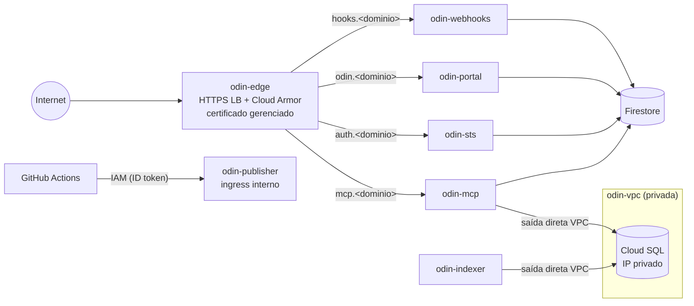
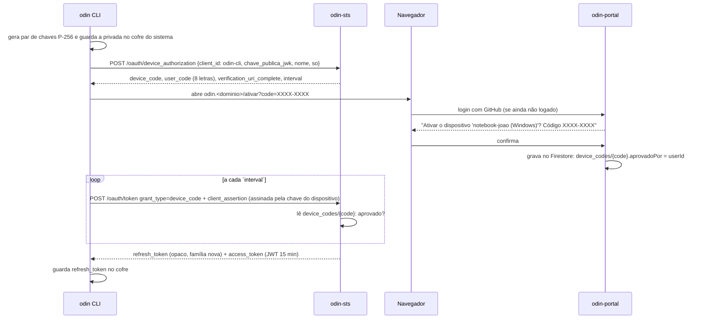
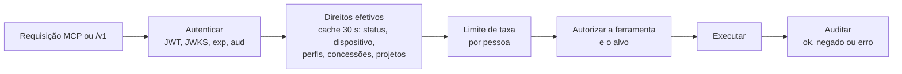

# 03. Arquitetura técnica

> Série: [01 Solução](01-arquitetura-de-solucao.md) · [02 Funcional](02-arquitetura-funcional.md) · **03 Técnica** · [04 Portal e perfilamento](04-portal-e-perfilamento.md). Base: [plano](../PLANO.md).
> [VERIFICAR] = confirmar na prova de conceito. Nomes de recursos usam `<amb>` = `poc` ou `prod`.

## 1. Inventário de recursos do Google Cloud

| Recurso | Nome | Configuração | Para quê |
|---|---|---|---|
| Projeto | `odin-<amb>` | Um por ambiente; APIs habilitadas pelo Terraform | Isolamento |
| Região | `southamerica-east1` | Todos os recursos regionais | Residência de dados, latência |
| **Cloud Run (serviço)** | `odin-mcp` | Node 22, 1 vCPU, 512 MiB, concorrência 80, min 0 (poc) / 1 (prod), max 20, ingress "interno + Load Balancer" | Orquestrador MCP + API `/v1` |
| Cloud Run (serviço) | `odin-sts` | Node 22, 1 vCPU, 512 MiB, min 0/1, max 10 | Device flow, tokens, JWKS |
| Cloud Run (serviço) | `odin-portal` | Next.js, 1 vCPU, 1 GiB, min 0/1, max 10 | UI + BFF administrativo |
| Cloud Run (serviço) | `odin-webhooks` | Node 22, 0,5 vCPU, 256 MiB, min 0, max 5 | Eventos do GitHub |
| Cloud Run (serviço) | `odin-publisher` | Node 22, 0,5 vCPU, 256 MiB, min 0, max 3, **ingress interno**, invocação só por IAM | Registro de versões publicadas |
| **Cloud Run (job)** | `odin-indexer` | 2 vCPU, 2 GiB, tempo máximo 60 min | Ingestão do RAG, índice de roteamento |
| Cloud Run (job) | `odin-jobs` | 1 vCPU, 512 MiB | Sincronização de times, expirações, exportações, auditor |
| Cloud Scheduler | `odin-sync-*` | Cron por tarefa | Disparar `odin-jobs` |
| Pub/Sub | `catalog-published`, `knowledge-changed`, `identity-events`, `github-events` | Com fila de mensagens mortas | Eventos assíncronos |
| **Load Balancer** | `odin-edge` | HTTPS externo global (Application LB), backends serverless (NEG), certificado gerenciado | Borda única |
| **Cloud Armor** | `odin-edge-policy` | Regras OWASP pré-configuradas, limite de taxa por IP, bloqueio por país opcional | WAF |
| Cloud DNS | `odin-<dominio>` | `odin.`, `mcp.`, `auth.`, `hooks.` | Domínios |
| **Identity Platform** | — | Provedor **GitHub** (OAuth App do GitHub), opcional Google e Microsoft; domínios autorizados | Login das pessoas |
| **Firestore** (nativo) | `(default)` | Modo nativo, `southamerica-east1`, PITR ligado, CMEK [VERIFICAR suporte de CMEK no Firestore na região] | Identidade, acesso, catálogo, revogações |
| **Cloud SQL** | `odin-kb-<amb>` | PostgreSQL 16, **IP privado apenas**, extensão `vector`, autenticação IAM, backups + PITR; poc: menor instância de núcleo compartilhado, prod: 2 vCPU com alta disponibilidade | RAG e roteamento |
| VPC | `odin-vpc` | Sub-rede regional; Cloud Run com **saída direta para VPC** | Acesso privado ao Cloud SQL |
| **Cloud Storage** | `odin-bundles-<amb>` | Versionamento, retenção de 365 dias, acesso uniforme, prevenção de acesso público, CMEK | Pacotes assinados |
| Cloud Storage | `odin-kb-snapshots-<amb>` | Versionamento, ciclo de vida de 180 dias | Cópia do que foi ingerido |
| Cloud Storage | `odin-tfstate-<amb>` | Versionamento, acesso só do CI de infraestrutura | Estado do Terraform |
| **Cloud KMS** | chaveiro `odin` | `bundle-signing` (assimétrica, `EC_SIGN_P256_SHA256`, HSM em prod); `jwt-signing` (assimétrica, `EC_SIGN_P256_SHA256`); `cmek` (simétrica, rotação de 90 dias) | Assinatura de pacotes, JWT e criptografia |
| **Secret Manager** | `github-app-key`, `github-webhook-secret`, `github-oauth-client-secret`, `session-secret` | Replicação na região, versões com rotação | Segredos |
| Artifact Registry | `odin-images` | Docker, varredura de vulnerabilidades | Imagens dos serviços |
| Vertex AI | — | Modelo de embeddings de texto multilíngue [VERIFICAR o nome atual do modelo e a disponibilidade na região] | Vetores do RAG e do roteamento |
| **BigQuery** | `odin_audit`, `odin_metrics` | Partição por dia, retenção de 365 dias, acesso por papel | Auditoria e métricas |
| Cloud Logging | coletor `odin-audit-sink` | Filtro por `jsonPayload.tipo="auditoria"` → BigQuery | Trilha de auditoria |
| Cloud Monitoring | painéis e alertas | SLOs por serviço | Operação |
| **Workload Identity Federation** | pool `github`, provedor `github-oidc` | Emissor `https://token.actions.githubusercontent.com`, com condição por dono, repositório e ref | CI sem chave |
| Binary Authorization (prod) | política `odin` | Só imagens atestadas pelo CI | Cadeia de suprimentos |
| Security Command Center | nível padrão | Achados de configuração | Postura |
| Orçamento | `odin-<amb>-budget` | Alertas em 50%, 90% e 100% | Custo |

## 2. Rede e borda



- **Domínios:** `odin.<dominio>` (portal), `mcp.<dominio>` (MCP e `/v1`), `auth.<dominio>` (STS), `hooks.<dominio>` (webhooks). Na prova de conceito, os endereços `run.app` servem; a borda entra antes de chamar o time.
- **Ingress:** os serviços públicos aceitam tráfego **só do Load Balancer** (configuração de ingress do Cloud Run), para que o Cloud Armor não possa ser contornado. O `odin-publisher` é interno e exige IAM.
- **Cloud Armor:** regras OWASP (injeção de SQL, XSS, LFI, RCE); limite de 300 requisições/min por IP no MCP e de 30/min nos endpoints de token e ativação; `hooks.` aceita apenas as faixas de IP do GitHub (publicadas em `api.github.com/meta`, atualizadas por job) além da assinatura HMAC.
- **TLS:** 1.2+ com política moderna; HSTS no portal.

## 3. Serviços e contas de serviço (mínimo privilégio)

| Serviço | Conta de serviço | Papéis (escopo mínimo) |
|---|---|---|
| `odin-mcp` | `sa-mcp` | `datastore.user`; `cloudsql.client` + usuário IAM no banco (somente leitura no RAG); `storage.objectViewer` no bucket de pacotes; `iam.serviceAccountTokenCreator` **em si mesma** (para gerar URLs assinadas); `kms` **verificador** na chave `jwt-signing` (ou JWKS em cache); `aiplatform.user` (embedding da consulta) |
| `odin-sts` | `sa-sts` | `datastore.user`; `cloudkms.signerVerifier` **só** na chave `jwt-signing` |
| `odin-portal` | `sa-portal` | `datastore.user`; `firebaseauth.admin` (verificar ID tokens e cookies de sessão); `bigquery.dataViewer` + `jobUser` nos conjuntos de auditoria e de métricas (auditor e consumo); `secretmanager.secretAccessor` em `session-secret` e `github-app-key` |
| `odin-webhooks` | `sa-webhooks` | `secretmanager.secretAccessor` em `github-webhook-secret`; `pubsub.publisher` em `github-events` |
| `odin-publisher` | `sa-publisher` | `datastore.user` (só coleção do catálogo, imposto pelas regras da aplicação); `pubsub.publisher` em `catalog-published` |
| `odin-indexer` | `sa-indexer` | `cloudsql.client` + usuário IAM com escrita no RAG; `aiplatform.user`; `storage.objectAdmin` no bucket de snapshots; `secretmanager.secretAccessor` em `github-app-key` |
| `odin-jobs` | `sa-jobs` | `datastore.user`; `secretmanager.secretAccessor` em `github-app-key`; `pubsub.publisher` em `identity-events` |
| CI: deploy de serviços | `sa-ci-deploy` | `run.developer` nos serviços do Odin; `artifactregistry.writer`; `iam.serviceAccountUser` nas contas de execução |
| CI: assinatura de pacotes | `sa-ci-signer` | `cloudkms.signerVerifier` **só** em `bundle-signing`; `storage.objectCreator` no bucket de pacotes; `run.invoker` no `odin-publisher` |
| CI: infraestrutura | `sa-ci-infra` | Papéis administrativos para Terraform, **só** a partir de `main` do repositório Odin, com aprovação de ambiente no GitHub |

Nenhuma conta de serviço tem chave exportada. Os papéis amplos (`owner`, `editor`) não são usados em nenhum lugar, nem por pessoas no dia a dia: administradores usam papéis específicos e elevação temporária quando necessário.

## 4. Dados: onde fica cada coisa

### 4.1 Mapa de armazenamento

| Dado | Onde | Retenção | Proteção |
|---|---|---|---|
| Código do Odin, catálogo (`catalog/`), políticas do guard | GitHub (repositório Odin) | Histórico Git | Proteção de branch, CODEOWNERS, revisão obrigatória |
| Fonte das skills e agentes | GitHub (repositório de cada skill) | Histórico Git | Idem |
| Fonte do conhecimento | GitHub (`odin-knowledge`) | Histórico Git | Idem; conteúdo `confidencial` em repositório **privado** |
| Pacotes assinados (conteúdo, runtime, políticas, agentes, `ODIN.md`) | Cloud Storage `odin-bundles-<amb>` | 365 dias por versão | CMEK, URL assinada por pessoa (5 min), versionamento |
| Índice do catálogo (versões, canais, hashes, manifestos) | Firestore `catalog_*` | Enquanto existir a versão | Escrita só pelo publisher |
| Pessoas, squads, projetos, perfis, concessões, solicitações | Firestore | Enquanto ativos; pseudonimização na exclusão | Regras de acesso, só pelos serviços |
| Dispositivos (chave pública, hash da credencial) | Firestore `devices` | Até revogar + 90 dias | Nunca guarda a credencial em claro |
| Revogações | Firestore `revocations` (com TTL) | Até o fim da validade do que foi revogado | — |
| Trechos do conhecimento e vetores | Cloud SQL `kb_*` | Enquanto vigentes; histórico marcado | IP privado, segurança em nível de linha, CMEK |
| Índice de roteamento (intenções das skills) | Cloud SQL `routing_*` | Por versão do catálogo | Idem |
| Cópia do que foi ingerido | Cloud Storage `odin-kb-snapshots-<amb>` | 180 dias | CMEK |
| Auditoria | Cloud Logging → BigQuery `odin_audit` | 365 dias | Acesso só do papel auditor e super-admin |
| Métricas | BigQuery `odin_metrics` + Cloud Monitoring | 13 meses | — |
| Segredos | Secret Manager | Versões com rotação | IAM por segredo, logs de acesso |
| Chaves | Cloud KMS | Rotação (seção 8.2) | HSM em produção |
| Na máquina do usuário | `~/.odin/` (runtime, políticas, cache cifrado, `ODIN.md`), cofre do sistema (credencial e chave do dispositivo) | Até `odin uninstall` | Assinatura conferida; guard protege as pastas |

### 4.2 Firestore: modelo
```
users/{userId}                 githubId (número), githubLogin, nome, email?, status (ativo|suspenso|saiu),
                               policyVersion, adminRoles[], criadoEm, ultimoAcesso
squads/{squadId}               nome, projetos[], perfisPermitidos[], gestores[], githubTeam? (org/slug)
memberships/{userId_squadId}   perfis[], origem (portal|github), desde, expiraEm?
projects/{projectId}           nome, cliente, classificacao (interna|confidencial)
profiles/{profileId}           skills[], colecoes {nome: ler|propor|curar}, canais[]
grants/{grantId}               userId, alvo (skill|colecao), nivel, projeto?, motivo, aprovadoPor, expiraEm
access_requests/{id}           userId, alvo, motivo, prazo, status, decididoPor, decididoEm
admin_changes/{id}             tipo, alvo, antes, depois, pedidoPor, aprovadoPor?, status   (quatro olhos)
devices/{deviceId}             userId, nome, so, chavePublicaJwk, refreshHash, familia, criadoEm, ultimoUso, ip, status
device_codes/{code}            userCodeHash, deviceId, expiraEm (TTL 10 min), aprovadoPor?
pats/{id}                      userId, hash, escopos[], expiraEm, ultimoUso
revocations/{id}               tipo (usuario|dispositivo|familia|jti|global), alvo, ate (TTL)
catalog_skills/{skillId}       nome, dominio, estado, canais {beta: versao, stable: versao}
catalog_versions/{skillId@ver} sha, manifestoUri, manifestoHash, assinatura, publicadoEm, publicadoPor (run do CI)
catalog_events/{id}            ciclo de vida das skills (portal 07): incorporada, versão, promoção, rollback, perfil, depreciação, retirada, proibição
mcp_tools/{versaoServidor}     metadados das ferramentas MCP (gravado pelo odin-mcp; lido pelo guia do portal)
quotas/{userId}/{dia}          contador diário de requisições (incremento atômico)
quota_rules/{id}               cotas por perfil, squad ou pessoa (portal 06)
proposals/{id}                 colecao, projeto, texto, fonte, origem (skill|pessoa), status, curador, prUrl?
settings/global                ttls, limites, provedores habilitados, mensagem de manutenção
```
- **Acesso:** os clientes nunca leem o Firestore direto. As regras de segurança negam tudo para clientes, e só as contas de serviço acessam.
- **Cache de direitos:** o `odin-mcp` monta os "direitos efetivos" de cada pessoa a partir de `users`, `memberships`, `profiles`, `grants` e `projects`, e os guarda em memória por 30 s, chaveados por `userId` + `policyVersion`. Qualquer mudança administrativa incrementa o `policyVersion` da pessoa (ou de todos os membros de um squad).

### 4.3 Cloud SQL: RAG e roteamento
```sql
CREATE EXTENSION IF NOT EXISTS vector;

CREATE TABLE kb_documents (
  id text PRIMARY KEY,               -- ex.: TEC-APEX-012
  colecao text NOT NULL,             -- funcional | negocio | tecnico | licoes | dados
  projeto text NOT NULL,             -- 'global' ou id do projeto
  tipo text NOT NULL, autoridade int NOT NULL,
  vigencia_de date, vigencia_ate date, substituido_por text,
  sensibilidade text NOT NULL, fonte_repo text, fonte_sha text, fonte_caminho text,
  atualizado_em timestamptz NOT NULL DEFAULT now()
);

CREATE TABLE kb_chunks (
  id bigserial PRIMARY KEY,
  documento_id text REFERENCES kb_documents(id) ON DELETE CASCADE,
  colecao text NOT NULL, projeto text NOT NULL,          -- repetidos para a política de linha
  secao text, ordem int, texto text NOT NULL,
  tsv tsvector GENERATED ALWAYS AS (to_tsvector('portuguese', texto)) STORED,
  embedding vector(768) NOT NULL                          -- dimensão conforme o modelo escolhido [VERIFICAR]
);
CREATE INDEX ON kb_chunks USING hnsw (embedding vector_cosine_ops);
CREATE INDEX ON kb_chunks USING gin (tsv);

-- Segurança em nível de linha: o odin-mcp define, por transação, os projetos e coleções permitidos
ALTER TABLE kb_chunks ENABLE ROW LEVEL SECURITY;
CREATE POLICY leitura_por_direito ON kb_chunks FOR SELECT USING (
  projeto = ANY (string_to_array(current_setting('odin.projetos', true), ','))
  AND colecao = ANY (string_to_array(current_setting('odin.colecoes', true), ','))
);

CREATE TABLE routing_intents (
  skill_id text, versao text, canal text, dominio text,
  texto text NOT NULL, embedding vector(768) NOT NULL
);
```
- **Busca híbrida:** combinação da similaridade vetorial com a busca textual (`ts_rank`) por fusão de ranking (RRF), depois o filtro de vigência e precedência (autoridade, `substituido_por`).
- **Usuários do banco:** `odin_mcp` (só `SELECT`, sujeito à política de linha, **sem** `BYPASSRLS`) e `odin_indexer` (escrita). Os dois por autenticação IAM, sem senha.
- **Teste obrigatório:** no CI, uma consulta com os projetos de A não pode retornar nenhuma linha de B.

### 4.4 BigQuery: auditoria
Tabela `odin_audit.eventos` (a partir do coletor): `ts`, `servico`, `ator` (userId ou conta de serviço), `dispositivo`, `acao` (por exemplo `mcp.rotear`, `mcp.carregar_skill`, `sts.token`, `admin.grant.create`), `alvo`, `resultado` (`ok`|`negado`|`erro`), `motivo`, `ip`, `ua`, `latencia_ms`, `skill`, `versao`, `request_id`, `antes`/`depois` (ações administrativas). **Sem** o texto do pedido (RN-13).

## 5. Identidade e autenticação

### 5.1 Matriz de métodos

| Quem → onde | Método | Credencial | Validade |
|---|---|---|---|
| Pessoa → portal | **OIDC/OAuth 2.0 com GitHub** via Identity Platform **+ segundo fator do Odin** (TOTP obrigatório; passkey obrigatória para administradores); depois cookie de sessão | Cookie de sessão `HttpOnly`, `Secure`, `SameSite=Lax`, com proteção CSRF | 8 h; ações administrativas exigem login com menos de 15 min (reautenticação) |
| CLI → STS (ativação) | **Device Authorization Grant (RFC 8628)**, aprovado no portal | Credencial de dispositivo opaca + par de chaves do dispositivo (P-256) no cofre do sistema | Família de até 90 dias, rotativa a cada uso, revogada sem uso por 30 dias |
| CLI → STS (renovação) | `refresh_token` + **prova de posse** (JWT assinado pela chave do dispositivo, no estilo `private_key_jwt`, RFC 7523) | — | — |
| Claude Code → MCP | **Bearer JWT** (ES256) via `headersHelper` (`odin token`) | Token de acesso | 15 min |
| CLI → `/v1` | Mesmo Bearer JWT | — | 15 min |
| CLI → Cloud Storage | **URL assinada** emitida pelo `/v1` por pessoa e por pacote | — | 5 min |
| Exceção sem CLI | **Token pessoal** gerado no portal, enviado como `Authorization: Bearer odin_pat_...` | Token opaco (só o hash fica guardado) | ≤ 90 dias |
| Evolução | **OAuth 2.1 do MCP** (STS como servidor de autorização: RFC 8414, RFC 9728, PKCE, registro de cliente) | — | — |
| GitHub Actions → Google Cloud | **Workload Identity Federation** (OIDC do GitHub) | Token federado de curta duração | ~1 h |
| Google Cloud → GitHub | **GitHub App**: JWT assinado com a chave do app → token de instalação | Token de instalação | 1 h |
| GitHub → webhooks | **HMAC SHA-256** (`X-Hub-Signature-256`) + faixa de IP | Segredo compartilhado | Rotação semestral |
| Serviço → serviço | **IAM do Cloud Run** (ID token da conta de serviço) | ID token | ~1 h |
| Serviço → Cloud SQL | **Autenticação IAM do banco** | Token IAM | ~1 h |

### 5.2 Login no portal com GitHub

```mermaid
sequenceDiagram
  participant B as Navegador
  participant P as odin-portal
  participant IP as Identity Platform
  participant GH as GitHub
  B->>P: GET /entrar
  P-->>B: página com "Entrar com GitHub"
  B->>IP: signInWithPopup/Redirect (provedor GitHub)
  IP->>GH: OAuth 2.0 (escopos mínimos: read:user, user:email; read:org se houver organização)
  GH-->>IP: autorização
  IP-->>B: ID token do Identity Platform (+ id numérico do GitHub)
  B->>P: POST /sessao {idToken} (com CSRF)
  P->>P: verifica o ID token, lê o id do GitHub
  P->>P: pessoa existe e está ativa? (convite ou time mapeado)
  P->>P: [com organização] pertence à organização? 2FA exigido pela organização?
  P-->>B: cookie de sessão (HttpOnly, Secure) e redireciona
```
- **Segundo fator:** depois do GitHub, o portal exige o fator do Odin (TOTP ou passkey) antes de criar a sessão. Detalhes em [segurança 02](../seguranca/02-autenticacao-e-mfa.md).
- **Chave da pessoa:** o id numérico do GitHub (`providerData[github.com].uid`), nunca o login.
- **Primeiro acesso:** só entra quem foi **convidado** (pelo login do GitHub, resolvido para o id no aceite) ou quem pertence a um **time do GitHub mapeado** a um squad. Os demais veem "sem acesso; peça a um administrador".
- **2FA:** a organização do GitHub deve exigir 2FA (configuração da organização). Na conta pessoal da prova de conceito, o portal mostra o aviso e o administrador decide. [VERIFICAR] como confirmar o 2FA de um membro pela API (depende de permissões de dono da organização).
- **Token do GitHub:** o portal não guarda o token OAuth do GitHub. Pertença a times e à organização é consultada pelo **GitHub App** (seção 7.2), não com o token da pessoa.

### 5.3 Ativação do CLI (device flow com chave do dispositivo)


- **Proteções:** `user_code` expira em 10 min e só vale uma vez; a tela mostra nome, sistema, IP e localização aproximada do dispositivo; limite de tentativas no `/ativar`.
- **Renovação:** `POST /oauth/token grant_type=refresh_token` + `client_assertion` assinada pela chave do dispositivo. O STS confere a assinatura com a chave pública registrada. Uma credencial roubada sem a chave privada não renova.
- **Rotação com detecção de reuso:** cada renovação emite um `refresh_token` novo e invalida o anterior. Se um anterior for reapresentado, **toda a família** (o dispositivo) é revogada e um alerta é gerado.

### 5.4 Token de acesso (JWT)
```json
{
  "iss": "https://auth.<dominio>",
  "aud": "odin-mcp",
  "sub": "usr_8f2c...",          // id interno da pessoa
  "gh": 1234567,                 // id numérico do GitHub
  "dev": "dev_41a9...",          // dispositivo
  "pv": 17,                      // policyVersion no momento da emissão
  "iat": 1760000000, "exp": 1760000900, "jti": "…"
}
```
- **Sem perfis dentro do token** (ADR-05). O MCP resolve os direitos no servidor, com cache de 30 s. Se o `pv` do token for menor que o atual da pessoa, os direitos usados são **os atuais** (nunca os antigos).
- Assinado com `jwt-signing` (KMS, ES256). As chaves públicas ficam em `https://auth.<dominio>/.well-known/jwks.json`, com cache de 10 min no MCP. A rotação mantém duas chaves publicadas durante a troca.
- O `odin token` imprime `{"Authorization":"Bearer <jwt>","X-Odin-Runtime":"<caminho>","X-Odin-Cli":"<versão>"}` e guarda o JWT em cache até faltar 2 min para expirar.

### 5.5 Revogação (≤ 30 s)
- **Tipos:** pessoa, dispositivo, família, `jti` e global (incidente).
- **Mecanismo:** o MCP e o `/v1` consultam o status da pessoa e do dispositivo junto com os direitos (o mesmo cache de 30 s). Revogar = mudar o status no Firestore + incrementar o `policyVersion`. O STS deixa de renovar na hora.
- **Revogação global:** o super-admin grava no portal `revocations/global` com um **carimbo de tempo**. O MCP recusa todo token com `iat` anterior ao carimbo, e o STS recusa toda credencial de dispositivo emitida antes dele. Todos os CLIs pedem login de novo. O portal **não** precisa de permissão no KMS. A troca da chave de JWT, se o incidente envolver a chave, é feita à parte por runbook, com papel de KMS concedido temporariamente.

### 5.6 Evolução: OAuth 2.1 do MCP
O `odin-sts` já publica `/.well-known/oauth-authorization-server` (RFC 8414) e o `odin-mcp` publica `/.well-known/oauth-protected-resource` (RFC 9728). Para habilitar o login nativo do Claude Code (`/mcp` → navegador), falta implementar o endpoint de autorização com PKCE e o registro de cliente (dinâmico ou por documento de metadados de cliente). Mantido como evolução (ADR-12).

## 6. Orquestrador (`odin-mcp`)

### 6.1 Pipeline de cada requisição

- **Transporte:** Streamable HTTP em modo **sem estado** (sem `Mcp-Session-Id` com afinidade), para escalar no Cloud Run sem sessão. [VERIFICAR] a compatibilidade do modo sem estado com o Claude Code.
- **Instruções do servidor:** até 4.096 caracteres (o gatilho do plano, seção 7.6), versionadas com o catálogo.
- **Limite de taxa e cota:** limite por minuto conforme o perfil (em memória por instância) e cota diária por pessoa (contador no Firestore), definidos em [portal 06](../portal/06-consumo-cotas-e-metricas.md). O Cloud Armor cuida do volume por IP. Em produção, se necessário, um Memorystore para limite global.

### 6.2 Ferramentas MCP (contratos)
| Ferramenta | Entrada (resumo) | Saída (resumo) | Autorização |
|---|---|---|---|
| `odin_rotear` | `pedido` (texto), `artefatos[]` (caminhos), `skill_atual?` | `candidatas[] {skill, subskill?, confianca, motivo}` ou `{nao_sei, pergunta}` | Só skills dos direitos efetivos |
| `odin_carregar_skill` | `skill`, `subskill?` | `conteudo` (SKILL.md com `{{ODIN_RUNTIME}}` resolvido), `manifesto {versao, runtime_min, prerequisitos, agentes, proximos, colecoes}`, `regras` | Skill nos direitos; canal conforme o perfil |
| `odin_ler_referencia` | `skill`, `caminho`, `pagina?` | `conteudo`, `pagina`, `total` | Idem |
| `odin_conhecimento_buscar` | `consulta`, `colecoes[]?`, `projeto?`, `tipo?`, `limite≤10` | `trechos[] {texto, citacao {documento, secao, versao, vigencia}, evidencia: true}` | Política de linha no banco |
| `odin_conhecimento_propor` | `colecao`, `projeto`, `texto`, `fonte`, `tipo` | `{proposta_id, status: "na_fila"}` | Direito `propor` na coleção |
| `odin_proximo_passo` | `artefatos[]` | `{skill, motivo}` ou `{fim}` | Só skills permitidas |
| `odin_feedback` | `request_id`, `nota`, `comentario?` | `{ok}` | Autenticado |

Toda resposta respeita o teto de 8.000 tokens (plano, seção 10). Erros têm código estável: `sem_acesso`, `skill_inexistente`, `versao_indisponivel`, `limite_excedido`, `revogado`, `manutencao`.

### 6.3 API REST `/v1` (usada pelo CLI)
| Método e caminho | Uso |
|---|---|
| `GET /v1/me` | Pessoa, squads, perfis e direitos efetivos (para o `doctor`) |
| `GET /v1/manifest/{skill}` | Manifesto assinado da versão vigente para a pessoa |
| `POST /v1/bundles/{skill}/{versao}/url` | URL assinada (5 min) do pacote |
| `GET /v1/policies` | Manifesto das políticas do guard e do `ODIN.md` |
| `POST /v1/telemetry` | Eventos do CLI (versões instaladas, falhas de `ensure`, guard inativo) |

### 6.4 Roteamento
1. Candidatas = skills dos direitos efetivos (filtro por perfil, canal e domínio).
2. Embedding do pedido (Vertex AI) → similaridade com `routing_intents` das candidatas.
3. Regras por artefato: por exemplo, `backlog.json` presente e spec ausente aumentam a nota do Journey Designer.
4. Limiar de confiança (inicial 0,55, calibrado pelos testes de intenção); abaixo dele, `nao_sei`.
5. Métricas: escolha aceita, troca de skill logo depois, feedback.

## 7. Integração GitHub ↔ Google Cloud

### 7.1 GitHub → Google Cloud (Workload Identity Federation)
```hcl
# Terraform (resumo)
resource "google_iam_workload_identity_pool" "github" { workload_identity_pool_id = "github" }

resource "google_iam_workload_identity_pool_provider" "github_oidc" {
  workload_identity_pool_id          = google_iam_workload_identity_pool.github.workload_identity_pool_id
  workload_identity_pool_provider_id = "github-oidc"
  oidc { issuer_uri = "https://token.actions.githubusercontent.com" }
  attribute_mapping = {
    "google.subject"       = "assertion.sub"
    "attribute.repository" = "assertion.repository"
    "attribute.ref"        = "assertion.ref"
    "attribute.owner"      = "assertion.repository_owner"
  }
  # Só repositórios do dono do Odin
  attribute_condition = "assertion.repository_owner == '<dono-github>'"
}
```
Vínculos (quem pode virar qual conta de serviço):
| Conta de serviço | Só pode ser usada por |
|---|---|
| `sa-ci-signer` | Workflow `publish.yml` do **repositório Odin**, em `refs/heads/main` |
| `sa-ci-deploy` | Workflow `deploy.yml` do repositório Odin, em `main` ou tags `v*`, com aprovação de ambiente |
| `sa-ci-infra` | Workflow `infra.yml` do repositório Odin, em `main`, com aprovação de ambiente |

Os repositórios de skills **não** têm acesso ao Google Cloud. Eles só publicam código e tags. Quem publica no Odin é o pipeline do repositório Odin, a partir do catálogo, que fixa o SHA de cada skill.

### 7.2 Google Cloud → GitHub (GitHub App `odin-squad`)
| Permissão | Nível | Para quê |
|---|---|---|
| Metadata | leitura | Obrigatória |
| Contents | leitura | Ler `odin-knowledge` (indexer) e conferir conteúdo |
| Pull requests | escrita | Abrir PR de conhecimento aprovado no portal (curadoria) e PRs de catálogo (promover, rollback, depreciar, retirar) a partir do portal |
| Contents (repositório Odin) | escrita, **só branches `portal/*`** (regra de proteção) | Criar a branch do PR de catálogo; a `main` continua protegida, com revisão humana e CI |
| Members (organização) | leitura | Sincronizar times → squads |
| Eventos de webhook | `push`, `create` (tags), `membership`, `organization` (membro removido), `team` | Atualização de conhecimento, sincronização de acesso, saída de pessoas |

- A chave privada do app fica no Secret Manager (`github-app-key`), com rotação semestral. Só `odin-indexer`, `odin-jobs` e `odin-portal` a leem.
- Instalado só nos repositórios necessários (Odin, `odin-knowledge`) e, com organização, na organização para a leitura de membros.
- **Na conta pessoal (prova de conceito):** o app funciona para conteúdo e PRs; times e membros só existem em organização.

### 7.3 Webhooks
`odin-webhooks` → confere `X-Hub-Signature-256` com o segredo, confere a origem (faixa do GitHub) e o `X-GitHub-Delivery` (para não processar duas vezes) → publica em `github-events` → `odin-jobs` processa:
- `membership`/`team`: atualiza as pertenças dos squads mapeados e incrementa o `policyVersion`;
- `organization.member_removed`: suspende a pessoa e revoga os dispositivos (RN-07);
- `push` em `odin-knowledge` `main`: dispara o `odin-indexer`.

### 7.4 Pipelines (GitHub Actions, no repositório Odin)
| Workflow | Gatilho | Faz |
|---|---|---|
| `ci.yml` | Todo PR | Lint, testes, testes de política, testes de autorização do RAG, `terraform plan` |
| `publish.yml` | Merge em `catalog/` na `main` | Baixa skills no SHA, valida, testa, `odin lint`, empacota com dependências, **assina (KMS)**, envia ao bucket, chama o publisher, smoke test de roteamento |
| `knowledge.yml` (no `odin-knowledge`) | PR e merge | Valida frontmatter, PII e injeção, roda a avaliação de recuperação; no merge, o webhook dispara o indexer |
| `deploy.yml` | Tag `v*` | Build das imagens, SBOM, atestação de origem, envio ao Artifact Registry, deploy no Cloud Run (prod com Binary Authorization) |
| `cli-release.yml` | Tag `cli-v*` | Binários do CLI por plataforma, checksums, **atestação de origem do GitHub** |
| `infra.yml` | Merge em `infra/` | `terraform apply` com aprovação de ambiente |

## 8. Segurança

> Detalhamento completo (modelo de ameaças, MFA, tokens, autorização, cadeia de suprimentos, endpoint, infraestrutura, LGPD, resposta a incidentes, controles e runbooks) na pasta [`docs/seguranca/`](../seguranca/README.md). Em caso de diferença, vale a pasta de segurança.

### 8.1 Controles por camada
| Camada | Controles |
|---|---|
| Borda | Cloud Armor (OWASP, limite de taxa), TLS gerenciado, ingress só pelo LB, faixas do GitHub nos webhooks |
| Identidade | GitHub com 2FA (organização), convites, mapeamento por id numérico, reautenticação para administração, conta de emergência com alerta |
| Sessão do portal | Cookie `HttpOnly`/`Secure`, CSRF, CSP estrita, `X-Frame-Options: DENY`, `Referrer-Policy`, expiração de 8 h |
| Tokens | JWT de 15 min, assinado no KMS; renovação com prova de posse; rotação com detecção de reuso; revogação ≤ 30 s |
| Autorização | Negado por padrão; direitos no servidor; quatro olhos em papéis administrativos; separação de funções |
| Dados | CMEK em bucket e banco; Cloud SQL só com IP privado; segurança em nível de linha; Firestore fechado para clientes |
| Cadeia de suprimentos | Pacotes e dependências assinados; CLI com atestação; imagens com SBOM, varredura e Binary Authorization; Dependabot; proteção de branch e CODEOWNERS |
| Máquina | Guard fail-closed, blocos protegidos, verificação de assinatura, credencial no cofre do sistema |
| Detecção | Logs de auditoria do Google Cloud (atividade administrativa + acesso a dados em KMS e Secret Manager), alertas de reuso de credencial, de picos de recusa e de publicação fora do pipeline, Security Command Center |
| Resposta | Revogação por pessoa, dispositivo ou global; troca de chaves; runbooks (plano, F8) |

### 8.2 Chaves e segredos
| Item | Tipo | Rotação | Quem usa |
|---|---|---|---|
| `bundle-signing` | KMS assimétrica P-256 (HSM em prod) | Anual, com o CLI aceitando 2 chaves na transição | `sa-ci-signer` assina; o CLI verifica |
| `jwt-signing` | KMS assimétrica P-256 | Semestral (2 chaves no JWKS) | `sa-sts` assina; `odin-mcp` verifica |
| `cmek` | KMS simétrica | 90 dias automática | Cloud Storage, Cloud SQL |
| `github-app-key` | Secret Manager | Semestral | indexer, jobs, portal |
| `github-webhook-secret` | Secret Manager | Semestral | webhooks |
| `github-oauth-client-secret` | Identity Platform | Anual | Identity Platform |
| `session-secret` | Secret Manager | Trimestral | portal |

### 8.3 LGPD e privacidade
- Dados pessoais mínimos: id e login do GitHub, nome, e-mail (opcional), IP e agente do dispositivo.
- Auditoria sem o texto dos pedidos; amostragem só se habilitada, com máscara de PII.
- Exclusão de pessoa: dados de identidade apagados e auditoria pseudonimizada (o id é trocado por um hash).
- Conhecimento `confidencial` só em repositório privado, com CMEK e segurança em nível de linha.
- Região única no Brasil.

## 9. Máquina do usuário

### 9.1 CLI `odin`
- Node 22 empacotado como executável único por plataforma (para não depender do Node do usuário). [VERIFICAR] a ferramenta de empacotamento.
- Cofre: macOS Keychain, Windows Credential Manager, Linux libsecret. Sem cofre disponível → arquivo cifrado com permissão `0600` e aviso.
- Comandos: `setup`, `login`, `logout`, `token`, `ensure <skill>`, `doctor`, `guard-ping`, `update`, `uninstall`, `dev validate|try` (mantenedores).
- Autoatualização: confere a release nova, a atestação e o checksum antes de trocar o binário.

### 9.2 Registro no Claude Code
```bash
claude mcp add --transport http --scope user odin https://mcp.<dominio>/mcp
# o CLI acrescenta à entrada do servidor:  "headersHelper": "odin token"
```

### 9.3 Isolamento (plano, seção 22)
Escreve só em `~/.odin/`, `~/.claude/agents/odin-*`, `~/.claude/skills/odin/`, nos blocos marcados de `~/.claude/settings.json` e `~/.claude/CLAUDE.md`, e no registro do MCP em `~/.claude.json`. **Nunca** no projeto.

## 10. Observabilidade

| Sinal | Fonte | Uso |
|---|---|---|
| Logs estruturados | Todos os serviços (JSON com `request_id`, `ator`, `acao`, `resultado`, `latencia_ms`) | Depuração e auditoria |
| Métricas | Cloud Monitoring (latência, erros, instâncias) + métricas próprias (roteamento, `ensure`, guard) | SLOs e painéis |
| Rastreamento | Cloud Trace (OpenTelemetry) | Latência entre serviços |
| Auditoria | BigQuery | Auditor, relatórios |

**SLOs iniciais:** MCP com 99,5% de disponibilidade e p95 < 300 ms; STS com 99,9% e p95 < 200 ms; busca no RAG com p95 < 800 ms.
**Alertas:** erro > 2% em 5 min; reuso de credencial (imediato); uso da conta de emergência (imediato); assinatura inválida reportada por CLI; publicação fora do pipeline; picos de `negado`; 80% do orçamento.

## 11. Infraestrutura como código

```
infra/
  modules/
    network/        VPC, saída direta, NAT se preciso
    edge/           Load Balancer, NEGs, Cloud Armor, certificado, DNS
    run/            serviços e jobs do Cloud Run (um módulo genérico)
    data/           Firestore, Cloud SQL, buckets, BigQuery
    security/       KMS, Secret Manager, contas de serviço e IAM, Binary Authorization
    identity/       Identity Platform (provedores, domínios)
    wif/            pool e provedor do GitHub, vínculos
    observability/  coletor de logs, painéis, alertas, orçamento
  envs/
    poc/            main.tf, terraform.tfvars (sem segredos)
    prod/
```
- Estado no bucket `odin-tfstate-<amb>` com versionamento e trava.
- Segredos nunca no Terraform: o Terraform cria o segredo vazio, e o valor entra por um runbook ou pelo console, com auditoria.

## 12. Continuidade e backup

| Componente | Backup | Recuperação |
|---|---|---|
| Firestore | PITR (7 dias) + exportação diária para bucket | Restaurar ponto no tempo ou importar exportação |
| Cloud SQL | Backup automático diário + PITR | Clonar no ponto no tempo |
| Cloud Storage | Versionamento + retenção | Restaurar versão |
| Conhecimento | Fonte no GitHub | Reindexar do zero com o `odin-indexer` |
| Catálogo | Fonte no GitHub + pacotes no bucket | Republicar pelo pipeline |
| Infraestrutura | Terraform | `apply` em projeto novo |

Metas: RPO de 1 h e RTO de 4 h. Exercício de restauração a cada semestre.

## 13. Custo estimado da prova de conceito (por mês, estimativa)

| Item | Ordem de grandeza |
|---|---|
| Cloud Run (escala até zero, uso de 3 pessoas) | perto de zero (faixa gratuita) |
| Cloud SQL (menor instância, IP privado) | a maior parte do custo (dezenas de dólares) |
| Firestore, Pub/Sub, Scheduler, Secret Manager | centavos a poucos dólares |
| Cloud KMS (poucas chaves e operações) | poucos dólares |
| Vertex AI (embeddings) | centavos |
| Identity Platform | gratuito na faixa inicial [VERIFICAR preços] |
| Load Balancer + Cloud Armor | dezenas de dólares; **adiar na poc** e usar `run.app` |
| BigQuery | perto de zero no volume da poc |

Total esperado com o Load Balancer adiado: algumas dezenas de dólares por mês. Confirmar na calculadora de preços do Google Cloud antes de criar os recursos.

## 14. Pontos a verificar na prova de conceito
1. Modo sem estado do Streamable HTTP com o Claude Code (6.1).
2. Disponibilidade em `southamerica-east1` de Identity Platform, Vertex AI (modelo de embeddings) e CMEK no Firestore.
3. Nome e dimensão do modelo de embeddings multilíngue atual.
4. Como verificar o 2FA de membros pela API do GitHub com as permissões do app.
5. Ferramenta de empacotamento do CLI como executável único com acesso ao cofre do sistema.
6. Preços de Identity Platform, Load Balancer e Cloud Armor.
7. Itens do plano: `headersHelper` na extensão do VS Code, busca de ferramentas via LiteLLM, importação `@~/` no `CLAUDE.md`.
