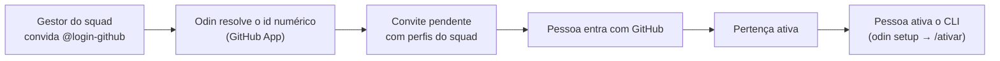

# 04. Portal e perfilamento

> **Detalhamento completo do portal na pasta [`docs/portal/`](../portal/README.md)** (vale a pasta em caso de diferença).
> Série: [01 Solução](01-arquitetura-de-solucao.md) · [02 Funcional](02-arquitetura-funcional.md) · [03 Técnica](03-arquitetura-tecnica.md) · **04 Portal e perfilamento**. Base: [plano](../PLANO.md).

## 1. Objetivo do portal

Um único site (`odin.<dominio>`) com duas áreas:
- **Área do usuário:** qualquer pessoa do squad entra com o GitHub, ativa o dispositivo, vê o que pode usar, pede acesso e gerencia os próprios dispositivos e tokens.
- **Console de administração:** quem tem papel administrativo governa pessoas, squads, projetos, perfis, catálogo, conhecimento, segurança e auditoria.

A mesma tela se adapta ao papel: cada pessoa só vê os menus que pode usar.

## 2. Tecnologia

| Item | Escolha |
|---|---|
| Aplicação | Next.js (App Router) no Cloud Run, renderização no servidor; o backend (BFF) é a única porta para a API administrativa |
| Componentes | Biblioteca de componentes acessível (por exemplo, Radix + Tailwind); tema claro e escuro |
| Login | SDK web do Identity Platform com o provedor **GitHub**; o servidor troca o ID token por um **cookie de sessão** |
| Autorização | Middleware no servidor: cada rota e cada ação declaram o papel exigido; o menu é só conveniência, nunca a proteção |
| Dados | Firestore (pela conta `sa-portal`), BigQuery para a tela de auditoria |
| Segurança | CSP estrita sem `unsafe-inline`, CSRF em todos os `POST`, `HttpOnly`/`Secure`, `X-Frame-Options: DENY`, HSTS, limite de taxa no `/ativar` e no `/sessao` |
| Acessibilidade | WCAG 2.1 AA |

## 3. Login e sessão

1. **Entrar com GitHub:** o único botão (Google e Microsoft podem ser ligados depois, por configuração).
2. **Segundo fator do Odin:** código do aplicativo autenticador (Google Authenticator, Microsoft Authenticator, Authy) ou passkey. No primeiro acesso, o cadastro do fator é obrigatório antes de qualquer outra tela. Administradores precisam de passkey ([segurança 02](../seguranca/02-autenticacao-e-mfa.md)).
3. **Quem entra:** pessoa convidada (pelo login do GitHub) ou membro de um time do GitHub mapeado a um squad. Os demais veem "Você ainda não tem acesso. Peça a um administrador do Odin" e o pedido fica registrado.
4. **Sessão:** 8 horas (30 min de inatividade). Ações administrativas pedem **o segundo fator de novo** se o último tiver mais de 15 minutos; ativar dispositivo e gerar token pessoal, se tiver mais de 5 minutos.
5. **Sair:** encerra a sessão no portal; dispositivos continuam ativos (são independentes).
6. **Suspensão:** pessoa suspensa perde a sessão no portal e os tokens em até 30 s.

## 4. Área do usuário (todos os perfis)

| Página | O que mostra | O que permite |
|---|---|---|
| **Início** | Saudação, squads e projetos, perfis, skills disponíveis (com versão e canal), status do serviço | Copiar o comando de instalação do CLI |
| **Conectar** | Passo a passo: instalar o CLI (macOS/Linux e Windows) e rodar `odin setup` | Copiar comandos; baixar o guia em uma página |
| **Ativar** (`/ativar`) | Dispositivo pedindo ativação: nome, sistema, IP, local aproximado, código | Confirmar ou recusar; avisa "só confirme se foi você quem rodou o comando agora" |
| **Segurança da conta** | Fatores cadastrados (TOTP, passkeys), códigos de recuperação restantes, últimos logins | Cadastrar ou remover fator (com o fator atual), gerar novos códigos de recuperação |
| **Meus dispositivos** | Lista com nome, sistema, ativado em, último uso, IP | Renomear, **revogar** um ou todos |
| **Tokens pessoais** | Tokens de exceção ativos (só prefixo e validade) | Gerar (escopo, prazo ≤ 90 dias, motivo; exibido **uma vez**), revogar |
| **Minhas skills** | O que posso usar, por squad e projeto, e o porquê (perfil ou concessão) | Ver detalhes e documentação de cada skill |
| **Solicitar acesso** | Formulário: skill ou coleção, projeto, motivo, prazo | Enviar; acompanhar o status |
| **Meu conhecimento** | Propostas que fiz (pelas skills ou pelo portal) e o status | Propor manualmente; ver o motivo de uma recusa |
| **Meu uso** | Minhas chamadas recentes (sem conteúdo), skills mais usadas | Exportar meus dados (LGPD) |

## 5. Perfilamento

### 5.1 Duas dimensões independentes
- **Perfil de uso** (o que a pessoa **usa**): `po`, `dev`, `qa`, `arquiteto`, `mantenedor`. Vem da pertença a squads e de concessões.
- **Papel administrativo** (o que a pessoa **administra**): `super-admin`, `admin-identidade`, `admin-catalogo`, `gestor-squad` (por squad), `curador` (por coleção e projeto), `auditor`.

Uma pessoa pode ser `dev` no squad Atendimento e `gestor-squad` do mesmo squad, sem ter nenhum papel global.

### 5.2 Matriz de permissões do console

Legenda: ✅ pode · 🔸 só no próprio escopo (squad, coleção ou projeto) · 👁 só leitura · — não pode

| Ação | super-admin | admin-identidade | admin-catalogo | gestor-squad | curador | auditor | usuário |
|---|---|---|---|---|---|---|---|
| Convidar pessoa | ✅ | ✅ | — | 🔸 (para o seu squad) | — | — | — |
| Suspender ou reativar pessoa | ✅ | ✅ | — | — | — | — | — |
| Revogar dispositivos de outra pessoa | ✅ | ✅ | — | 🔸 | — | — | só os seus |
| Revogação global (incidente) | ✅ | — | — | — | — | — | — |
| Criar squad e projeto | ✅ | ✅ | — | — | — | 👁 | — |
| Incluir e remover membros de squad | ✅ | ✅ | — | 🔸 (perfis permitidos ao squad) | — | 👁 | — |
| Mapear time do GitHub → squad | ✅ | ✅ | — | — | — | 👁 | — |
| Criar e editar perfis de uso | ✅ | — | ✅ | — | — | 👁 | — |
| Matriz perfil × skill × coleção | ✅ | — | ✅ | — | — | 👁 | — |
| Ver catálogo, versões, canais e uso | ✅ | 👁 | ✅ | 👁 | 👁 | 👁 | o que pode usar |
| Promover ou voltar versão | via PR no Git (o portal mostra e cria o link do PR) | — | via PR | — | — | 👁 | — |
| Aprovar solicitação de acesso | ✅ | ✅ | ✅ (skills) | 🔸 | 🔸 (coleções) | — | — |
| Conceder exceção com prazo | ✅ | ✅ | ✅ (skills) | 🔸 | 🔸 (coleções) | — | — |
| Curar conhecimento | ✅ | — | — | — | 🔸 | 👁 metadados | — |
| Atribuir papel administrativo | ✅ (com 2ª aprovação) | ✅ só `gestor-squad`, `curador` e `auditor` (com 2ª aprovação) | — | — | — | — | — |
| Ver auditoria completa | ✅ | 🔸 eventos de identidade | 🔸 eventos de catálogo | 🔸 do seu squad | 🔸 da sua coleção | ✅ | a própria |
| Exportar auditoria | ✅ | — | — | — | — | ✅ | a própria |
| Configurações globais (TTLs, provedores, manutenção) | ✅ (com 2ª aprovação) | — | — | — | — | 👁 | — |

### 5.3 Regras de governança aplicadas pelo portal
- **Ninguém aprova o próprio pedido** (o botão nem aparece, e o servidor recusa).
- **Quatro olhos:** papéis administrativos e configurações globais ficam "pendentes" até uma segunda pessoa com papel suficiente aprovar (`admin_changes`).
- **Perfis permitidos por squad:** o gestor só atribui o que o squad permite. Um squad de PO não recebe `mantenedor`.
- **Prazo obrigatório:** concessões e tokens pessoais sempre têm validade (máximo de 90 dias).
- **Motivo obrigatório** em concessões, suspensões e revogações.
- **Antes e depois** de toda mudança administrativa ficam na auditoria.
- **Reautenticação** (login com menos de 15 min) para qualquer ação do console.
- **Conta de emergência:** dois super-admins; usar o papel em modo emergência gera alerta imediato a todos os administradores e fica destacado na auditoria.

## 6. Console de administração (por área)

| Área | Telas | Quem vê |
|---|---|---|
| **Pessoas** | Lista com filtros (squad, perfil, status, último acesso); ficha da pessoa (squads, perfis, concessões, dispositivos, papéis, linha do tempo de auditoria); convidar; suspender | super-admin, admin-identidade; gestor-squad (só o seu squad) |
| **Squads** | Lista; ficha (projetos, membros, gestores, perfis permitidos, time do GitHub mapeado); incluir e remover membros | super-admin, admin-identidade; gestor-squad (o seu) |
| **Projetos** | Lista; ficha (cliente, classificação, squads, coleções de conhecimento) | super-admin, admin-identidade |
| **Perfis** | Matriz perfil × skill × coleção (com nível ler, propor ou curar) e canais | super-admin, admin-catalogo |
| **Catálogo** | Skills (domínio, dono, estado), versões por canal, hashes e assinatura, uso por perfil, link para o PR de promoção ou rollback | super-admin, admin-catalogo; leitura para os demais |
| **Solicitações** | Fila de pedidos com motivo e prazo; aprovar ou recusar com comentário | Aprovadores conforme a matriz |
| **Conhecimento** | Fila de propostas por coleção e projeto; comparação com o que existe; aprovar (vira PR no `odin-knowledge`) ou recusar; vigência e substituições | curador (sua coleção), super-admin |
| **Segurança** | Sessões e dispositivos ativos, alertas (reuso de credencial, picos de recusa, publicação fora do pipeline), revogação em massa, revogação global por carimbo de tempo | super-admin; admin-identidade (sem a global) |
| **Auditoria** | Busca por pessoa, ação, alvo, período e resultado; exportação | auditor, super-admin; recortes por papel |
| **Saúde** | Disponibilidade, latência, erros, versões de CLI e runtime em uso, lacunas de conhecimento, acerto do roteamento | todos os papéis administrativos |
| **Configurações** | Validade de tokens, limites, provedores de login, mensagem de manutenção | super-admin (com 2ª aprovação) |

## 7. Fluxos do portal

### 7.1 Entrada de uma pessoa nova

Com organização GitHub: incluir a pessoa no time do GitHub mapeado basta (o webhook cria a pertença com os perfis padrão do squad).

### 7.2 Solicitação de acesso
Usuário pede (skill ou coleção, motivo, prazo) → o aprovador do escopo recebe → aprova (concessão com prazo) ou recusa (com motivo) → vale em até 30 s → expira sozinha no prazo (`odin-jobs`).

### 7.3 Atribuição de papel administrativo
admin-identidade pede "tornar Maria `curador` de `negocio` do projeto X" → fica pendente → outro administrador com papel suficiente aprova → papel ativo, com auditoria das duas pessoas.

### 7.4 Saída de uma pessoa
Remoção do time do GitHub (webhook) ou suspensão no portal → pertenças encerradas → dispositivos e tokens revogados → sessão do portal encerrada → auditoria. Conhecimento e propostas da pessoa permanecem (autoria pseudonimizada se houver pedido de exclusão).

### 7.5 Incidente
super-admin abre **Segurança → Revogação global** → reautentica → confirma com motivo → `revocations/global` é gravado com o carimbo de tempo → tokens e credenciais emitidos antes dele deixam de valer, e todos os CLIs pedem login de novo → alerta e relatório para todos os administradores. Se a própria chave de JWT estiver comprometida, a troca da chave segue o runbook (fora do portal).

## 8. API administrativa (usada só pelo BFF do portal)

| Recurso | Operações |
|---|---|
| `/admin/v1/users` | listar, ver, convidar, suspender, reativar |
| `/admin/v1/squads` | CRUD, membros, gestores, mapeamento de time |
| `/admin/v1/projects` | CRUD |
| `/admin/v1/profiles` | CRUD, matriz |
| `/admin/v1/grants` | criar, revogar, listar por pessoa ou alvo |
| `/admin/v1/requests` | listar, aprovar, recusar |
| `/admin/v1/admin-changes` | pedir, aprovar, recusar (quatro olhos) |
| `/admin/v1/devices` | listar, revogar (por pessoa ou em massa) |
| `/admin/v1/catalog` | ler skills e versões, abrir link de PR |
| `/admin/v1/knowledge/proposals` | listar, aprovar (abre PR pelo GitHub App), recusar |
| `/admin/v1/security` | alertas, revogação global, troca de chave |
| `/admin/v1/audit` | busca e exportação (BigQuery) |
| `/admin/v1/settings` | ler, pedir mudança (quatro olhos) |

Cada operação declara o papel e o escopo exigidos. O BFF confere o cookie de sessão, a reautenticação recente e o papel. A API grava a auditoria antes de responder.

## 9. Critérios de aceite do portal
- Pessoa não convidada e fora de time mapeado não entra.
- Gestor de squad não vê nem altera pessoas de outro squad (teste automatizado).
- Pedido de papel administrativo nunca é aprovado pela mesma pessoa (teste automatizado).
- Revogação de dispositivo no portal faz o próximo `odin token` falhar e o MCP recusar em ≤ 30 s.
- Toda ação do console aparece na auditoria com antes e depois.
- Ativação de dispositivo mostra nome, sistema e IP, e expira em 10 min.
- Navegação completa por teclado e leitor de tela nas telas principais.
