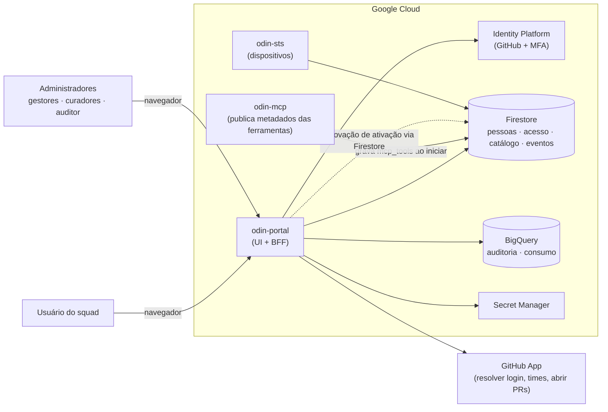
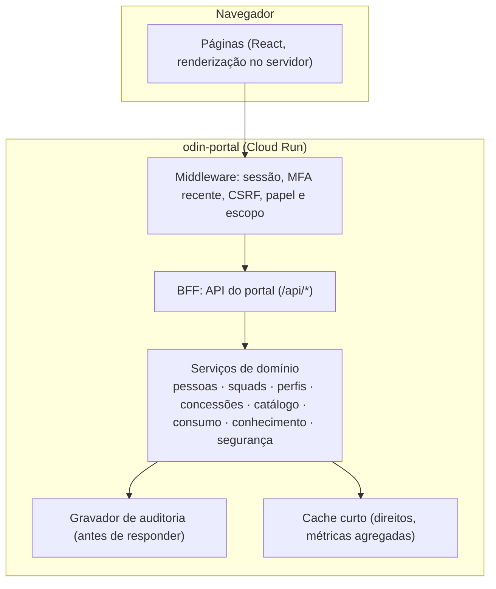
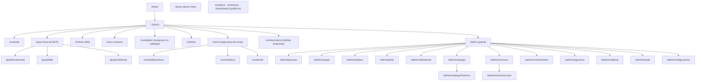

# 01. Arquitetura de solução do portal

> [Índice do portal](README.md)

## 1. Papel do portal na solução
O portal é a **interface humana** do Odin. Ele não executa skills nem entrega conteúdo ao Claude Code (isso é do `odin-mcp`). O portal:
1. **autentica** pessoas (GitHub + segundo fator do Odin) e **ativa dispositivos** (aprovação do device flow);
2. **mostra** a cada pessoa o que ela pode usar, como conectar e quanto consumiu;
3. **governa** pessoas, squads, projetos, perfis, concessões e papéis administrativos;
4. **expõe** o catálogo de skills e o histórico do ciclo de vida delas;
5. **mede** o consumo de requisições e aplica cotas;
6. **cura** o conhecimento (fila de propostas);
7. **audita** e responde a incidentes (revogação, revogação global).

## 2. Contexto

## 3. Componentes internos

| Componente | Responsabilidade |
|---|---|
| Páginas | Renderização no servidor (sem dados sensíveis no navegador além do necessário), componentes acessíveis |
| Middleware | Confere o cookie de sessão, a idade do MFA exigida pela rota, CSRF e `Origin`, e o papel e o escopo da pessoa; nega por padrão |
| BFF | API do portal: única porta para dados e ações. O navegador nunca fala com Firestore, BigQuery ou GitHub |
| Serviços de domínio | Regras de negócio (por exemplo, perfis permitidos ao squad, quatro olhos, prazos) |
| Gravador de auditoria | Toda ação grava o evento com antes e depois **antes** de responder sucesso |
| Cache | Direitos e métricas agregadas com validade curta; invalidado por `policyVersion` |

## 4. Fontes de dados por área

| Área do portal | Fonte | Atualização |
|---|---|---|
| Identidade, squads, projetos, perfis, concessões, solicitações, papéis | Firestore | Imediata |
| Dispositivos e tokens pessoais | Firestore (escrito pelo `odin-sts` e pelo portal) | Imediata |
| Ferramentas do MCP (nomes, descrições, entradas) | Firestore `mcp_tools/{versao}`, gravado pelo próprio `odin-mcp` ao iniciar (fonte única, sem chamada entre serviços) | A cada versão do servidor |
| Catálogo e versões | Firestore `catalog_skills`, `catalog_versions` | A cada publicação |
| Histórico do ciclo de vida das skills | Firestore `catalog_events` (+ cópia no BigQuery) | A cada evento |
| Consumo (requisições, erros, latência) | BigQuery `odin_metrics` (agregados) e `odin_audit.eventos` (detalhe) | Agregados a cada 15 min; detalhe em até ~1 min |
| Conhecimento (propostas, coleções) | Firestore `proposals` + GitHub (PRs) | Imediata |
| Auditoria | BigQuery `odin_audit` | ~1 min |
| Saúde do serviço | Cloud Monitoring (API) | ~1 min |

## 5. Tecnologia

| Camada | Escolha | Motivo |
|---|---|---|
| Aplicação | Next.js (App Router), TypeScript, renderização no servidor | Uma só aplicação para UI e BFF; segredos e dados ficam no servidor |
| UI | Componentes acessíveis (Radix UI) + Tailwind; gráficos com biblioteca leve e acessível | Acessibilidade (WCAG 2.1 AA) e consistência |
| Login | SDK web do Identity Platform (GitHub) + MFA; cookie de sessão emitido no servidor | Ver [segurança 02](../seguranca/02-autenticacao-e-mfa.md) |
| Passkeys | WebAuthn com biblioteca de servidor madura | Fator resistente a phishing |
| Dados | SDK de servidor do Firestore e do BigQuery com a conta `sa-portal` | Mínimo privilégio |
| Hospedagem | Cloud Run (`odin-portal`), atrás do Load Balancer com Cloud Armor | Mesma borda dos outros serviços |
| Observabilidade | OpenTelemetry → Cloud Trace e Logging | Rastreio de ponta a ponta |

## 6. Segurança do portal (resumo)
- **Login:** GitHub + segundo fator do Odin; administradores com passkey.
- **Sessão:** cookie `__Host-` (`HttpOnly`, `Secure`, `SameSite=Lax`), 8 h, 30 min de inatividade.
- **MFA recente por ação:** 5 min para ativar dispositivo e gerar token pessoal; 15 min para o console.
- **Proteções web:** CSRF em todo `POST`, CSP estrita sem `unsafe-inline`, `X-Frame-Options: DENY`, HSTS, nenhuma renderização de HTML vindo de usuários.
- **Autorização:** no servidor, por rota e por ação; o menu escondido é só conveniência.
- **Auditoria:** toda leitura sensível (por exemplo, abrir a ficha de outra pessoa, exportar consumo) e toda ação.
Detalhe completo em [`docs/seguranca/`](../seguranca/README.md).

## 7. Mapa do site

Cada pessoa vê só os itens que o papel dela permite ([05](05-console-de-administracao.md), seção 1).

## 8. Integrações do portal
| Com | Para quê | Como |
|---|---|---|
| Identity Platform | Login com GitHub, MFA, cookie de sessão | SDK web + SDK de servidor |
| `odin-mcp` | Lista e descrição das ferramentas do MCP (guia sempre igual ao servidor) | Indireta: o `odin-mcp` grava `mcp_tools` no Firestore e o portal lê |
| `odin-sts` | Ativação de dispositivo | Pela coleção `device_codes` no Firestore (sem chamada direta) |
| GitHub App | Resolver login → id numérico ao convidar; listar times para mapear squads; abrir PR de conhecimento aprovado; links para PRs de catálogo | Token de instalação (1 h), chave no Secret Manager |
| BigQuery | Consumo e auditoria | Consultas parametrizadas, com limites de custo por consulta |
| Cloud Monitoring | Página de saúde | API de leitura |
| E-mail transacional (opcional) | Avisos de segurança e de aprovação | Provedor de e-mail com domínio próprio [VERIFICAR provedor] |
