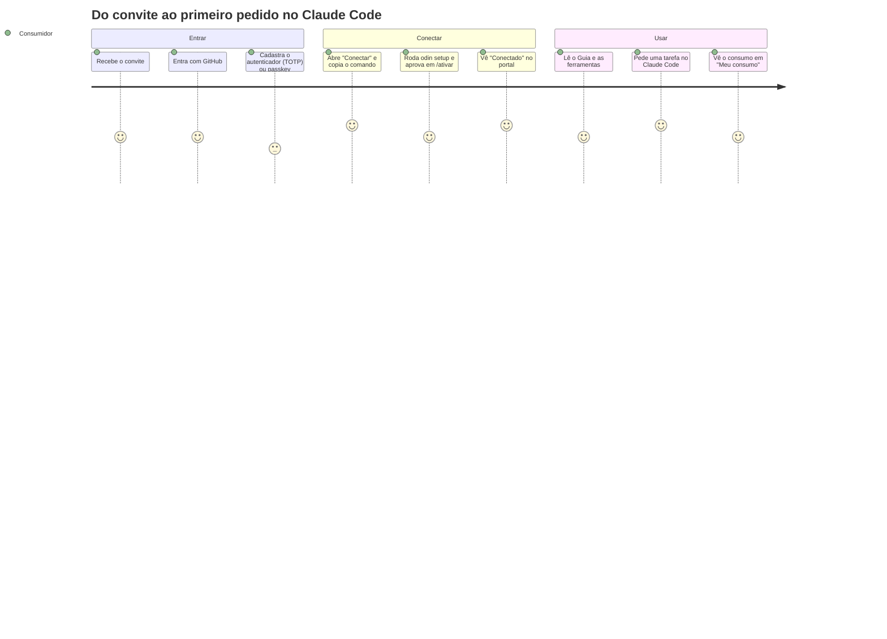

# 02. Arquitetura funcional do portal

> [Índice do portal](README.md) · Modelo de acesso completo em [arquitetura funcional](../arquitetura/02-arquitetura-funcional.md)

## 1. Personas

| Persona | Objetivo no portal | Frequência |
|---|---|---|
| **P1 · Consumidor (PO, dev, QA, arquiteto)** | Conectar uma vez; saber o que pode usar e como; ver o próprio consumo; pedir acesso; cuidar dos dispositivos | Rara depois do onboarding (o trabalho é no Claude Code) |
| **P2 · Gestor de squad** | Manter o squad certo (pessoas e perfis), aprovar pedidos, acompanhar o consumo do squad | Semanal |
| **P3 · Administrador de identidade** | Entrada e saída de pessoas, dispositivos, tokens, incidentes de credencial | Diária |
| **P4 · Administrador de catálogo** | Perfis × skills × coleções, canais, acompanhar versões e mudanças, cotas | Semanal |
| **P5 · Curador de conhecimento** | Aprovar ou recusar propostas da sua coleção | Semanal |
| **P6 · Auditor** | Investigar, exportar, revisar acessos | Mensal ou por demanda |
| **P7 · Super-admin** | Papéis administrativos, configurações globais, emergência | Rara |

## 2. Jornadas principais

### 2.1 Consumidor: do convite ao primeiro pedido

### 2.2 Administrador: revogar e ajustar acesso
1. Recebe um alerta (por exemplo, consumo anômalo ou saída de pessoa).
2. Abre **Pessoas → ficha da pessoa**: squads, perfis, dispositivos, tokens, consumo dos últimos 30 dias, linha do tempo da auditoria.
3. Age: revoga um dispositivo, suspende a pessoa, troca o perfil numa pertença ou encerra uma concessão.
4. Confere o efeito em até 30 s, com o indicador "aplicado" ao lado da ação.

### 2.3 Administrador de catálogo: entender uma mudança
1. Abre **Catálogo → skill** → aba **Histórico**.
2. Vê a linha do tempo: incorporada em X, versões publicadas, promoções, rollbacks e mudanças de perfil, com quem fez, PR, pipeline e resumo da mudança.
3. Compara duas versões (arquivos alterados, linhas, changelog).
4. Vê o impacto: quantas pessoas usaram cada versão e se houve aumento de erro depois da mudança.

## 3. Capacidades do portal

| # | Capacidade | Consumidor | Gestor | Admin identidade | Admin catálogo | Curador | Auditor | Super-admin |
|---|---|---|---|---|---|---|---|---|
| CP-01 | Entrar e cuidar da conta (MFA, dispositivos, tokens) | ✅ | ✅ | ✅ | ✅ | ✅ | ✅ | ✅ |
| CP-02 | Conectar o Claude Code e ler o guia do MCP | ✅ | ✅ | ✅ | ✅ | ✅ | ✅ | ✅ |
| CP-03 | Ver as próprias skills e o próprio consumo | ✅ | ✅ | ✅ | ✅ | ✅ | ✅ | ✅ |
| CP-04 | Pedir acesso | ✅ | ✅ | ✅ | ✅ | ✅ | ✅ | ✅ |
| CP-05 | Ver novidades do catálogo que afetam a pessoa | ✅ | ✅ | ✅ | ✅ | ✅ | ✅ | ✅ |
| CP-06 | Gerir membros e perfis de squad | — | 🔸 o seu | ✅ | — | — | 👁 | ✅ |
| CP-07 | Gerir pessoas (convidar, suspender, revogar) | — | 🔸 convidar para o seu | ✅ | — | — | 👁 | ✅ |
| CP-08 | Gerir perfis (matriz perfil × skill × coleção) | — | — | — | ✅ | — | 👁 | ✅ |
| CP-09 | Ver consumo de todos | — | 🔸 do seu squad | ✅ | ✅ | — | ✅ | ✅ |
| CP-10 | Gerir cotas | — | — | — | ✅ | — | 👁 | ✅ |
| CP-11 | Ver catálogo e histórico do ciclo de vida | o que pode usar | ✅ | ✅ | ✅ | ✅ | ✅ | ✅ |
| CP-12 | Aprovar solicitações | — | 🔸 | ✅ | ✅ skills | 🔸 coleções | — | ✅ |
| CP-13 | Curar conhecimento | — | — | — | — | 🔸 | 👁 | ✅ |
| CP-14 | Segurança (alertas, revogação em massa e global) | — | — | ✅ (sem global) | — | — | 👁 | ✅ |
| CP-15 | Auditoria e exportação | a própria | 🔸 | 🔸 | 🔸 | 🔸 | ✅ | ✅ |
| CP-16 | Papéis administrativos e configurações | — | — | 🔸 alguns (quatro olhos) | — | — | 👁 | ✅ (quatro olhos) |

Legenda: ✅ pode · 🔸 só no próprio escopo · 👁 só leitura · — não pode.

## 4. Casos de uso do portal

| UC | Caso de uso | Persona | Pré-condição | Resultado |
|---|---|---|---|---|
| PT-01 | Entrar com GitHub e MFA | P1–P7 | Convite ou time mapeado | Sessão de 8 h |
| PT-02 | Cadastrar autenticador ou passkey | P1–P7 | Primeiro acesso | Fator cadastrado, códigos de recuperação exibidos |
| PT-03 | Conectar o Claude Code | P1 | Sessão | Comandos de instalação; status "Conectado" após o `odin setup` |
| PT-04 | Aprovar a ativação de um dispositivo | P1 | Código do terminal; MFA < 5 min | Dispositivo ativo |
| PT-05 | Consultar ferramentas e skills do MCP | P1 | Sessão | Guia com as ferramentas e as skills permitidas |
| PT-06 | Ver o próprio consumo | P1 | Sessão | Requisições por dia, skill e ferramenta; cota e uso |
| PT-07 | Ver novidades do catálogo | P1 | Sessão | Mudanças nas skills que a pessoa usa |
| PT-08 | Pedir acesso | P1 | Sessão | Solicitação na fila do aprovador |
| PT-09 | Revogar os próprios dispositivos e tokens | P1 | Sessão | Revogados em até 30 s |
| PT-10 | Gerar token pessoal (exceção) | P1 | MFA < 5 min | Token exibido uma vez |
| PT-11 | Convidar pessoa para o squad | P2, P3 | MFA < 15 min | Convite pendente |
| PT-12 | Alterar perfis de uma pessoa no squad | P2, P3 | Perfil permitido ao squad | Vale em até 30 s |
| PT-13 | Suspender pessoa / revogar dispositivos | P3 | Motivo | Acesso cortado em até 30 s |
| PT-14 | Editar a matriz de perfis | P4 | MFA < 15 min | Nova versão de política |
| PT-15 | Definir cota por perfil, squad ou pessoa | P4 | MFA < 15 min | Cota aplicada |
| PT-16 | Investigar consumo anômalo | P3, P4, P6 | — | Detalhe por pessoa, ferramenta e período |
| PT-17 | Consultar o histórico de uma skill | P2–P7 | — | Linha do tempo com versões e mudanças |
| PT-18 | Comparar versões de uma skill | P4 | — | Diferenças e changelog |
| PT-19 | Aprovar ou recusar solicitação | P2–P5 | Não ser o solicitante | Concessão com prazo ou recusa |
| PT-20 | Curar proposta de conhecimento | P5 | Curador da coleção | PR aberto no `odin-knowledge` ou recusa |
| PT-21 | Revogação global | P7 | Passkey, motivo, quatro olhos | Todos fazem login de novo |
| PT-22 | Atribuir papel administrativo | P3 (alguns), P7 | Quatro olhos | Papel ativo |
| PT-23 | Buscar e exportar auditoria | P6, P7 | — | Resultado e CSV |
| PT-24 | Revisão trimestral de acessos | P2, P3 | Campanha aberta | Confirmações; o resto expira |

## 5. Regras de negócio do portal

| RN | Regra |
|---|---|
| RP-01 | Toda tela e toda ação exigem sessão com segundo fator; o console exige MFA com menos de 15 min |
| RP-02 | O menu mostra só o que o papel permite, e o servidor recusa o resto mesmo se a URL for digitada |
| RP-03 | Ninguém aprova o próprio pedido nem altera os próprios papéis administrativos |
| RP-04 | Papéis administrativos e configurações globais ficam pendentes até a segunda aprovação |
| RP-05 | Gestor de squad só vê pessoas do próprio squad e só atribui os perfis permitidos ao squad |
| RP-06 | Toda ação exige motivo quando reduz acesso ou revoga credenciais |
| RP-07 | Toda mudança de acesso mostra o indicador "aplicado" quando o `policyVersion` novo estiver em vigor |
| RP-08 | Consumo de outras pessoas só aparece para quem tem CP-09 no escopo; abrir o consumo de alguém gera auditoria |
| RP-09 | Mudanças no catálogo (versões, canais, retirada) **não** são feitas no portal: o portal mostra e leva ao PR (GitOps). Exceção: a matriz perfil × skill (acesso) e as cotas |
| RP-10 | Skill retirada do catálogo some do roteamento; as pessoas que a usaram nos últimos 30 dias recebem aviso em **Novidades** |
| RP-11 | Cotas excedidas bloqueiam novas chamadas com mensagem clara e link para pedir aumento; nunca cortam uma resposta no meio |
| RP-12 | Exportações (consumo, auditoria) têm limite de linhas e ficam registradas |
