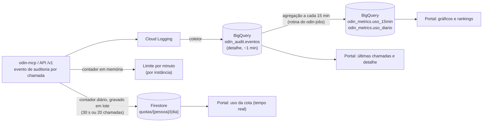

# 06. Consumo, cotas e métricas

> [Índice do portal](README.md)

## 1. O que é medido

| Métrica | Definição | Dimensões |
|---|---|---|
| **Requisição MCP** | Uma chamada a uma ferramenta do Odin (`tools/call`) ou a um prompt ou recurso | pessoa, dispositivo, squad, projeto, perfil, skill, versão, ferramenta, resultado, dia/hora |
| Requisição de API `/v1` | Chamada do CLI (manifesto, pacote, políticas, telemetria) | Idem, sem ferramenta |
| Resultado | `ok`, `negado` (sem acesso ou cota), `erro` (falha do servidor), `cliente` (entrada inválida) | — |
| Latência | Tempo no servidor, p50 e p95 | ferramenta, serviço |
| Download de pacote | Pacote baixado (tamanho) | skill, versão |
| Sessões ativas | Pessoas com pelo menos uma requisição na janela | squad, perfil |
| Roteamento aceito | `odin_rotear` seguido de `odin_carregar_skill` da primeira candidata | skill |
| Troca de skill | Outra skill carregada em até 2 min após o roteamento | skill |
| Busca sem resultado | `odin_conhecimento_buscar` com zero trechos | coleção, projeto |

**O que não é medido:** o texto dos pedidos, o código, as respostas do modelo e os tokens de modelo (que ficam no LiteLLM). O Odin mede **só o consumo do próprio MCP**; as chaves e o consumo do LiteLLM são controlados pela empresa, fora do Odin ([decisão 27](../DECISOES.md)).

## 2. De onde vêm os números



| Visão | Fonte | Atraso |
|---|---|---|
| Uso da cota (barra) | Firestore `quotas` | Tempo real |
| Últimas chamadas e detalhe | `odin_audit.eventos` | ~1 min |
| Gráficos, rankings, tendências | `odin_metrics.uso_15min` e `uso_diario` | até 15 min |
| Latência e erro do serviço | Cloud Monitoring | ~1 min |

**Tabelas agregadas (esquema):**
```
odin_metrics.uso_15min(janela_inicio, pessoa_id, squad_id, projeto_id, perfil, skill, versao,
                       ferramenta, resultado, requisicoes, latencia_p50_ms, latencia_p95_ms)
odin_metrics.uso_diario(dia, pessoa_id, squad_id, projeto_id, perfil, skill, ferramenta,
                        resultado, requisicoes, pessoas_distintas)
```
- Particionadas por dia e agrupadas por `squad_id` e `skill`, para consultas baratas.
- O portal só lê os agregados para gráficos e limita as consultas de detalhe a 31 dias e 10.000 linhas.
- Custo protegido: limite de bytes processados por consulta (`maximum_bytes_billed`).

## 3. Cotas e limites

### 3.1 Dois mecanismos
| Mecanismo | Para quê | Onde | Ao exceder |
|---|---|---|---|
| **Limite por minuto** | Proteger o serviço de laços e abusos | Em memória no `odin-mcp` (por pessoa, e por IP nas rotas anônimas); Cloud Armor por IP só em E2 | `limite_excedido` com "tente em N s" |
| **Cota diária** | Governança de uso por perfil, squad ou pessoa | Contador no Firestore (`quotas/{pessoa}/{dia}`), incrementado de forma atômica | `limite_excedido` com a hora de renovação e o link "pedir aumento" |

### 3.2 Valores iniciais (configuráveis no portal)
| Perfil | Limite por minuto | Cota diária |
|---|---|---|
| `po` | 60 | 1.000 |
| `dev` | 120 | 3.000 |
| `qa` | 120 | 3.000 |
| `arquiteto` | 120 | 3.000 |
| `mantenedor` | 240 | 10.000 |
Os valores são **pontos de partida** para calibrar com o uso real da prova de conceito.

### 3.3 Regras
- **Precedência:** exceção da pessoa > exceção do squad > padrão do perfil (vale o maior perfil da pessoa).
- Exceções têm **prazo** e **motivo**, e ficam no histórico.
- Aviso em 80% (portal e cabeçalho de resposta `X-Odin-Cota-Restante`); bloqueio em 100%.
- A cota **nunca** interrompe uma chamada em andamento; só recusa as próximas.
- A cota renova à meia-noite no horário de Brasília.
- Chamadas `negado` por falta de acesso **não** consomem cota (para não punir o erro de configuração); `erro` do servidor também não.

## 4. Painéis

### 4.1 Do usuário (Meu consumo)
- Requisições por dia (barras), por skill e por ferramenta (barras horizontais), taxa de erro.
- Uso da cota hoje (barra com marcas de 80% e 100%).
- Últimas 50 chamadas (sem conteúdo).

### 4.2 Do gestor de squad
- Requisições do squad por dia e por pessoa; skills mais usadas; pessoas sem uso há 30 dias (candidatas a revisão de acesso); cotas do squad.

### 4.3 Do administrador
| Painel | Pergunta que responde |
|---|---|
| Visão geral | Quanto o Odin está sendo usado, e está saudável? |
| Por ferramenta | Quais ferramentas mais pesam? Algum erro concentrado? |
| Por skill e versão | A versão nova aumentou erros? Quem ainda usa a antiga? |
| Por squad e projeto | Quem mais usa? Há squad sem adoção? |
| Ranking de pessoas | Há consumo anômalo (pico em relação à média da própria pessoa)? |
| `negado` | Há alguém tentando acessar o que não pode (sondagem) ou perfis mal configurados? |
| Cotas | Quem está perto do limite? Quais exceções vencem? |
| Roteamento | O roteador acerta? Quais pedidos acabam em "não sei"? |
| Conhecimento | Quais buscas não têm resposta (lacunas)? |

### 4.4 Anomalias (marcadas automaticamente)
- Pessoa com requisições/hora acima de 5× a mediana dela nos últimos 14 dias.
- Pessoa com mais de 20% de `negado` num dia.
- Pico de `erro` numa skill logo depois de uma versão nova (ligação com [07](07-ciclo-de-vida-das-skills.md)).
- Uso a partir de um dispositivo ou IP novo com volume alto logo no início.
As anomalias aparecem no painel e, as graves, como alertas na área de Segurança.

## 5. Privacidade do consumo
- Cada pessoa vê o **próprio** consumo; gestores veem o do **seu squad**; administradores com papel de consumo e o auditor veem tudo.
- Abrir o consumo de outra pessoa gera evento de auditoria.
- Os dados de consumo seguem a retenção da auditoria (1 ano) e são pseudonimizados quando a pessoa sai ([segurança 08](../seguranca/08-dados-e-lgpd.md)).
