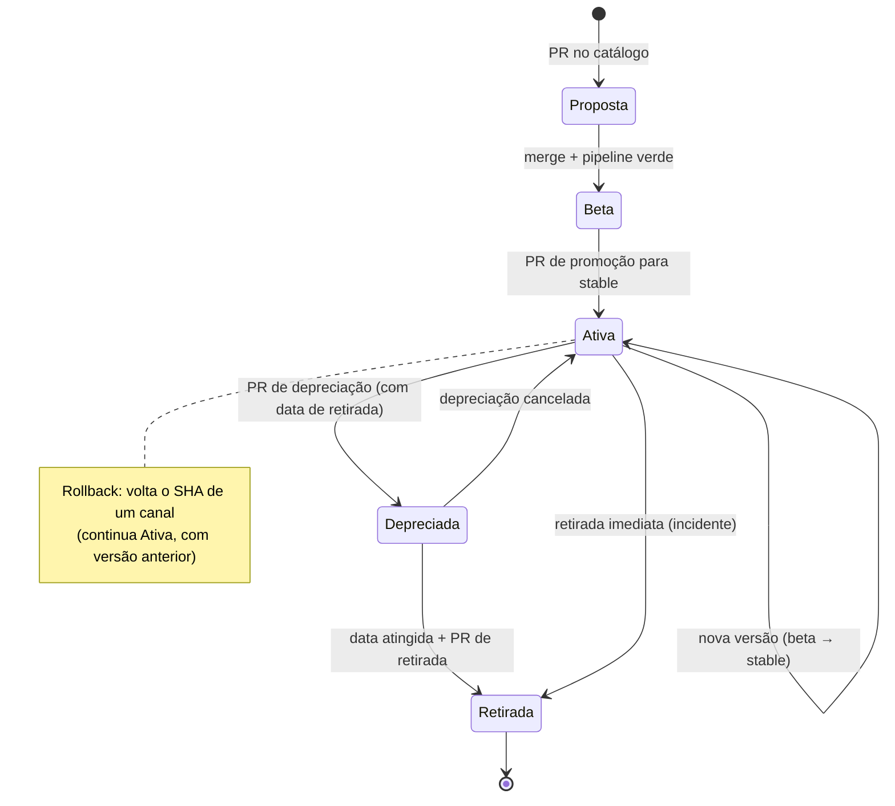

# 07. Ciclo de vida das skills no catálogo

> [Índice do portal](README.md) · Publicação técnica em [arquitetura técnica, seção 7](../arquitetura/03-arquitetura-tecnica.md) e [plano, seção 8](../PLANO.md)

## 1. Estados de uma skill



| Estado | Roteamento | Quem vê no portal | Aviso aos usuários |
|---|---|---|---|
| **Proposta** | Não | Mantenedores e admin de catálogo | — |
| **Beta** | Só para perfis com o canal `beta` | Mantenedores, admin de catálogo, quem tem `beta` | — |
| **Ativa** | Para todos os perfis com acesso | Todos com acesso | "Nova skill disponível" (ao entrar em `stable` pela primeira vez) |
| **Depreciada** | Sim, com aviso na resposta | Todos com acesso | "Será retirada em DD/MM; use Y no lugar" |
| **Retirada** | Não (some do roteamento) | Administradores e histórico | "Retirada em DD/MM" para quem usou nos últimos 30 dias |

**Versão proibida** (segurança): independente do estado, uma versão pode entrar na lista assinada de versões proibidas ([segurança 09](../seguranca/09-deteccao-e-resposta.md), seção 5). O CLI e o guard bloqueiam essa versão nas máquinas.

## 2. Eventos registrados

Toda mudança gera um evento em `catalog_events` (Firestore, com cópia no BigQuery). **Nada é apagado.**

| Evento | Quando | Dados |
|---|---|---|
| `skill_incorporada` | Primeira publicação de uma skill | skill, repositório, dono, domínio, PR, quem aprovou |
| `versao_publicada` | Pipeline publicou uma versão (em `beta`) | versão, SHA da fonte, PR do catálogo, run do pipeline, `kid` da assinatura, hash do manifesto, changelog, estatística de mudanças (arquivos e linhas) |
| `versao_promovida` | Versão passou de `beta` para `stable` | versão de, versão para, PR, quem aprovou, **nota da avaliação** de comportamento (atual e da versão anterior, ADR 0017) |
| `rollback` | Canal voltou para uma versão anterior | canal, versão de, versão para, motivo, PR |
| `perfil_alterado` | Matriz perfil × skill mudou (no portal) | perfil, skill, antes, depois, quem mudou, pessoas afetadas |
| `depreciada` | PR de depreciação | data prevista de retirada, substituta sugerida, motivo |
| `depreciacao_cancelada` | PR cancelando | motivo |
| `retirada` | PR de retirada (ou incidente) | motivo, imediata ou programada |
| `versao_proibida` | Inclusão na lista de versões proibidas | versão, motivo, incidente |
| `metadados_alterados` | Descrição, intenções, pré-requisitos ou coleções mudaram sem nova versão de runtime | campos alterados |

**Formato do evento:**
```json
{
  "id": "evt_01J…",
  "tipo": "versao_publicada",
  "skill": "sf-test",
  "versao": "1.4.2",
  "canal": "beta",
  "quando": "2026-11-14T12:03:10Z",
  "quem": { "autor_pr": "gh:1234567", "aprovador": "gh:7654321", "pipeline": "https://github.com/…/actions/runs/…" },
  "fonte": { "repo": "<dono>/Salesforce_Test_Automator", "sha": "be2e06b…", "pr": "https://github.com/…/pull/42" },
  "mudancas": { "arquivos": 12, "linhas_adicionadas": 340, "linhas_removidas": 55, "changelog": "Cross-browser opcional; smoke automático" },
  "assinatura": { "kid": "bundle-2026-a", "manifesto_sha256": "…" }
}
```

## 3. Telas

### 3.1 Histórico da skill (`/admin/catalogo/{skill}` → Histórico)
Linha do tempo em ordem decrescente, com ícone por tipo de evento, filtro por tipo e período, e em cada item: o que mudou, quem (autor e aprovador), quando, links para PR e pipeline, e o resumo do changelog. Exemplos de leitura rápida:
- "**Entrou** no catálogo em 02/10 (beta) e em `stable` em 09/10."
- "**Atualizada** 6 vezes; última em 14/11 (1.4.2)."
- "**Alterada** no acesso em 20/10: perfil `qa` passou a ter acesso."
- "**Rollback** em 15/11 de 1.4.2 para 1.4.1: aumento de erros."
- "**Retirada** em 01/12: substituída pela skill X."

### 3.2 Histórico geral do catálogo (`/admin/catalogo/historico`)
Todos os eventos de todas as skills, com filtros e exportação. Indicadores do topo: skills ativas, entradas no mês, versões publicadas no mês, rollbacks no mês, retiradas no mês, tempo médio de `beta` até `stable`.

### 3.3 Comparar versões (`/admin/catalogo/{skill}/comparar?de=1.4.1&para=1.4.2`)
- Arquivos adicionados, removidos e alterados (conteúdo, agentes, regras, runtime, políticas), com contagem de linhas.
- Diferença do texto do `SKILL.md` e das regras (lado a lado).
- Mudanças de manifesto: pré-requisitos, coleções, agentes, `runtime_min_cli`.
- Link para a comparação no GitHub (fonte).

### 3.4 Impacto (aba Uso)
- Requisições e pessoas por versão ao longo do tempo (para ver a adoção da versão nova).
- Taxa de erro antes e depois de cada evento `versao_publicada` e `versao_promovida`.
- Nota da avaliação de comportamento por versão (gráfico da evolução); promoções recusadas pelo portão de avaliação.
- Pessoas que ainda têm runtime antigo instalado (telemetria do CLI).

### 3.5 Para o usuário (Novidades)
Os eventos `skill_incorporada` (quando a pessoa ganha acesso), `versao_promovida` (com o changelog), `depreciada`, `retirada`, `perfil_alterado` (se afetar a pessoa) e `versao_proibida` (se a pessoa tinha a versão instalada) aparecem em **Novidades**, em linguagem simples.

## 4. Quem faz o quê
| Ação | Onde acontece | Quem |
|---|---|---|
| Incorporar, publicar versão, promover, voltar, depreciar, retirar | **PR no repositório Odin** (`catalog/`), aprovado por outra pessoa | Mantenedor + admin de catálogo |
| Abrir esses PRs a partir do portal | Portal (botões que montam o PR pelo GitHub App) | Admin de catálogo |
| Mudar quem acessa a skill | Portal (matriz de perfis) | Admin de catálogo |
| Proibir uma versão | Runbook RB-09 (lista assinada) | Admin de catálogo + segurança |
| Ver histórico | Portal | Conforme o papel |

O portal **não** muda versões direto: ele mostra, compara e prepara o PR. A mudança só vale depois do merge e do pipeline, para manter a revisão de código e a assinatura (GitOps).
