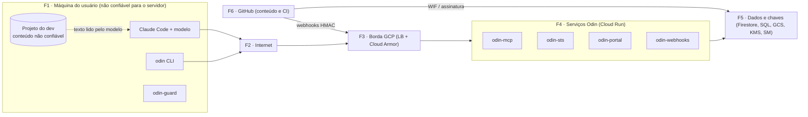

# 01. Modelo de ameaças

> [Índice da segurança](README.md)

## 1. O que protegemos (ativos)

| Ativo | Por que importa | Classificação |
|---|---|---|
| A1. Identidades e credenciais (sessões, refresh tokens, chaves de dispositivo, tokens pessoais) | Quem as tem age como a pessoa | Crítico |
| A2. Chaves de assinatura (pacotes e JWT) no KMS | Quem assina pode distribuir código para todas as máquinas ou forjar tokens | Crítico |
| A3. Integridade das skills, agentes, políticas e runtime | Rodam com acesso total na máquina de cada pessoa | Crítico |
| A4. Conhecimento de regra de negócio dos clientes (RAG) | Confidencial, por contrato e LGPD | Alto |
| A5. Configuração de acesso (perfis, squads, papéis) | Muda quem vê o quê | Alto |
| A6. Trilha de auditoria | Prova do que aconteceu; precisa ser íntegra | Alto |
| A7. Máquinas dos usuários e os projetos nelas | Código dos clientes, credenciais Salesforce, chaves | Crítico (fora do Odin, mas o Odin roda lá) |
| A8. Disponibilidade do serviço | Time parado se o Odin cair | Médio |
| A9. Dados pessoais (id do GitHub, nome, e-mail, IP) | LGPD | Médio |

## 2. Quem pode atacar

| Ator | Capacidade | Motivação |
|---|---|---|
| T1. Atacante externo | Internet, phishing, credenciais vazadas | Acesso a código, dados de clientes, uso das máquinas |
| T2. Pessoa de dentro mal-intencionada | Acesso legítimo a parte do sistema | Ver dados de outro cliente, elevar privilégio |
| T3. Pessoa de dentro descuidada | Acesso legítimo | Vazamento acidental (token colado em chat, repositório público) |
| T4. Mantenedor comprometido | Conta do GitHub tomada | Publicar skill ou política maliciosa |
| T5. Repositório ou documento malicioso | Conteúdo lido pelo agente na máquina | Injeção de instrução no modelo, sombra de agente |
| T6. Fornecedor comprometido | Dependência npm, imagem base, ação do GitHub | Código malicioso no runtime ou nos serviços |
| T7. Ex-integrante | Credenciais antigas | Acesso depois de sair |

## 3. Fronteiras de confiança

Regras de fronteira:
- **F1 → F4:** nada que vem da máquina é confiável. Toda chamada é autenticada e autorizada no servidor, e os direitos nunca são decididos pelo cliente.
- **F4 → F1:** o texto entregue ao modelo é instrução não verificável pelo modelo. A proteção na máquina é o guard, que é código assinado (ver 06).
- **Conteúdo do projeto → modelo:** qualquer arquivo do repositório (README, issue, documento do cliente) pode conter instrução maliciosa. É tratado como evidência, nunca como ordem.
- **F6 → F5:** só o pipeline do repositório Odin, em `main`, com identidade federada, pode assinar e publicar.

## 4. Ameaças por componente (STRIDE)

S = falsificação de identidade · T = adulteração · R = repúdio · I = vazamento de informação · D = negação de serviço · E = elevação de privilégio

| # | Componente | STRIDE | Ameaça | Controles (documento) | Risco residual |
|---|---|---|---|---|---|
| AM-01 | Login do portal | S | Conta do GitHub tomada por phishing | 2FA exigido no GitHub + **segundo fator do Odin** (TOTP ou passkey), alerta de login novo (02) | Baixo |
| AM-02 | Ativação do CLI | S | **Phishing de device code**: atacante roda `odin setup`, manda o código para a vítima aprovar | Tela de ativação mostra dispositivo, IP e local; MFA na aprovação; código vale 10 min; aviso explícito; alerta e e-mail de dispositivo novo; detecção de IP muito diferente entre o pedido e a aprovação (02, 03) | Médio, reduzido por treinamento |
| AM-03 | Refresh token | S/T | Roubo do refresh token da máquina | Guardado no cofre do sistema; ligado à chave do dispositivo (não renova sem ela); rotação com detecção de reuso (03) | Baixo |
| AM-04 | Token de acesso | S | Token copiado de log ou memória | 15 min, `aud` restrito, não sai do cache do CLI, cabeçalhos nunca registrados nos logs (03) | Baixo |
| AM-05 | Token pessoal | S | Token colado num chat ou repositório | Exceção com prazo; prefixo detectável por varredura de segredos; criação com MFA; alerta de uso por IP novo (03) | Médio |
| AM-06 | `odin-mcp` | E | Pessoa acessa skill ou conhecimento de outro projeto | Direitos no servidor, negado por padrão, segurança em nível de linha no banco, testes de autorização no CI (04, 08) | Baixo |
| AM-07 | `odin-mcp` | I | Respostas com dados de outro cliente via RAG | Filtro por projeto no banco (não só na aplicação) (08) | Baixo |
| AM-08 | `odin-mcp` | D | Excesso de chamadas | Cloud Armor por IP, limite por pessoa, escala automática com teto, orçamento (07) | Baixo |
| AM-09 | Portal | E | Gestor de squad se dá mais acesso | Perfis permitidos por squad, ninguém aprova o próprio pedido, quatro olhos (04) | Baixo |
| AM-10 | Portal | T/I | XSS ou CSRF no console | CSP estrita, cookies `__Host-` `HttpOnly`, CSRF, sem HTML vindo do usuário (07, 10) | Baixo |
| AM-11 | Portal | R | Administrador nega ter feito uma mudança | Auditoria com antes e depois, MFA recente, identidade forte (09) | Baixo |
| AM-12 | Pipeline | T | Mantenedor comprometido publica skill maliciosa | Revisão por outra pessoa, CODEOWNERS, SHA fixado, CI obrigatório, canal `beta` antes de `stable`, assinatura só pelo CI (05) | Médio |
| AM-13 | KMS | T/S | Uso indevido da chave de assinatura | Só `sa-ci-signer` assina, só do workflow de `main`; logs de acesso a dados no KMS com alerta; HSM em produção (05, 07) | Baixo |
| AM-14 | Distribuição | T | Pacote trocado no bucket ou em trânsito | Assinatura verificada pelo CLI com chave embutida; o hash vem do manifesto assinado (05) | Muito baixo |
| AM-15 | Runtime | T | Dependência npm maliciosa | Dependências empacotadas e assinadas, lockfile, Dependabot, varredura, política de idade mínima de versão (05) | Médio |
| AM-16 | Máquina | E | Instrução maliciosa (do servidor, do RAG ou do projeto) leva o agente a ação destrutiva | Guard fail-closed com políticas globais (produção, segredos, destruição, exfiltração); conhecimento marcado como evidência; filtro de injeção na ingestão (06) | Médio (risco inerente a agentes) |
| AM-17 | Máquina | E | Repositório traz agente `odin-*` que sombreia o oficial | Alerta do guard e do doctor; conferência de hash antes de delegar (06) | Baixo |
| AM-18 | Máquina | T | Agente edita o guard ou o `settings.json` para se liberar | Guard nega edição das pastas e blocos do Odin; só o CLI mexe, com assinatura (06) | Baixo |
| AM-19 | Webhooks | S | Evento falso do GitHub (por exemplo, "pessoa entrou no time") | HMAC, faixa de IP do GitHub, idempotência por id de entrega, eventos só acionam leitura confirmada pelo GitHub App (07) | Muito baixo |
| AM-20 | WIF | E | Workflow de outro repositório assume a conta de serviço | Condição por dono, repositório e ref; vínculos por conta de serviço (07) | Muito baixo |
| AM-21 | Auditoria | T | Apagar rastros | BigQuery com acesso restrito, coletor de logs gerenciado, retenção; alerta de mudança no coletor (09) | Baixo |
| AM-22 | Ex-integrante | S | Continua acessando | Saída do time do GitHub revoga tudo; dispositivos sem uso por 30 dias caem; revisão periódica de acessos (04, 11) | Baixo |
| AM-23 | Conta de emergência | E | Uso indevido do super-admin | Duas pessoas, passkey obrigatória, alerta imediato, revisão de cada uso (04) | Baixo |
| AM-24 | GitHub App | E | Chave do app vazada | Permissões mínimas, Secret Manager, rotação, instalação só nos repositórios necessários (07, 11) | Baixo |

## 5. Ameaças específicas de agentes de IA

| # | Ameaça (referência: OWASP Top 10 para aplicações com LLM) | Controle |
|---|---|---|
| IA-01 | Injeção de instrução direta ou indireta (documento, issue, página, resultado de ferramenta), inclusive escondida em Unicode invisível | Guard em código; "evidência, nunca instrução" nas skills e no `ODIN.md`; filtro na ingestão do RAG; recusa de Unicode oculto no `odin lint`, na ingestão e no CI (ADR 0017); nenhuma ação crítica decidida só pelo modelo |
| IA-02 | Vazamento de informação sensível pelo modelo | RAG filtrado por projeto; segredos nunca em skills; guard nega leitura de `.env*` e chaves |
| IA-03 | Agência excessiva (o agente faz mais do que deveria) | Políticas do guard por skill (só sandbox, só registros criados pela execução, sem deploy em produção) |
| IA-04 | Cadeia de suprimentos de prompts e skills | Skills assinadas, revisadas por PR, canal `beta`; avaliação de comportamento antes do `stable` e integridade do runtime conferida no uso (ADR 0017) |
| IA-05 | Envenenamento do conhecimento | Curadoria humana, PR revisado, vigência, avaliação automática da recuperação |
| IA-06 | Confiança excessiva na resposta | Citação obrigatória; oráculos e vereditos das skills (por exemplo, `A_CONFIRMAR`) |

## 6. Riscos aceitos (conscientemente)
- **Texto já entregue fica na máquina** depois de uma revogação (método, não segredo).
- **Risco inerente a agentes com acesso total ao disco:** o guard reduz, mas não elimina, o dano de uma instrução maliciosa que use comandos não cobertos pelas políticas.
- **Phishing de device code:** reduzido, não eliminado; depende também de orientação às pessoas.
- **Modo degradado de 7 dias** (decisão 14): uma máquina sem rede continua com as skills que tinha, mesmo se o acesso for revogado nesse período.
- **Na PoC:** isolamento do RAG só na aplicação (Firestore), sem Load Balancer nem Cloud Armor, e um único administrador. Por isso a PoC **não recebe conhecimento confidencial nem o time** até o Portão 2 do [plano, seção 23](../PLANO.md).

## 7. Manutenção
Refazer este modelo quando: entrar um componente ou integração nova; mudar o método de autenticação; houver um incidente; a cada 6 meses.
