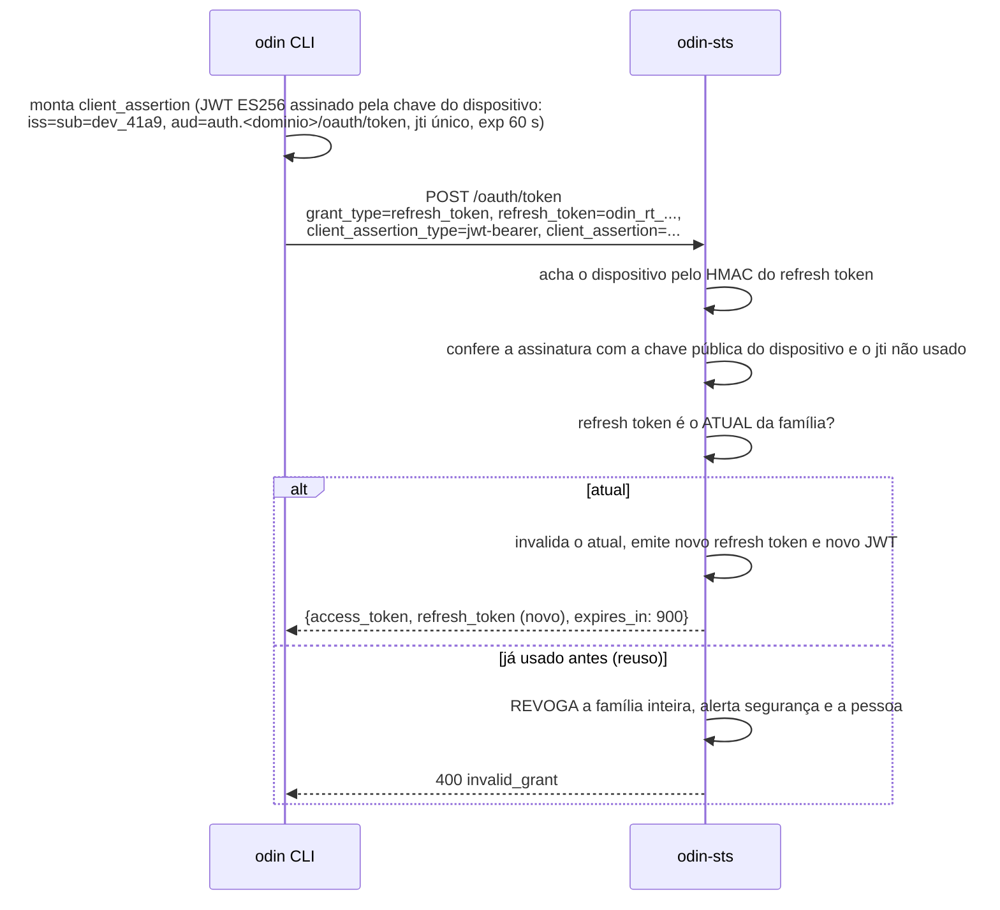

# 03. Tokens, sessões e chaves

> [Índice da segurança](README.md)

## 1. Catálogo de credenciais

| # | Credencial | Formato | Validade | Onde fica | Como é guardada no servidor | Renovação |
|---|---|---|---|---|---|---|
| CR-1 | Cookie de sessão do portal | Cookie de sessão do Identity Platform, nome `__Host-odin_sessao` | 8 h (absoluta); 30 min de inatividade | Navegador (`HttpOnly`, `Secure`, `SameSite=Lax`, `Path=/`) | Verificado a cada requisição; revogável | Novo login (com MFA) |
| CR-2 | Marca de MFA recente | Campo na sessão (`mfa_em`, `metodo`) | 5 min (ativação, token pessoal) ou 15 min (administração) | Servidor | — | Novo desafio de MFA |
| CR-3 | `device_code` | Aleatório de 256 bits | 10 min, uso único | CLI (memória) | Hash | — |
| CR-4 | `user_code` | 8 letras sem ambiguidade (`BCDF-GHJK`) | 10 min, uso único | Tela do CLI | Hash; limite de tentativas | — |
| CR-5 | Chave do dispositivo | Par ECDSA P-256 | Vida do dispositivo (≤ 90 dias por ativação) | **Cofre do sistema** (Keychain, Credential Manager, libsecret); não exportável quando o sistema permitir | Só a chave pública (JWK) em `devices` | Nova ativação |
| CR-6 | **Refresh token** (credencial de dispositivo) | Opaco, 256 bits, prefixo `odin_rt_` | **Rotativo**: cada uso gera outro; a família dura até 90 dias; revogado sem uso por 30 dias | Cofre do sistema | HMAC-SHA256 com "pimenta" no Secret Manager; nunca em claro | Pelo próprio uso, com prova de posse |
| CR-7 | **Token de acesso** | JWT ES256, `typ: at+jwt` | **15 min** | Memória e cache cifrado do CLI | Não é guardado (verificação pela assinatura) | Pelo refresh token |
| CR-8 | Token pessoal | Opaco, prefixo `odin_pat_` + 32 bytes base62 + soma de verificação | ≤ 90 dias (padrão 30) | Onde a pessoa colocar (no `~/.claude.json`, em texto) | HMAC-SHA256 | Não renova; gera outro |
| CR-9 | Token de instalação do GitHub App | Do GitHub | 1 h | Memória do serviço | — | Novo JWT do app |
| CR-10 | Token federado do CI | Do Google (WIF) | ~1 h | Runner do GitHub Actions | — | Por execução |
| CR-11 | ID token entre serviços | OIDC do Google | ~1 h | Memória | — | Automático |

**Por que prefixos:** `odin_rt_` e `odin_pat_` permitem que a varredura de segredos (do GitHub e de ferramentas internas) reconheça um token vazado num repositório ou num log, e que o portal o revogue. A soma de verificação deixa a varredura distinguir um token real de um texto parecido.

## 2. Token de acesso (JWT)

### 2.1 Conteúdo
```json
// cabeçalho
{ "alg": "ES256", "typ": "at+jwt", "kid": "jwt-2026-11-a" }
// corpo
{
  "iss": "https://auth.<dominio>",
  "aud": "https://mcp.<dominio>",
  "sub": "usr_8f2c1d...",
  "client_id": "odin-cli",
  "gh": 1234567,
  "dev": "dev_41a9...",
  "fam": "fam_77b0...",
  "pv": 17,
  "amr": ["github", "otp"],        // como a sessão de ativação foi autenticada
  "acr": "N1",
  "iat": 1760000000, "nbf": 1760000000, "exp": 1760000900,
  "jti": "a3f1..."
}
```
- **Sem perfis, squads ou papéis no token:** os direitos são resolvidos no servidor (cache de 30 s). Um token nunca dá mais do que a pessoa tem **agora**.
- **Nunca administrativo:** `acr` máximo `N1`. O console não aceita este token.

### 2.2 Validação no `odin-mcp` e no `/v1` (todas obrigatórias)
1. Algoritmo **fixo** `ES256` (recusar `none`, `HS*` e qualquer outro).
2. `kid` presente no JWKS em cache (10 min; se não encontrar, buscar de novo uma única vez).
3. Assinatura válida.
4. `iss` exato; `aud` exato; `typ` = `at+jwt`.
5. `exp` no futuro e `nbf` no passado, com tolerância de 60 s de relógio.
6. `iat` não anterior ao carimbo da **revogação global**.
7. Pessoa ativa, dispositivo e família não revogados (cache de 30 s).
8. Direitos efetivos atuais (nunca os da emissão).
Qualquer falha → `401` com `WWW-Authenticate: Bearer error="invalid_token"`, sem detalhe, e auditoria do motivo (só no servidor).

### 2.3 O que nunca acontece com o token
- Não vai em URL nem em parâmetro de consulta.
- Não aparece em log: os cabeçalhos `Authorization` são removidos antes do registro, nos serviços e no Load Balancer.
- Não é aceito por outros serviços (`aud` restrito ao MCP).

## 3. Refresh token com prova de posse

### 3.1 Renovação


### 3.2 Por que isso é seguro
- **Roubo só do arquivo ou do token:** não renova sem a chave privada, que está no cofre do sistema.
- **Roubo do token e da chave** (máquina comprometida): o primeiro uso concorrente (atacante ou dono) gera reuso → a família inteira cai → os dois perdem acesso, e o alerta dispara.
- **Janela de corrida:** se o CLI perder a resposta da renovação (rede), pode reenviar o mesmo refresh token em até 10 s sem disparar reuso (tolerância de reenvio idêntico, com o mesmo `jti` da asserção).

### 3.3 Limites
- A família vence em 90 dias da ativação, mesmo com uso. Depois, nova ativação com MFA.
- Sem uso por 30 dias → revogada.
- Um dispositivo por instalação do CLI (por usuário do sistema operacional). Cada dispositivo aparece no portal.

## 4. Token pessoal (exceção)
- Criado em **Tokens pessoais** no portal, com MFA de menos de 5 min, motivo e prazo (padrão 30, máximo 90 dias).
- **Escopo reduzido:** só `mcp:usar` (nunca `/v1/bundles`, porque sem o CLI não há runtime nem guard). Skills que dependem de runtime recusam com a mensagem "esta skill exige o CLI".
- Exibido **uma vez**. Depois, só o prefixo e os 4 últimos caracteres.
- Alertas: uso a partir de IP ou país novo; uso após 7 dias sem uso; mais de 1 token ativo por pessoa.
- Revogado sozinho se a pessoa sair, for suspensa ou ficar 30 dias sem usar.

## 5. Sessão do portal
- Login com GitHub → ID token do Identity Platform → o servidor cria o **cookie de sessão** (validade de 8 h) e grava a marca de MFA.
- Proteções: `__Host-` (exige `Secure`, sem `Domain`, `Path=/`), `HttpOnly`, `SameSite=Lax`, token CSRF em todo `POST`, verificação de `Origin`.
- Encerramento: logout, 30 min de inatividade, 8 h absolutas, suspensão da pessoa, troca de fator de MFA, revogação global.
- **Reautenticação** (CR-2): a tela pede o fator de novo quando a marca está velha para a ação.

## 6. Chaves criptográficas

| Chave | Algoritmo | Onde | Quem usa | Rotação |
|---|---|---|---|---|
| `jwt-signing` | ECDSA P-256 (ES256) | Cloud KMS (HSM em prod) | `sa-sts` assina; JWKS público | **Semestral.** Versão nova publicada no JWKS 24 h antes de começar a assinar; a antiga fica no JWKS até 24 h depois do último token assinado com ela |
| `bundle-signing` | ECDSA P-256 | Cloud KMS (HSM em prod) | `sa-ci-signer` assina; o CLI verifica | **Anual**, por cerimônia (05); o CLI aceita 2 chaves na transição |
| `cli-signing` | ECDSA P-256 | Cloud KMS | Workflow `cli-release.yml` assina; o CLI verifica as próprias atualizações | **Anual**, com o CLI aceitando 2 chaves na transição (mesmo processo da `bundle-signing`) |
| `cmek` | AES-256 | Cloud KMS | Cloud Storage, Cloud SQL | Automática, 90 dias |
| Pimenta dos HMAC | 256 bits | Secret Manager | `sa-sts` | Anual, com versão dupla (tokens antigos validados pela versão anterior até vencerem) |
| Segredo TOTP de cada pessoa | 160 bits | Firestore, cifrado com envelope no KMS | `sa-sts` | Ao recadastrar |
| Chave do dispositivo | ECDSA P-256 | Cofre do sistema da pessoa | CLI | A cada ativação |

**JWKS:** `https://auth.<dominio>/.well-known/jwks.json`, com `Cache-Control: max-age=600`. Contém só chaves públicas ativas e em transição.

## 7. Revogação

| Alvo | Gatilho | Efeito | Tempo |
|---|---|---|---|
| Dispositivo | Pessoa ou admin no portal; reuso detectado; 30 dias sem uso; 90 dias de família | Refresh token não renova; JWTs do dispositivo recusados | ≤ 30 s |
| Máquina sem rede | Revogação acontecida enquanto a máquina estava desconectada | A cópia local das skills (modo degradado) vale até 7 dias desde o último contato; no primeiro contato, os direitos são conferidos e as cópias revogadas apagadas | ≤ 7 dias |
| Pessoa | Suspensão; saída do GitHub (webhook); saída do último squad | Todos os dispositivos, tokens pessoais e sessões | ≤ 30 s |
| Token pessoal | Pessoa ou admin; varredura de segredos encontrou | Recusado | ≤ 30 s |
| Global | Super-admin em incidente | Todo JWT com `iat` anterior e todo refresh token emitido antes do carimbo | ≤ 30 s; todos fazem login de novo |
| Chave de JWT | Suspeita sobre a chave | Runbook (11): nova versão, retirada da antiga do JWKS, revogação global | Minutos |

## 8. Relógio e tolerâncias
- Servidores usam o relógio gerenciado do Google; o CLI avisa no `doctor` se o relógio local divergir mais de 60 s.
- Tolerância de 60 s em `exp` e `nbf`. A asserção de prova de posse vale no máximo 60 s, e o `jti` dela é guardado por 2 min para impedir reuso.
