# 05. Cadeia de suprimentos e distribuição

> [Índice da segurança](README.md)

O Odin coloca código para rodar, com acesso total, nas máquinas de todo o time. **A integridade do que é distribuído é o ponto mais sensível da solução.**

## 1. Cadeia de ponta a ponta

```mermaid
flowchart LR
  A["Autor (PR)"] --> B["Revisão por outra pessoa<br/>CODEOWNERS"]
  B --> C["main protegida<br/>commit assinado"]
  C --> D["CI do repositório Odin<br/>(identidade federada)"]
  D --> E["valida · testa · odin lint<br/>varre segredos e vulnerabilidades"]
  E --> F["empacota com dependências<br/>SBOM"]
  F --> G["assina no Cloud KMS<br/>(sa-ci-signer, só main)"]
  G --> H["Cloud Storage<br/>versionado, retenção"]
  H --> I["CLI baixa por URL assinada"]
  I --> J["CLI verifica a assinatura<br/>com a chave embutida"]
  J --> K["instala de forma atômica"]
```


## 2. Controles por elo

| Elo | Controle |
|---|---|
| Contas do GitHub | 2FA obrigatório (organização); chaves SSH ou de assinatura por pessoa; revisão trimestral de quem tem escrita |
| Repositórios | **GitHub Free** (decisão 41): em repositório privado não há proteção de branch, revisão obrigatória nem tags protegidas [VERIFICAR nos planos atuais do GitHub]. **Compensações:** só o mantenedor tem escrita em todos os repositórios (o time só lê o `odin-suporte`); 2FA obrigatório na conta; todo merge por PR por disciplina, com o CI verde; o `publish.yml` confere no próprio workflow que o commit está na `main` e que o autor do disparo é o mantenedor; a **assinatura no KMS** continua sendo a garantia de integridade |
| Tags e releases | Só o CI cria releases; o workflow de release confere que a tag aponta para um commit da `main` (sem tags protegidas no Free) |
| GitHub Actions | Ações de terceiros fixadas por **SHA completo** (não por tag); permissões do `GITHUB_TOKEN` mínimas por workflow (`contents: read` por padrão); `pull_request_target` proibido; disparo manual (`workflow_dispatch`) pelo mantenedor para `deploy` e `infra`, no lugar de ambientes com aprovação (indisponíveis no Free em privado) |
| Identidade do CI | Workload Identity Federation com condição por dono, repositório e ref (07); quem implanta (`sa-ci-deploy`) não assina (`sa-ci-signer`) |
| Dependências | Lockfiles obrigatórios; Dependabot; varredura (OSV) no CI que **falha** em vulnerabilidade alta ou crítica sem exceção registrada; versões novas só depois de 7 dias publicadas (contra pacotes sequestrados recentes); `npm ci --ignore-scripts` no empacotamento, com lista explícita de pacotes que podem rodar scripts de instalação |
| Segredos no código | Varredura de segredos no CI e no GitHub; padrões `odin_rt_` e `odin_pat_` registrados como padrões personalizados |
| Conteúdo das skills | `odin lint` (arquivos proibidos, destinos, colisões, **Unicode oculto**, tamanho, licenças); varredura de PII e de alias de org; avaliações determinísticas no pipeline; canal `beta` antes de `stable`, com promoção bloqueada por queda na avaliação de comportamento (ADR 0017) |
| Empacotamento | Construção reprodutível (mesma entrada → mesmo hash), dentro de contêiner fixado por digest; SBOM (CycloneDX) de cada pacote |
| Assinatura | Manifesto com o SHA-256 de cada arquivo e do pacote, assinado com `bundle-signing` (KMS, HSM em prod). O CI só tem `signerVerifier` nessa chave |
| Armazenamento | Bucket com versionamento, retenção de 365 dias, CMEK, sem acesso público; download só por URL assinada de 5 min |
| Verificação na máquina | O CLI confere a assinatura com a **chave pública embutida** e o hash de cada arquivo antes de instalar; recusa versão menor que a instalada (anti-rebaixamento), exceto em rollback assinado pelo catálogo. **No uso:** na primeira chamada de cada skill na sessão, o `odin ensure` recalcula os hashes do runtime instalado contra o manifesto assinado; divergência reinstala e gera DT-19 (ADR 0017) |
| Imagens dos serviços | Imagem base mínima fixada por digest; varredura no Artifact Registry; SBOM; **atestação de origem**; Binary Authorization em produção (só imagens atestadas pelo CI) |
| CLI | Binários assinados no KMS (`cli-signing`), guardados num bucket **privado** e servidos pelo portal (os repositórios são privados); a primeira instalação confere o **checksum fixado** no script servido pelo portal por HTTPS; a autoatualização confere a **assinatura** com a chave embutida. Atestação de origem do GitHub registrada quando o plano do GitHub permitir em repositório privado [VERIFICAR] |

## 3. Manifesto assinado (formato)
```json
{
  "schema": "odin.bundle/1",
  "skill": "sf-test", "versao": "1.4.2", "canal": "beta",
  "fonte": { "repo": "<dono>/Salesforce_Test_Automator", "sha": "be2e06b…" },
  "pipeline": { "run": "https://github.com/<dono>/Salesforce_Odin_MCP_Squad/actions/runs/…", "sha": "6df0db3…" },
  "pacotes": {
    "conteudo": { "uri": "gs://odin-bundles-poc/sf-test/1.4.2/conteudo.tar.zst", "sha256": "…" },
    "runtime":  { "uri": "gs://odin-bundles-poc/sf-test/1.4.2/runtime.tar.zst",  "sha256": "…" }
  },
  "arquivos": { "runtime/scripts/executar.mjs": "sha256:…", "…": "…" },
  "sbom": "sha256:…",
  "runtime_min_cli": "1.2.0",
  "emitido_em": "2026-11-14T12:00:00Z",
  "kid": "bundle-2026-a"
}
```
Assinatura: ECDSA P-256 sobre o SHA-256 do manifesto canônico (JSON ordenado), em arquivo separado `manifesto.sig`.

## 4. Cerimônia da chave de assinatura de pacotes
- **Criação:** pelo Terraform, no KMS (HSM em produção), sem possibilidade de exportar.
- **Quem pode assinar:** só `sa-ci-signer`, só pelo workflow `publish.yml` em `main`. Nenhuma pessoa tem `signerVerifier` no dia a dia.
- **Rotação anual:** (1) criar versão nova da chave; (2) lançar o CLI com as duas chaves públicas; (3) esperar a adoção (métrica de versões do CLI); (4) começar a assinar com a nova; (5) retirar a antiga do CLI na versão seguinte.
- **Comprometimento:** runbook em [11](11-runbooks.md): desabilitar a versão, publicar CLI com a chave revogada, reassinar os pacotes vigentes e forçar a atualização do CLI.

## 5. Skills de terceiros
As bibliotecas embutidas (pastas `salesforce`, `mattpocock` e `agent-skills`) passam pelos mesmos controles. Elas viram pacotes de biblioteca com versão, `LICENSE` e `NOTICE`, e qualquer atualização vinda do autor original entra por PR revisado. O conteúdo de terceiros também é instrução para o modelo e é revisado como código.
